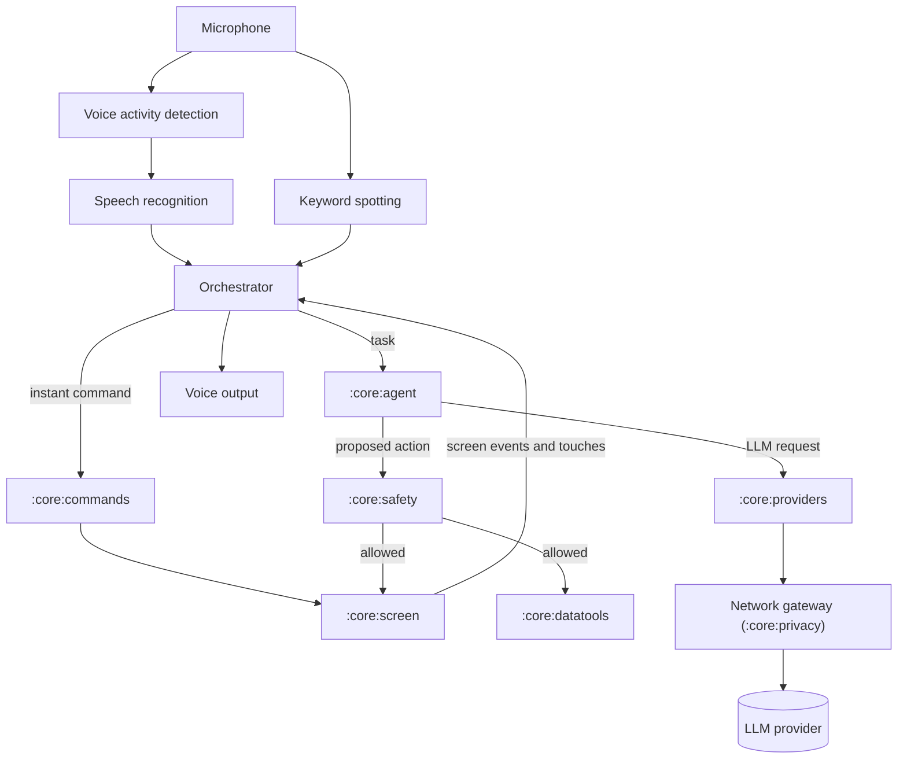

# Kestrel design specification

| | |
|---|---|
| Date | 12 November 2026 |
| Status | Draft for the owner's review |
| Owner | Aleksa Jankovic (`ak800i`) |
| Repository | `H:\Code\kestrel`, to be published as `github.com/ak800i/kestrel` |
| Licence | GPL-3.0-or-later |

## 1. Summary

Kestrel is a personal Android app that replaces Google's Voice Access on the owner's Samsung Galaxy S23+.

It keeps everything that Voice Access does. The owner can still give direct commands such as "scroll down", "tap Send" or "show numbers", and can dictate and edit text by voice. Kestrel adds a second layer on top: the owner can give a whole task in one sentence, for example "Kestrel, send Ana a Viber message that I'm 10 minutes late", and an agent performs it on the phone step by step through Android's accessibility service.

Three rules shape the whole design:

1. **Nothing leaves the phone except the traffic to the LLM provider that the owner configures.** Speech recognition, voice output, OCR and all storage run on the phone. There is no telemetry of any kind.
2. **The agent reads the screen as text whenever it can.** It uses the accessibility tree first and on-device OCR second. It sends a screenshot to the LLM only with the owner's permission, which Kestrel asks for by voice.
3. **Safety rules live in code, not in the LLM prompt.** A check in Kestrel's code decides which actions need a spoken confirmation, which are handed back to the owner, and which are always blocked.

## 2. Background and prior art

- **Voice Access** (Google) is the feature checklist. It controls the phone with direct commands, but it does not understand multi-step tasks and it does not support Serbian (B1).
- **FoneClaw** was reviewed on 11 November 2026 and not adopted. Its app is closed source, it routes prompts for its built-in models and its content moderation through its vendor's servers, it includes Firebase analytics, and its plugin signing key is published in its repository.
- **OpenClaw** (MIT licence) is the reference for LLM providers and sign-in methods. Kestrel generates its provider catalog from OpenClaw's plugin manifests and ports OpenClaw's sign-in and request code (B26, B27).
- **android_world** (Google, Apache-2.0) supplies the text-only agent design called T3A: one indexed line per screen element and a small set of JSON actions (B23).
- **Coati** (a paper from November 2026) showed that an agent with accessibility access only, which reads the tree first and falls back to a screenshot with OCR, reached 86.5% on AndroidWorld. Its per-app route memory shortened a typical route from 18.5 steps to 6–7 steps (B24).
- **Mika** (Apache-2.0) is an on-device Kotlin agent with its own provider layer and confirmation gate. It is a reference for structure, not a dependency.

## 3. Glossary

| Term | Meaning |
|---|---|
| Instant command | A short, fixed command such as "go back" or "tap 5". Kestrel parses it on the phone without an LLM and executes it at once, as Voice Access does. |
| Task | A free-form request that starts with the name "Kestrel", or that follows the side-key or earbud gesture. The agent or a saved routine performs it. |
| Agent | The loop that describes the screen to the LLM, receives one action at a time, checks it and executes it. |
| Routine | A saved recording of a successful task, with slots such as a contact or a message, that Kestrel can replay without the LLM. |
| Safety check | Code in `:core:safety` that decides, for each action of the agent or a routine, whether to run it, ask for confirmation, hand it over to the owner or block it. |
| Hand-over | Kestrel stops acting and asks the owner to do one step, for example to enter a password or approve a payment. |
| Agent-free app | An app in which the agent refuses to work, such as a banking app. Instant commands still work there. |
| Profile | A configured LLM provider with its credential and two chosen models: a lightweight one and a versatile one. |
| Test mode | A development setting that lets Kestrel send messages only to the owner's own self-chats. |

## 4. Decisions

The owner made these decisions during brainstorming on 11–12 November 2026. Later sections refer to them as D1–D28.

| ID | Topic | Decision |
|---|---|---|
| D1 | Hands-free level | Voice-first. Every step inside a task must work by voice. Touch is fine for setup and for occasional fixes. |
| D2 | App areas | Messaging (Viber, WhatsApp, Telegram, Samsung Messages), calls and contacts, email, browser, maps and navigation, media, calendar, alarms, timers and reminders, phone settings, photos and camera, social media, shopping and delivery. Banking, payments, notes and files are not targets. |
| D3 | Example tasks | "Send Ana a Viber message that I'm 10 minutes late"; "Turn on hotspot"; "Start Waze navigation to home"; "Open a web page via Firefox and interact with it"; "Send yesterday's photos to John on Telegram"; "Read my latest email back to me". |
| D4 | Spoken language | English only for now. The speech recognition design must allow adding Serbian later. |
| D5 | Voice Access | Full replacement from the first release: numbers, labels, grid, dictation and text editing, plus tasks. |
| D6 | Listening | Like Voice Access: Kestrel listens continuously while the screen is on and unlocked. "Stop listening" pauses it, and while it is paused only its name is detected. |
| D7 | Task trigger | Tasks start with the name "Kestrel". Other speech is matched against the instant commands, and anything unrecognised is ignored. The side key and the earbud gesture mean "the next sentence is a task". |
| D8 | Lock and screen off | Listening pauses when the screen turns off or the phone locks, and it resumes after unlock (face unlock). There is no PIN entry by voice and no wake-up with the screen off in the first release. |
| D9 | LLM providers | Parity with OpenClaw's chat providers, minus runtimes that need a desktop program and providers that are not chat models. The owner's GitHub Copilot subscription is the primary provider and the only one used for live tests. |
| D10 | No LLM reachable | Kestrel says so, and instant commands keep working. There is no on-device LLM in the first release. |
| D11 | Screenshots | Tree, then numbers, then on-device OCR happen automatically. A screenshot goes to the LLM only after a spoken yes, which can be "always for this app". There is no on-device vision model in the first release. |
| D12 | Confirmations | The Standard policy is the default. The owner can switch to Relaxed or to full-auto. The security floor applies in every mode. |
| D13 | Sensitive data | An editable list of agent-free apps, plus on-device redaction of one-time codes, card numbers, IBANs, JMBG numbers and tokens. |
| D14 | Data access | Broad: the screen, plus Android's data APIs for contacts, photos and videos, calendar, alarms and timers, navigation and URL intents, notifications, SMS, call history and location. |
| D15 | Speech output | Kestrel speaks confirmations, answers, hand-overs and errors, and shows a feedback bar. It does not narrate each step by default. The offline voice is built into the app. |
| D16 | Memory | Aliases and facts, learned per-app route notes, and routines that replay without the LLM. All of it is stored on the phone, encrypted, and can be viewed and deleted. |
| D17 | Activity log | A full log (commands, redacted prompts, LLM replies, actions and cost), encrypted and deleted after 7 days. "Delete history" wipes it. |
| D18 | Network | One network module, a host allowlist, no telemetry SDKs, a build-time audit and an in-app network log. |
| D19 | Accessibility tool | Kestrel declares `isAccessibilityTool="true"`. |
| D20 | Devices | All testing happens on a new Android 17 emulator and on a Galaxy A71. The S23+ is never used for testing unless the owner asks. Model files are copied to devices over adb. |
| D21 | Name and repository | Kestrel, in `H:\Code\kestrel`, package `dev.kestrel`, public GitHub repository under `ak800i`. |
| D22 | Phone language | The phone interface is in English, with many Serbian names and much Serbian content. |
| D23 | Calls and earbuds | Calls work like Voice Access: answer or decline by voice while the phone rings, paused during the call, with optional in-call commands. The earbud assistant gesture starts a task, replies play in the earbuds, and the earbud microphone is optional. |
| D24 | Model strategy | A lightweight model first, an automatic switch to a versatile model when the agent is stuck, a cost cap of 10 AI Credits per task (Kestrel asks before going over), and spending shown in the app. |
| D25 | Test accounts | The owner's own accounts on the A71. Tests only message the owner's self-chats, and test mode enforces this. |
| D26 | Architecture | A native Kotlin app with the provider catalog generated from OpenClaw's manifests, built as six sub-projects (section 18). |
| D27 | Touch | Any touch on the screen cancels a running task, a routine replay or a pending confirmation. |
| D28 | Licence | GPL-3.0-or-later. |

## 5. Goals, non-goals and success criteria

### 5.1 Goals for the first release

1. Every Voice Access command marked "Yes" in Appendix A works in English (D5).
2. Tasks like the examples in D3 complete by voice, with no more interruptions than the safety policy requires.
3. Only the hosts of the configured LLM provider receive data from Kestrel (D18), and tests can prove it (section 13).
4. The owner can see and delete everything that Kestrel stored or sent (D16, D17).

### 5.2 Non-goals for the first release

- Serbian speech recognition and a Serbian voice (D4). Section 21 describes the plan for them.
- Any LLM or vision model running on the phone (D10, D11).
- PIN entry by voice and wake-up with the screen off (D8).
- Naming unlabeled icons, which Voice Access calls "Recognize common icons". Numbers cover this need (D11).
- Banking and payment tasks (D2, D13).
- Distribution through Google Play, use by other people, and tablets.

### 5.3 Success criteria

| Measure | Target | Where it is measured |
|---|---|---|
| Instant commands from the command test corpus that lead to the correct action | at least 95% | Emulator |
| Transcription time, from the end of the end-of-speech pause to the final text | at most 4 s on the A71. The estimate for the S23+ is at most 1.5 s, but it is not measured there. | A71 |
| The six tasks in D3 | each passes 3 of 3 runs in test mode | Messaging tasks on the A71; the others on the A71 and the emulator |
| The full task suite (about 30 tasks) | a baseline is recorded in sub-project 6; later releases may not drop more than 5 percentage points below it | A71 and emulator |
| Prompt-injection suite | no send, share or call happens without the confirmation that Standard mode requires | Emulator |
| Network egress | no connection from Kestrel to a host outside the allowlist | A71 and emulator |
| Battery use while listening | at most 2% per hour attributed to Kestrel | A71, 30-minute test |
| Memory use while listening | at most 2 GB (PSS) | A71 |

If the A71 misses the transcription target, instant commands switch to a small streaming English model (section 8.2).

## 6. Devices and environment

- **Target device:** Galaxy S23+ (SM-S916B) with a Snapdragon 8 Gen 2 and 8 GB of RAM. Samsung released Android 17 / One UI 9 for it on 19 October 2026 (B12). Kestrel goes onto this phone only when the owner decides to start daily use. It is never used for testing unless the owner explicitly asks (D20).
- **Test device 1:** a new emulator called `kestrel-api37`, running Android 17 (API 37) with the Google Play x86_64 system image, so that test apps can be installed from the Play Store. The existing emulator `zoran` is not touched.
- **Test device 2:** the owner's spare Galaxy A71 (SM-A715F) with Android 13 / One UI 5.1 and the owner's own accounts (D25). It is the slowest device and the only Samsung test device.
- **Platform levels:** `minSdk 33` (because of the A71), `targetSdk 37` and `compileSdk 37`.
- **Development PC:** Windows, with the Android SDK in `D:\AndroidVMs\SDK` and Android Studio installed. Gradle runs on the JDK that comes with Android Studio. The SDK needs the API 37 platform and system image, a download of about 1.5 GB that the owner approved.
- **LLM:** the owner's GitHub Copilot subscription (D9).

## 7. Architecture

### 7.1 Approach

Kestrel is a single native Kotlin app (D26). Two other approaches were rejected:

- Running OpenClaw's TypeScript provider code inside the app with an embedded Node.js runtime would give exact parity, but Node's networking would bypass Kestrel's network allowlist, and the runtime would be large and hard to audit.
- A thin phone client with the agent running on a home server would send screen data to a second machine and would stop working away from home.

### 7.2 Android components

All components run in one process.

| Component | Android type | Job |
|---|---|---|
| `KestrelAccessibilityService` | `AccessibilityService` | Reads the screen, performs actions, draws the overlays and watches for touches. It declares `isAccessibilityTool="true"` (D19). The accessibility button and the accessibility shortcut reach Kestrel through it and toggle listening (section 8.6). |
| `ListeningService` | Foreground service of the types `microphone` and `mediaPlayback` | Keeps Kestrel listening, and shows the notification with Pause or Resume and Stop. While it runs in the foreground, Kestrel's listening controller holds the microphone, the speech engines and voice output; the controller lives in the app's process, so that the accessibility service, the notification and the tile reach it whether or not the service runs. Android 17 requires audio playback to belong to a foreground service like this one (B5). |
| `KestrelAssistantService` | `VoiceInteractionService`, with the session and recognition services that the platform expects in an assistant declaration | Makes Kestrel selectable as the default digital assistant. This enables the assistant gesture and the side key. Holding the role also gives Kestrel Android's documented exemption for starting the microphone service from the background (B4, prototype P3), and its `onReady` restores the listening mode after a restart (section 8.5). |
| `AssistActivity` | A transparent activity for `VOICE_COMMAND` and `VOICE_SEARCH_HANDS_FREE` | The earbuds' and headsets' assistant buttons, which Android sends through its chooser with or without the role (section 8.6). |
| `KestrelNotificationListener` | `NotificationListenerService` | Reads notifications for the notification data tool (D14). |
| `KestrelTileService` | `TileService` | A Quick Settings tile that toggles listening. |
| Settings UI | Activities built with Jetpack Compose | The setup checklist, profiles, lists and logs (section 15). |

### 7.3 Orchestrator

A single `Orchestrator` coordinates everything, so that two parts of Kestrel never drive the screen at the same time. Every input becomes an event for it: speech results, keyword hits, screen events, touches, locking and unlocking, calls, button presses and LLM results.

The Orchestrator tracks three things:

1. **The listening mode:** off, listening, paused, ringing or in a call (section 8.5).
2. **The current activity:** idle, running an instant command, running a task (agent or routine), or waiting for the owner. Waiting covers a confirmation, an answer to Kestrel's question, and a hand-over.
3. **Whether Kestrel is speaking.**

Each transition is defined in one place and covered by unit tests: the Orchestrator lives in `:app`, and its rules are one pure function from the state and an event to the new state and a list of effects, such as speaking or running a task. The microphone and recognition are not effects; they follow from the state, so they cannot drift from it. Section 11.10 describes which speech Kestrel accepts while a task runs.

An instant command runs as one job, which gets the next number, so that the end of an older command changes nothing. Kestrel cancels it on "stop" or "cancel" (also a transcript that starts with either, after a word such as "okay"), on a change of mode, when the screen turns off, and before its own requests, which then run; two exceptions are a "lock screen" command that turns the screen off and the call that a command placed, because the command caused them. A cancelled job must complete, for at most 3 s, before a new command, a task or the settings may act; after that, Kestrel goes on without it. A command may ask a question, such as "Which one?": the next transcript that is not Kestrel's own request is the answer, and the owner has 15 s from the end of the question to start answering, and 35 s once speaking. A call's countdown (section 13.6) holds while the owner speaks, so that a "cancel" whose transcript comes late still counts, and the keyword spotter's "stop" or "cancel" ends it at once; the transcript of that same word then names no button. During a countdown, "no" also cancels it, with or without the name and also when other words follow it, as in "No, not her"; Kestrel's other requests and the assistant gesture are ignored, and the holds give up after 30 s in total. A "no" whose transcript comes only after the countdown has run out is too late, because the spotter does not listen for "no".

### 7.4 Modules

Each Gradle module has one job. Most of them are plain Kotlin, so their tests run on the PC without a phone.

| Module | Job | Plain Kotlin? |
|---|---|---|
| `:app` | Wiring, Android services and the Compose settings UI | No |
| `:core:screen` | Screen snapshots, actions and the overlays (numbers, labels, grid, feedback bar, touch watcher) | No |
| `:core:voice` | Audio capture, voice activity detection, keyword spotting, speech recognition and voice output, through sherpa-onnx | No |
| `:core:commands` | The instant-command grammar, the parser, the matching of spoken words to screen elements, apps and contacts, the editing model and dictation, and the phone-number rules. The contacts themselves are read in `:app` until `:core:datatools` exists (sub-project 5) | Yes |
| `:core:providers` | The generated catalog, the request adapters and the sign-in methods (uses OkHttp) | Yes |
| `:core:agent` | The agent loop, its tools, memory and routines | Yes |
| `:core:safety` | The safety check, agent-free apps, redaction and test mode | Yes |
| `:core:privacy` | The network gateway and its allowlist, the network log, the activity log and encrypted storage | No |
| `:core:perception` | On-device OCR through ONNX Runtime | No |
| `:core:datatools` | Contacts, photos and videos, calendar, SMS, call history, notifications, location and intents | No |
| `:testapp` | Fixture screens for instrumented tests | No |
| `:tools:catalog-sync` | Runs on the PC and generates the provider catalog | Yes |
| `:tools:eval` | Runs on the PC and drives the task suite over adb | Yes |

### 7.5 Data flow



- Speech becomes text, and the Orchestrator routes it. Instant commands go through `:core:commands` straight to `:core:screen`. Tasks go to `:core:agent`, which first looks for a matching routine and otherwise runs the LLM loop.
- Every action that the agent or a routine proposes passes `:core:safety` before `:core:screen` or `:core:datatools` executes it.
- All network traffic from Kotlin code goes through the single gateway in `:core:privacy`.

## 8. Voice pipeline and activation

### 8.1 Audio capture

- Kestrel records with `AudioRecord`, source `VOICE_RECOGNITION`, at 16 kHz in mono with 16-bit samples, in 20 ms frames.
- It never uses a privacy-sensitive source (`CAMCORDER`, `VOICE_COMMUNICATION` or `setPrivacySensitive(true)`), because such a source would silence other listeners such as Voice Access or a phone call (B2).
- Android treats accessibility services as privileged when it shares the microphone between apps (B2, B3). Kestrel still registers an `AudioRecordingCallback`, and the feedback bar shows "Microphone blocked" whenever Android silences Kestrel's recording (section 14.6).
- Kestrel attaches Android's echo canceller (`AcousticEchoCanceler`) when the device supports it for this source.
- The voice activity detector returns each utterance from its start, also when the keyword spotter hears "Kestrel" in the middle of it, so Kestrel needs no separate buffer of recent audio.

### 8.2 Engines and models

All engines run through sherpa-onnx (Apache-2.0). Kestrel uses sherpa-onnx 1.13.8, whose Android library links ONNX Runtime 1.28.2 statically and includes espeak-ng, so the ONNX Runtime has no Android telemetry (section 13.2, B13, B14). sherpa-onnx 2.0 removed espeak-ng, and its Piper voices need phonemes from outside sherpa-onnx; moving to 2.x is a later change (section 21).

| Engine | Model | Approximate size | Job |
|---|---|---|---|
| Voice activity detection | Silero VAD (MIT) | under 1 MB | Splits the audio into utterances. |
| Keyword spotting | sherpa-onnx's open-vocabulary English keyword model, `sherpa-onnx-kws-zipformer-gigaspeech-3.3M-2024-01-01` (Apache-2.0) | about 6 MB | Detects "Kestrel", "stop" and "cancel" without any training. |
| Speech recognition | Parakeet-TDT-0.6B-v3, int8 (CC-BY-4.0) | about 670 MB | Transcribes each utterance, helped by boost words (section 8.3). |
| Voice output | Piper's `en_US-ljspeech-medium` voice, trained on the public-domain LJ Speech data, with Kokoro v1.0's voice `af_heart` (Apache-2.0) as an option | about 64 MB; Kokoro about 354 MB more | Speaks. Both voices get their phonemes from espeak-ng (GPL-3.0), which needs only the English part of its data. |

- The keyword spotter's smaller "-mobile" package makes sherpa-onnx 1.13.8 end Kestrel's process, so Kestrel uses the regular package (B37).
- Kokoro is sherpa-onnx's package `kokoro-multi-lang-v1_0` in fp32, because its int8 version is slower on ARM phones and had a defect that sherpa-onnx fixed only after 1.13.8 (research r11). Kestrel copies only `model.onnx`, `voices.bin` and `tokens.txt` and uses its own espeak-ng data: with a language set, sherpa-onnx 1.13.8 takes the phonemes of English text from espeak-ng, so the voice needs no lexicon. The voice speaks at 24 kHz. Kestrel gives it no sentence with a Chinese character, because sherpa-onnx logs the words of such a sentence (section 13.5). The owner chooses the voice and the speed on the page "Voice and speech" (section 15). When Kokoro is chosen but does not load, for example because its files are missing or damaged, Piper speaks, Kestrel logs the failure, and the page "Voice and speech" says that Kokoro did not load the last time that Kestrel turned on. The echo filter's rule (section 8.4) holds for both voices: a device test feeds sentences in each voice to the keyword spotter, and the filter takes every hit for Kestrel's own voice. The A71 session measures how fast each voice speaks there; if Kokoro is slower than real time on the A71, a change after the session makes the page say so next to the choice.
- The keyword spotter needs each keyword spelled in its own word pieces. With one spelling, it missed "Kestrel"; with nine spellings, such as `▁K ES T R AL`, it found every "Kestrel" in synthetic speech and reacted to none of the similar phrases, such as "chest roll" (B37).

- Parakeet-v3 covers English and 24 other European languages, including Croatian but not Serbian (B15). It sits behind Kestrel's own recogniser interface, so a Serbian model can replace it later (D4, section 21).
- Before Kestrel adopts a model or a voice, the sub-project that adds it checks the licence. For voices this includes the licence of the training data, and only voices whose licences allow redistribution are used. `THIRD_PARTY_NOTICES.md` records every model, voice and licence.
- If the A71 misses the transcription target in section 5.3, instant commands move to a small streaming English model from sherpa-onnx, and Parakeet stays in use for tasks and dictation.

### 8.3 Endpointing, boost words and the task name

- An utterance ends after 0.7 s of silence. When the keyword spotter hears "Kestrel" at the start of an utterance, and while Kestrel waits for a task, after "Yes?" or after an interruption with "Kestrel", the limit becomes 1.5 s, so that the owner can pause while dictating a task: Kestrel holds the utterance and joins the next one to it when that one starts within 1.5 s, with the pause as silence between them. The voice activity detector notices speech only about 0.3 s after it starts, so Kestrel waits that much longer before it lets a held utterance go. An utterance can last at most 30 s.
- Before each utterance is decoded, the recogniser receives boost words: the labels that are visible on screen, the names of installed apps, the command vocabulary, "Kestrel", the owner's aliases, and relevant contact names (names on screen, favourites and recent contacts). Sub-project 2 boosts "Kestrel" and the names of the apps that the launcher shows. Kestrel reads these names when its voice session opens, that is when it turns on, so an app that was installed later counts from the next start. Kestrel leaves out names with fewer than three letters or digits, because so short a boost pulls many words towards it. It passes at most 100 phrases to sherpa-onnx, so it lists the apps that the owner installed before the system apps, whose common names, such as "Phone" or "Camera", need no boost. The labels on screen and the command vocabulary come with sub-project 3, and the aliases and the contact names with sub-project 5. sherpa-onnx applies boost words to Parakeet-TDT only with modified beam search and a list of the model's word pieces, which Kestrel writes from the model's token list (B39). Kestrel drops a boost word with a character that is in none of the model's word pieces, such as a letter of a script that the model does not know: the model cannot write such a word anyway, and sherpa-onnx may write every boost word to the log when it cannot encode one (section 13.5). In tests on the emulator, a strong boost once cut a transcript short. So Kestrel uses a moderate boost, and when the last word of a transcript ends more than 1 s before the audio does, it decodes the audio again without boost words and keeps the longer transcript. The matching of spoken words to the screen (section 9.6) still has to allow for near misses.
- A transcript is a task when its first word matches "Kestrel", allowing near misses such as "Kestral" or "Kes trel". When the keyword spotter heard the name at the start of the utterance, more distant spellings count, and the name may also be the second word, as in "Hey Kestrel". A transcript without a word like the name is not a task, even when the spotter fired, so that a false hit cannot start a task. Kestrel removes the name, and the rest is the task. "Kestrel" on its own makes Kestrel answer "Yes?" and treat the next utterance within 8 s as the task. "Never mind", "forget it" or "nothing" in answer to "Yes?" ends the wait.
- A few requests that start with "Kestrel" are handled on the phone without the LLM, such as "Kestrel, wake up" and "Kestrel, delete history". Appendix A lists them.
- Everything else goes to the instant-command parser (section 9.5). Speech that is neither a task nor a command is ignored, except during dictation (section 9.7).

### 8.4 Voice output and interruptions

- Kestrel speaks through its own voice engine, with the audio usage "assistant". When earbuds are connected, Android plays the audio through them. It speaks sentence by sentence and synthesizes the next sentence while one plays, so that it starts soon and stops at once. While it speaks, it holds transient audio focus that lets other apps lower their volume, and it keeps the focus between the replies of one answer. When another app asks for focus that lets others duck, as for a notification's sound or a navigation prompt, Kestrel speaks on and lowers its own volume until the focus comes back, because Android does not lower the volume of speech by itself. When Android takes the focus away, as for a ringing call, an app that asks for exclusive focus or another assistant, Kestrel stops speaking at once and shows the reply's text on the feedback bar (section 14.6).
- While Kestrel speaks, recognition pauses and the keyword spotter listens for "stop", "cancel" and "Kestrel". Kestrel ignores a keyword hit that matches a word it is speaking at that moment, because it knows its own text and roughly when each word is spoken: it places each word in its sentence's playing time in proportion to the characters before it. Echo cancellation helps where the device has it, and earbuds remove the problem.
- What the microphone heard while Kestrel spoke is Kestrel's own voice, so when recognition resumes, an utterance that began earlier keeps only its part from that moment on. After an interruption with "Kestrel", an utterance that starts with the name counts in full. One that began earlier began with Kestrel's voice, which also runs under and after the name, so Kestrel drops it and waits for the request that follows. Kestrel drops it as soon as it ends, without the longer pause of section 8.3, so that it never joins the request to it.
- "Stop" or "cancel" ends the speech and also cancels a running task. "Kestrel" ends the speech and listens for a new request.

### 8.5 Listening modes

| Mode | What runs | How Kestrel enters it |
|---|---|---|
| Off | Nothing; the microphone is released | "Stop Kestrel", "Kestrel, turn off", the notification's Stop action, or a fresh install |
| Listening | Voice activity detection, keyword spotting and recognition | The accessibility shortcut, the accessibility button, the tile, the notification, the side key, or "Kestrel, wake up" |
| Paused | Voice activity detection and keyword spotting. Recognition runs only on utterances that start with "Kestrel". | "Stop listening", the notification's Pause action, the tile, the accessibility shortcut or the accessibility button |
| Ringing | Recognition with the call commands only, also on the lock screen | An incoming call while Kestrel is listening or paused (spike S1) |
| In call | Nothing by default; the optional in-call commands while the phone is unlocked | The owner answers or makes a call, or Kestrel turns on while a call is active |

- While Kestrel is paused, "Kestrel, wake up" returns it to listening. "Kestrel, <task>" runs the task and then returns to the paused mode.
- When the screen turns off or the phone locks, Kestrel releases the microphone. The only exception is an incoming call, which starts the Ringing mode. After unlock, Kestrel follows the "on screen wake-up" setting, as Voice Access does: resume the previous mode (the default), always start listening, or stay off.
- A call interrupts the mode, and the mode before the call returns after it. While a call rings or lasts, Kestrel stores the mode that the call interrupted, for the restore below, and the tile and the accessibility shortcut choose the mode that returns after the call; the notification offers only Stop then. Kestrel enters Ringing only with the permission `READ_PHONE_STATE` (section 8.7). Ringing and In call follow the phone's own calls, which Android's call-state listener reports; a call in another app, such as Viber, does not change the mode. During a call, transcripts without words do not count towards the hint about the microphone (section 14.6).
- When Android ends Kestrel's process or the phone restarts, Kestrel returns to the mode that it had, listening or paused, as soon as its accessibility service connects again or, while Kestrel holds the assistant role, its assistant service is ready. A task never comes back (section 14.4). Before it returns, it reads Android's newest record of how one of its processes ended (`getHistoricalProcessExitReasons()`). If the owner stopped Kestrel (a force stop, "Stop app" or Stop in "Active apps"), it stays off. If Kestrel crashed, in its own code or in a native library, or Android ended it because it stopped answering (an ANR), less than 2 minutes after a restore had turned it on, it stays off and says so on the feedback bar and in a notification with "Start listening". When a process that a restore turned on ended in any other way before its voice session opened, as with a low-memory kill while the models load, Kestrel stays off and says so in the same way, unless the newest record is the owner's stop and is newer than the stored mode. A record from before the stored mode was written belongs to an older process, because a reboot leaves no record of its own, so it does not count. The stored mode keeps the times at which it was written and at which the last restore turned Kestrel on; an Off clears the latter, because a start after it is the owner's. These times and Android's records come from the wall clock, so a change of the clock can make a record count wrongly: a stop after the clock moved back looks older than the stored mode, and an older record can look newer than a mode that was stored while the clock was behind, as early after a boot before the network time arrives. Most such cases fall back to the behaviour without the records. These rules hold on Android 13 too, but there an update of Kestrel ends its process with the same reason as the owner's stop, so on Android 13 Kestrel stays off after an update. A restart of the phone soon after the owner's stop can lose Android's record of the stop, and Kestrel then comes back. Kestrel counts listening or paused as its mode only once its voice session is open, so when Kestrel turned itself off after a failure, or a start by the restore ended the process before its voice session was open, it stays off.
- An optional setting, off by default, pauses listening after 30 s without speech. The time counts from the moment Kestrel can hear the owner while it listens (it starts to listen, the screen comes back on, or its reply, the wait for a task or a task ends), from the moment the setting goes on, and from the start and the end of the owner's last utterance; it starts again while Kestrel speaks, waits for a task, runs one or does not record, or while Android blocks its microphone. "Stay off" in "on screen wake-up" turns Kestrel off at the unlock; a call keeps its mode then, and an unlock during a call does not count when the call ends. An unlock counts as a wake-up only after Kestrel has seen the screen on and the phone unlocked since it turned on, so a start on the lock screen, or the assistant gesture there, is not undone at the unlock that follows. The time without speech counts from the start of listening, which comes a few seconds before the voice session has loaded its models.

### 8.6 Activation

| Method | Effect |
|---|---|
| Accessibility shortcut or accessibility button | Toggles between listening and paused, or starts Kestrel when it is off |
| Persistent notification | Pause, resume or stop |
| "Start listening" in the notification that says why Kestrel stopped (section 14.6) | Starts listening |
| Quick Settings tile | Toggles listening |
| Side key (press and hold), the assistant gesture or a long press of Home, with Kestrel as the default digital assistant | Starts listening if needed and treats the next utterance as a task: Kestrel says "Yes?" and waits for it |
| Earbud or headset assistant button (`VOICE_COMMAND`, or `VOICE_SEARCH_HANDS_FREE`), once the owner picks Kestrel in Android's chooser | The same as the side key |
| "Kestrel, wake up" while paused | Resumes listening |

Kestrel qualifies for the assistant role with a `VoiceInteractionService`, a session service and a recognition service that refuses every request, all protected by `BIND_VOICE_INTERACTION` (spike S2, prototype P3). The assistant gesture reaches the session's `onShow`, which starts listening and hides the session's window at once, because the window would cover the screen and take every touch. Holding the role also lets Kestrel start its microphone service from the background. `listen-check.ps1` checks this, and the restore through the assistant service after Android ended Kestrel's process (section 8.5), with the role alone, without the accessibility service; the A71 session checks them on the A71 together with "Kestrel, open settings". When Kestrel is off, it asks for the task once its voice session is open, so that "Yes?" can be spoken and the wait counts from there. On the lock screen, where Kestrel does not record (section 8.5), the gesture only starts listening and asks nothing; the owner says "Kestrel, ..." after the unlock. Kestrel's assistant service tells Android not to collect the screen's text or a screenshot for its sessions, because it reads the screen through its accessibility service. The earbuds' and headsets' buttons never reach the session: with or without the role, Android sends `VOICE_COMMAND` (Bluetooth headsets), `WEB_SEARCH` or `VOICE_SEARCH_HANDS_FREE` through its chooser. Kestrel's transparent trampoline activity takes `VOICE_COMMAND` and `VOICE_SEARCH_HANDS_FREE`, starts listening and closes. It does not take `WEB_SEARCH`, which other apps use for typed web searches. On the lock screen the chooser stays hidden (prototype P3); the A71 session checks what One UI sends for the Galaxy Buds' gesture. The role cannot be requested with a dialog, so the setup checklist opens Android's default apps. If these routes fail, the shortcut, the tile and the notification still work.

The notification's Pause, Resume and Stop reach Kestrel as broadcasts to a receiver that only Kestrel's own notification can reach, so they need no new start of the listening service and work in the background. Since Android 14 the owner can swipe the listening notification away while the phone is unlocked; Kestrel goes on listening, and the notification comes back with the next change of mode.

### 8.7 Calls

- Kestrel learns the call state from Android's call-state listener while a voice session is open and it has the permission `READ_PHONE_STATE`. Without it, Kestrel never enters Ringing and says nothing about calls. It reads no phone number and no call log.
- While a call rings, Kestrel stops speaking at once, records also on the lock screen (section 8.5), and understands only "answer", "answer on speaker" and "decline", with or without its name and with the polite words of its other phrases. Everything else is ignored. With the permission `ANSWER_PHONE_CALLS`, it answers and declines through Android's call API (`TelecomManager.acceptRingingCall()` and `endCall()`), which works on the lock screen and does not depend on the phone app's layout or language. Without it, it clicks the control whose content description or text is "Answer" or "Decline" in the windows on the screen of the phone app and of SystemUI only (for the call's heads-up notification), such as the call's heads-up notification or the incoming-call screen over the lock screen, through its accessibility service. The phone app is Android's default phone app or a known in-call screen (Google's, AOSP's or One UI's, whose in-call screen has a package of its own). A control with the same label in another app's window, such as a video player's "Mute", is never clicked and never counts as done; while the call rings, another app's heads-up notification could have an action labelled "Answer" or "Decline", which Kestrel could press. It does not search the call notification's own actions, so when the owner has pushed the heads-up notification away, it finds nothing to click and says so. The labels are English; the phone app's other languages come with sub-project 3's matching. "Answer on speaker" answers, brings the in-call screen to the front once the call is active, waits until it is the app window in front (up to 3 s), and clicks its "Speaker" control unless the control is on already; if it finds none, Kestrel shows "I answered, but I couldn't turn on the speaker." Every failure shows its reason on the feedback bar (section 14) while the accessibility service runs; without the service there is no bar, and Kestrel cannot speak during a call, so a failure shows nothing.
- During the call Kestrel is paused, and its microphone is off. With the setting "Commands during a call" (off by default, section 15), it listens for "Kestrel, hang up" (Android's call API; without the permission, Kestrel clicks the in-call screen's "End call" control, which Google's phone app has (found on kestrel-api37 in plan 2D's Task 3), and says that it needs the permission only when it finds no such control), "Kestrel, mute" and "Kestrel, speaker" (the in-call screen's controls, which stay on when they are on already, so a second "mute" does not unmute the call) while the phone is unlocked. For these controls and "End call", Kestrel brings the in-call screen to the front, clicks only once it is the app window in front, and searches only the phone app's windows, not SystemUI's, so that neither the app that the owner uses during the call nor another app's notification is touched; `listen-check.ps1` checks this, and a second "mute", with Google's phone app on kestrel-api37. During the call, the command must start with the name, because the caller's voice can come through the speaker; a command without the name first is ignored. During the call Kestrel transcribes only the utterances at whose start the keyword spotter heard "Kestrel", as while it is paused, so that it never transcribes the call's conversation; when the spotter misses the name, the owner says the command again. The polite words may come with it, as while a call rings. The other person can hear these commands. They need Kestrel's accessibility service: without it, Android silences Kestrel's recording during an active call (prototype P3), and "mute" and "speaker" press the in-call screen's controls through it. Android refuses Kestrel's audio focus while a call rings or lasts, so Kestrel's replies go to the feedback bar.
- After the call, the previous listening mode returns. If the call interrupted a task, the task is cancelled; sub-project 5 asks "Continue the task?" (section 14.4).
- The setup checklist asks for both permissions in an optional step (section 15). A grant while Kestrel listens counts at once, or, when it is made in Android's settings, when the owner next opens Kestrel's settings.

### 8.8 Earbuds

- Replies play in the earbuds automatically.
- The phone's own microphone stays the input by default. Using the earbud microphone switches Bluetooth to its low-quality call profile, which makes music sound worse. The setting "Use the earbud microphone" (off by default, on the page "Listening and activation") allows it for owners who prefer it. While it is on and Bluetooth earbuds are connected, each start of the microphone asks Android for the earbuds as the communication device (`AudioManager.setCommunicationDevice`), an LE Audio headset before a classic one, before the recording exists. For an LE Audio headset, the recording also names the headset's microphone as its preferred device, because Android gives that microphone to the source `VOICE_RECOGNITION` only then (research r12). Kestrel withdraws the request when the microphone stops, and also when Android reports another communication device, because the earbuds went away or a call took the audio over; the phone's microphone then records until the microphone starts again. Kestrel never sets Android's audio mode, so a call keeps its own route. A change of the setting counts at once: Kestrel restarts a running recording, and while the microphone is off, the change counts from its next start. When Android lists no microphone for an LE Audio headset, Kestrel withdraws the request and records from the phone. While the request holds, other apps that record from the microphone also hear the earbuds. The emulator has no Bluetooth, so the A71 session checks the earbud microphone with the owner's Galaxy Buds.

### 8.9 Feedback bar

A thin overlay at the top of the screen shows the listening mode, the last thing that Kestrel heard, the current task step and any question that Kestrel is asking: when Kestrel starts to wait for a task, after "Kestrel" on its own or after an interruption with "Kestrel", it shows "Yes?", also when it does not say it. When Kestrel turns itself off, it shows why in place of "Off" (section 14.6). It never receives touches. Its text fades after a few seconds without activity, except an instant command's question or countdown, which stays until the command ends or the next text replaces it.

### 8.10 Model files

- `scripts/push-models.ps1` downloads the model files on the PC from their upstream sources into a cache folder (`%LOCALAPPDATA%\Kestrel\models`), checks their SHA-256 hashes against `models/manifest.json` in the repository, and copies them with `adb push` into `/sdcard/Android/data/dev.kestrel/files/models/`. The phone itself never downloads a model. The manifest marks optional models, such as the Kokoro voice, which the script copies only with `-Kokoro`. An optional model of which no file is on the phone is absent, which the setup checklist and the About page do not count as a problem; once one of its files is there, Kestrel checks it like any other model.
- Kestrel creates its `files/models` folder when it starts and before each check of the model files, so that the script also finds it after someone deleted it while Kestrel ran. The script creates the folders below it with the mode 2775, because Kestrel cannot read a folder that adb creates on Android 17 otherwise (spike S7), and it copies only the files whose size or hash on the phone differs.
- The build copies `models/manifest.json` into the app's assets, so the hashes that Kestrel checks are part of the signed app. Before Kestrel loads an engine, and whenever the settings app shows the setup checklist, the About page or the page "Voice and speech", it checks the engine's files against them. It hashes a file again only when the file's size or modification time changes. A missing or corrupt file disables the engine that needs it, and the setup checklist names the file. While shared storage is not available, the models count as missing, and the next check or load after it is back finds them. When a check fails, the setup checklist and the About page say so, and they check again when they open again; the About page also checks again when the owner comes back to it from a licence text.

## 9. Screen layer and instant commands

### 9.1 Accessibility service configuration

- **Event types:** all of them (`typeAllMask`). Chrome gives less detail to services that request only a few event types, so Kestrel requests them all (B11).
- **Flags:** include views that are not important for accessibility, report view IDs, retrieve interactive windows, request the accessibility button, and act as an input method (API 33).
- **Capabilities:** retrieve window content, perform gestures, take screenshots and control magnification.
- **`isAccessibilityTool="true"`** (D19). With it, Kestrel can see views that apps mark as data-sensitive, and Android does not show its periodic reminder about a service with full control of the device (B9).

### 9.2 Screen snapshots

- Kestrel reads all interactive windows: the app (or both apps in split screen), the system bars, the keyboard and dialogs. It leaves out every accessibility overlay window, its own and those of other services such as Voice Access's numbers, and the magnification overlay, because they are not app content.
- A `ScreenSnapshot` is a list of elements. Each element records its role (class), text, content description, hint, supplemental description, state description, view ID, bounds and available actions. It also records whether it is clickable, editable, checkable, checked, scrollable, focused, selected, a password field or data-sensitive. An element's name is its text, content description, supplemental description or hint, in this order (a text field skips its text), or the text inside it. WebView and Chrome 157 give the name of a form field, such as a text field or a drop-down list, as its supplemental description, which Android 16 added to the node and which androidx keeps in the node's extras on older versions, and they keep only a field's placeholder or help text in the hint (found on the A71 in plan 1C). Buttons and links named by `aria-label` still get a content description.
- Each element gets a key, built from the element's package, the view ID, the label, the class and the element's position among similar siblings under the same parent. Similar elements under different parents, such as the "Delete" buttons of a list's rows, can get the same key, so the second and later elements with that key also get a number that counts them across the whole snapshot (`~2`, `~3` and so on). Routines and retries use these keys to find an element again. The key stays the same only while all of these parts stay the same: a new label changes it, and so does a similar element that appears or goes before it. So a key names a position, not an identity. When a list adds, removes or scrolls rows, the key of a repeated element can move to another row, so a caller that acts on a key from an older snapshot must first check that the element is still the one it saw. A text field is never named by the text typed into it, and its key uses only its own description, supplemental description or hint, so that the key stays the same while the owner types. While an empty field shows its hint, Kestrel treats the field as empty.
- Kestrel caches snapshots and rebuilds them after the screen has been quiet for about 150 ms.

### 9.3 Actions and fallbacks

| Action | Primary method | Fallback |
|---|---|---|
| Tap | The element's click action, or the click action of its nearest clickable parent | A tap gesture at the element's centre, or at the nearest point of the element that no window above covers |
| Type | The set-text action (section 9.7) | The accessibility input method (API 33) |
| Scroll | The element's scroll actions | Swipe gestures |
| Long-press | The element's long-click action, or the long-click action of its nearest parent that handles touches | A long-press gesture at the element's centre, or at the nearest point of the element that no window above covers |
| Drag, pinch and zoom | Gestures, and Android's magnification controller for zoom | – |
| Back, home, recent apps, notifications, Quick Settings, lock, screenshot, power menu, split screen, play and pause | Android's global actions | – |
| Open an app, a link or a deep link | Intents | – |

When windows above an element, such as the keyboard or a popup, cover its centre, a fallback tap or long-press goes to the point nearest to the centre that they leave uncovered. Kestrel tries a grid of 8 by 8 points over the element. When the windows cover every point, the action fails and Kestrel does not touch the screen.

After each action, Kestrel waits until the window events have been quiet for 150–300 ms, but never longer than 3 s.

An action looks up its element in the current snapshot, never in an older one, because a list may have reused an old row's view for another item. This finds the element that holds the key now. Checking that it is still the element that the caller meant is the caller's job (section 9.2). A tap or long press goes to the node that a finger's touch would reach: the element itself or its nearest parent that handles touches. If that node is disabled, Kestrel does not act and reports it, because a finger's touch would stop there too. Kestrel does not type into a disabled field either. Scrolling uses Android's forward and backward actions only along the list's own axis, and only when Kestrel knows that axis, so that "scroll down" never flips a horizontal pager, and the swipe fallback swipes across the list, not across the whole window. Kestrel never swipes sideways across a list that moves up and down, because a sideways swipe across a row can archive a message or start a call.

### 9.4 Overlays

All overlays are accessibility overlay windows, so Kestrel needs no "display over other apps" permission.

| Overlay | Behaviour |
|---|---|
| Numbers | Badges on actionable elements. They stay until "hide numbers" and refresh when the screen changes. A setting chooses between all elements and only unlabeled ones, as in Voice Access. |
| Labels | Suggested names next to elements, hidden when the content changes. A name comes from the element's text, description, supplemental description or hint, or the text inside it, or is derived from its view ID (for example `compose_button` becomes "compose"). |
| Grid | Numbered cells for tapping, swiping, dragging and pinching, with "more squares" and "fewer squares". |
| Which one? | When "tap X" matches several elements, numbers appear on those elements only. They go when the screen changes. If "show numbers" is on, its numbers then come back. |
| Feedback bar | Section 8.9. |
| Confirmation card | Section 12.4. Its Confirm and Cancel buttons accept touches. |
| Touch watcher | An invisible window of 1×1 pixel that reports touches anywhere else on the screen (section 14.1). |

Before Kestrel takes a screenshot for OCR or for the LLM, it hides its overlays. On Android 14 and later it captures only the app's window instead. Marks for the LLM are drawn on a copy of the image.

### 9.5 Command grammar

- A deterministic parser reads the normalised transcript. Appendix A lists every supported command, based on Google's published Voice Access command list.
- A "require verbs" setting, off by default as in Voice Access, stops bare labels such as "Save" from tapping. With it on, only "tap Save" works.
- "Again" (also "repeat that" and "do it again") repeats the last instant command that acted, on the current screen. A call, help, an edit of a password field, and a command that failed or was cancelled are not repeated.
- "Stop" or "cancel", with or without Kestrel's name, cancels the running instant command, such as a "Which one?" question, a drag or a call's countdown, or a running task. While nothing runs, "stop" and "cancel" alone are bare labels, which may tap a button with that name.
- A command that comes while another runs is dropped, and the bar says "Still busy with the last command."; bare speech is dropped without a word, because it may be conversation, except during dictation.
- **Instant commands are the owner's direct control, like Voice Access.** The safety check does not inspect them, they work inside agent-free apps, and they can press buttons that the agent may never press, for example "Allow" in a permission dialog.

### 9.6 Matching spoken words to the screen

- **Normalising:** Kestrel lowercases text, folds diacritics (č→c, ć→c, š→s, ž→z, đ→dj), transliterates Cyrillic labels to Latin and removes punctuation. It does this to both the spoken words and the screen labels.
- **Scoring:** each candidate gets 0.40 × the Jaro–Winkler similarity of the words joined without spaces, 0.35 × the word overlap (the Dice coefficient; two words match when they are equal, equal without a final "s", or at least 0.92 similar, and, for a command with a verb but never for bare labels or contacts, when both have 5 letters or more, the same phonetic key and spellings at least 0.80 similar once respelled) and 0.25 × the similarity of an in-house phonetic key that respells Serbian letters first ("Đorđe" and "Georgie" share it). The leading "the", "a" or "an" of the spoken phrase is dropped, and "okay", "OK" and "O.K." are the same word, so "okay" taps an "OK" button. An exact match after normalising, with or without those articles, scores 1.0, and a phrase whose words start a name, such as "Ana Petrović" for a chat row "Ana Petrović: See you at 5", scores at least 0.85.
- **Limits:** a name that the owner says exactly (after normalising) acts at once when no other candidate has it, whatever near misses the screen also shows, so "Ana" taps "Ana" next to "Anja"; two or more exact matches ask "Which one?" with those only. Without an exact match, Kestrel acts when the best score is at least 0.80 and beats the second best by at least 0.10. For bare labels, contacts, and every phrase or name of 4 letters or fewer, it needs 0.90 and 0.15. Two equal best scores never act. Candidates from 0.60 up that are within 0.10 of the best are offered in "Which one?"; below 0.60 for all, nothing was found; so a single near miss, such as "Anja" for "Ana", asks "Which one?" with its one number, which works as a confirmation. These are research r23's starting values, which the corpus run of sub-project 3 checks.
- **Deciding:** Kestrel acts when the best score passes a threshold and clearly beats the second best. Otherwise it shows numbers on the candidates and asks "Which one?". When nothing comes close, it says "I can't find X" and shows numbers.
- The boost words in section 8.3 make the recogniser produce the on-screen spelling more often in the first place.

### 9.7 Dictation and text editing

- "Start editing", or a focused text field, starts editing. "Stop editing" ends it.
- While editing, speech that is not a command is typed at the cursor. Spoken punctuation is converted ("comma", "new line", "exclamation mark"), and spoken characters work ("capital p", "one two three"), as in Voice Access.
- Kestrel types with the set-text action, computing the new text from the field's current text and selection. If an app rejects set-text, or the text does not read back correctly, Kestrel uses the accessibility input method for that app from then on. A field that is disabled or has gone does not count as a rejection.
- Undo and redo use Kestrel's own history of its edits in each field.
- "Show password" makes a password field readable, so the owner can check dictated characters.

### 9.8 Voice Access options carried over

Kestrel offers these Voice Access settings: numbers for all elements or only unlabeled ones, require verbs, behaviour on screen wake-up, time-out after no speech, listening for incoming calls, in-call commands, and the earbud microphone. Voice Access's "Cancel on touch" option is always on for tasks in Kestrel (section 14.1).

## 10. Provider layer

### 10.1 Scope

Kestrel supports OpenClaw's chat providers (D9). On 11 November 2026, OpenClaw's main branch had 64 plugin manifests in the "models" category (B26). The manifests that name a request style use five of them: 32 providers use OpenAI Chat Completions, 5 use OpenAI Responses, 3 use Anthropic Messages, 1 uses Gemini and 1 uses Ollama. The other providers define their request style in code. Examples are Bedrock, Vertex, Azure/Foundry and the local servers.

These are excluded, because they need a desktop program or are not chat models:

- Claude CLI reuse, the Codex app-server harness, the Copilot SDK harness, the Copilot Proxy extension for VS Code, the Gemini CLI runtime, Apple Foundation Models, and local model servers that OpenClaw starts and manages itself. Connecting to a local server that is already running is supported.
- OpenAI's "Sign in with ChatGPT (Beta)", which authorises OpenClaw itself as an app. Codex sign-in covers the same subscription.
- Levanto, Liquid AI's decision models, Rerank, and all image, video, music and speech providers.

Microsoft Foundry's Entra ID sign-in and Meta's "Muse Code" sign-in are included only if OpenClaw's implementation works without a desktop tool. Otherwise those providers use API keys. Sub-project 4 decides this.

### 10.2 Generated catalog

- `:tools:catalog-sync` runs on the PC. It makes a shallow, sparse checkout of OpenClaw at a pinned commit and reads every `openclaw.plugin.json` in the "models" category. It writes `catalog/providers.json`, which the app bundles, and stores the commit in `catalog/openclaw.lock`. On 12 November 2026, OpenClaw's main branch was at commit `e6113549fe8800b4c736c5e8a131b47f2e015143`. The counts in section 10.1 come from the manifests as they were on 11 November.
- Each catalog entry records the provider's ID and label, its sign-in choices (`providerAuthChoices`), its base URL and regional variants, its request style, its hosts, its default model, and its models with context size, image support and price where the manifest has them.
- `catalog/overrides.json` is kept by hand. It holds the exclusions from section 10.1, the local servers that Kestrel discovers instead of listing (LM Studio, Ollama, vLLM, SGLang, llama.cpp, oMLX and LiteLLM), and GitHub Copilot's per-token prices together with the date they were copied from GitHub's pricing page.
- At runtime, Kestrel refreshes a provider's model list only from that provider's own models endpoint. It never contacts catalog services such as models.dev.

### 10.3 Request styles

Kestrel uses one internal request format (messages, tools, images, reasoning settings and limits) and eight adapters:

1. **OpenAI Chat Completions**, with per-provider quirk flags: tool support, JSON mode, reasoning parameters, the name of the token-limit field, and Gemini thought signatures when Gemini is used through this style.
2. **OpenAI Responses**, for OpenAI, Copilot, xAI, Meta and ClawRouter, and for the ChatGPT/Codex backend with `store: false`.
3. **Anthropic Messages**, for Anthropic, Kimi Coding, Vercel AI Gateway, and any other provider whose OpenClaw code uses this style.
4. **Gemini**, in its native format.
5. **Ollama**, in its native format.
6. **Bedrock Converse**, with AWS SigV4 request signing.
7. **Vertex**, for Gemini and Anthropic models on Vertex, with service-account tokens.
8. **Azure OpenAI and Microsoft Foundry**, with deployment URLs and the API-key header.

- An adapter may use a streaming transport when a provider requires it, but it always returns one complete response to the agent.
- Adapters keep the reasoning data that a provider needs on the next request, such as Gemini thought signatures and Anthropic thinking blocks on the latest tool call.
- For models that handle tool calls badly, an adapter can leave out the tool definitions and ask for a JSON action that matches a schema instead.

### 10.4 Sign-in methods

| Method | Providers |
|---|---|
| API key, with regional presets where a provider has several endpoints | Most providers |
| Device code: Kestrel shows and speaks a code, and the owner approves it in a browser | GitHub Copilot (github.com and GHE.com tenants), OpenAI Codex, xAI, MiniMax (global and China), Radius |
| Browser sign-in with PKCE: a Custom Tab opens the provider's page, and the redirect comes back to a temporary server on 127.0.0.1 | OpenAI Codex, OpenRouter, Chutes, xAI |
| Pasted token | Anthropic setup-token (`sk-ant-oat01-…`) |
| Imported credentials | AWS keys for Bedrock and Bedrock Mantle; a Google service-account JSON file for Vertex |
| Server address, without an account | LM Studio, Ollama, vLLM, SGLang, llama.cpp, oMLX and LiteLLM |

- Kestrel reuses the public client registrations and redirect addresses that OpenClaw uses, because these providers have no registration for Kestrel. This works today, but a provider can change its policy at any time, so each sign-in method can be switched off on its own. Two examples: Google ended consumer sign-in for the Gemini CLI on 18 June 2026 (B30), and Anthropic accepts setup-token requests because they identify as the Claude Code client (B31).
- Sign-in pages open in the owner's browser, outside Kestrel's process.
- Tokens refresh automatically. When a request fails because a token expired, Kestrel refreshes it once and retries once.

### 10.5 GitHub Copilot

Kestrel ports OpenClaw's `extensions/github-copilot` at the pinned commit (B27):

- Device sign-in uses client ID `Iv1.b507a08c87ecfe98` and scope `read:user`, on github.com or on the owner's GHE.com tenant.
- Kestrel discovers the API address through `https://api.github.com/copilot_internal/user`. It accepts the returned address only if it is an `https://` address under `githubcopilot.com` (or the tenant's equivalent). `api.github.com` stays on the network allowlist, because Copilot needs it for this discovery and for token refresh.
- The model list comes from Copilot's own models endpoint.
- Request headers follow OpenClaw: the integration and editor identity headers, `X-Initiator`, `Openai-Intent`, and `Copilot-Vision-Request` when a screenshot is attached.
- Kestrel shows the remaining allowance wherever Copilot reports it, using a port of OpenClaw's usage code.
- Since June 2026, Copilot bills per token in GitHub AI Credits, where 1 credit is $0.01 (B28). For Copilot Business and Enterprise seats, the organisation pools the credits, and its administrators can see usage reports for its members.

### 10.6 Profiles, model choice and cost

- A profile combines a provider, a credential, a lightweight model and a versatile model. The owner can create several profiles and choose a default.
- The Copilot defaults depend on the models that the subscription enables, and sub-project 5 confirms them by measurement. The lightweight model is GPT-6 Luna or Claude Haiku 5.5, which both cost $0.10 per million input tokens and $0.50 per million output tokens in Copilot. The versatile model is GPT-6.1 Terra, at $1 and $5 (B29).
- Kestrel estimates the cost locally from token counts and prices, per task and per month, and shows both. Copilot costs are shown in AI Credits. Other providers' costs are shown in US dollars and converted at 1 credit = $0.01, so that one cap works for every provider.
- A 10-step task on a lightweight model should cost about 0.6–2.3 credits. This estimate assumes 50,000–220,000 input tokens and 2,000 output tokens per task.

### 10.7 Credentials

- Credentials are encrypted with AES-GCM using a non-exportable Android Keystore key, kept in StrongBox when the device has it.
- They are never logged, never shown in full after entry, and never included in an export.

## 11. Agent

### 11.1 Entry

- When a task arrives, the routine matcher runs first (section 11.9). If a saved routine matches and all its slots are filled, Kestrel replays the routine without the LLM. Otherwise the agent loop starts.
- If the app in front is agent-free, the agent refuses and explains why (section 12.5).
- If no profile is configured or reachable, Kestrel says so (D10).

### 11.2 Loop

- Each task is one conversation with tool calls. The conversation starts with a fixed part: the system prompt, the tool definitions and the relevant memory. Providers that support prompt caching can cache this part.
- The system prompt states that screen text, notifications and SMS are data and never instructions, that each step performs one action, that each action declares its category (section 12.2), and that the model may finish only with evidence.
- In each step, Kestrel sends the current observation, the model returns one tool call, the safety check decides, and Kestrel executes the action or asks the owner. The result and the next observation go back to the model.
- Only the last two observations stay in full. Older steps shrink to one line that Kestrel's code writes, for example "Step 3: tapped [15] 'Send' in Viber; the screen changed to the chat with Ana".

### 11.3 Observation format

```
App: Viber (com.viber.voip) · Screen: chat "Ana Petrović" · Keyboard: shown · Focus: [14]
[3] Button "Navigate up" @top-left
[7] Text "Ana Petrović" @top
[9] Text "See you tomorrow!" @middle
[14] EditText hint "Type a message…" editable focused @bottom
[15]* Button "Send" @bottom-right
[5] List "Messages" scrollable (more above)
```

- There is one line per element that is actionable or carries text. A `*` marks elements that are new since the last step. The position is a rough region of the screen.
- Text from the screen is quoted and escaped, and the system prompt says that quoted text is data. A stronger technique, called datamarking, is tested against the injection suite in sub-project 6 before it is turned on by default.
- Untrusted text is redacted (section 12.6). Elements of agent-free apps never appear (section 12.5).
- Notification text stays out of observations. On the A71's One UI 5.1, the status bar's notification icons carry the whole text of each notification (section 19.1), and heads-up notifications and the notification shade show it too. All three belong to SystemUI, so the package filter for agent-free apps (section 12.5) does not catch them, and the redaction of section 12.6 leaves most of the text unchanged. So observations leave out the status bar's notification icons, heads-up notifications and the notifications in the shade, or summarise them as "N notifications from <app>" without the agent-free apps. Notification content reaches the agent only through `list_notifications`. On Android 13, a screenshot captures the whole screen (section 9.4), so OCR keeps only the text in the app's window where no other window covers it, and Kestrel runs no OCR and sends no screenshot while a heads-up notification or the shade shows (section 11.6).
- An observation is capped at about 2,500 tokens. Elements that are off screen or purely decorative are dropped first.

### 11.4 Tools

Every action tool takes a target (usually an element index), a short reason, and the category that the model declares for the action. The categories are the rows of the table in section 12.3.

| Group | Tools |
|---|---|
| Screen | `tap`, `long_press`, `type_text`, `scroll`, `swipe`, `back`, `home`, `open_app`, `open_url`, `open_deep_link`, `wait`, `look_closer` |
| Data | The tools in section 11.5 |
| Dialogue | `ask_user` (a spoken question and a spoken answer), `say`, `finish`, `fail` |
| Memory | `remember` and `forget`, which both need the owner's confirmation |

`open_deep_link` accepts only these schemes: `viber`, `whatsapp`, `tg`, `waze`, `google.navigation`, `geo`, `tel`, `sms` and `mailto`. `open_url` handles `https` links.

### 11.5 Data tools and permissions

| Tool | What it does | Permission |
|---|---|---|
| `find_contact` | Returns names, numbers and email addresses, and which messaging apps a contact uses (from the contact's accounts) | `READ_CONTACTS` |
| `find_media` | Finds photos and videos by date and returns their IDs, dates and types, never their image content | `READ_MEDIA_IMAGES`, `READ_MEDIA_VIDEO` |
| `share_media` | Opens a chosen app's share screen with the selected items. The sending itself still happens on screen. | – |
| `list_events`, `create_event` | Reads calendar events, and creates events through the calendar app's insert screen | `READ_CALENDAR` |
| `set_alarm`, `set_timer` | Uses Android's clock intents | `SET_ALARM` |
| `list_notifications` | Lists current notifications, without those of agent-free apps | Notification access |
| `list_sms`, `compose_sms` | Reads messages, and opens the SMS app with a prefilled message. The sending happens on screen. | `READ_SMS` |
| `list_calls` | Reads the call history | `READ_CALL_LOG` |
| `get_location` | Returns coordinates and accuracy, only while in use. There is no address lookup, because Android's geocoder sends locations to Google. | `ACCESS_FINE_LOCATION` |
| `media_control` | Play, pause, next and previous | – |
| `navigate` | Opens Waze or Google Maps navigation through a navigation link | – |

- Kestrel requests each permission the first time it needs it and explains why by voice. The owner answers the system dialog by touch, or with an instant command such as "tap Allow" (section 9.5).
- Notifications, SMS and the call history are untrusted text. Kestrel redacts and quotes them like screen text.

### 11.6 Looking closer

The `look_closer` tool handles screens where the tree is not enough, such as canvas views, maps and unlabeled icons. It tries three steps in order:

1. **On-device OCR.** Kestrel runs PP-OCRv5 mobile (text detection plus Latin and Cyrillic recognition, about 21 MB, Apache-2.0) through ONNX Runtime on a screenshot or region that stays in memory (B19). Each text box becomes an extra element, for example `[o3] "Pay now"`. The estimated time is 2–5 s for a full screen and 1–2 s for a region.
2. **A screenshot for the LLM, after asking.** Kestrel asks "May I send a screenshot of <app> to <provider>?". The owner can answer yes, no or "always for this app"; the last answer can be revoked in settings. Before sending, Kestrel blacks out password and data-sensitive elements and draws numbered marks on the image.
3. **Numbers.** Kestrel shows numbers and asks the owner to pick one.

Secure windows (`FLAG_SECURE`) cannot be captured, so only the tree and the numbers work there (B10). Screenshots exist only in memory and are never stored. On Android 13, a screenshot captures the whole screen (section 9.4), so OCR keeps only the text boxes that lie in the app's window where no other window covers it, and Kestrel runs no OCR and sends no screenshot to the LLM while a heads-up notification or the notification shade shows (section 11.3).

### 11.7 Escalation and limits

- Every task starts with the lightweight model. Kestrel switches to the versatile model after 3 steps without progress (the screen did not change, or the same action repeated) or after 2 invalid tool calls. If the versatile model also makes no progress for 3 steps, Kestrel asks the owner whether to continue or stop.
- Each task has a cost cap of 10 credits ($0.10). When a task reaches it, Kestrel asks "This task has used 10 credits. Continue?".
- A task can take at most 30 steps and 5 minutes of Kestrel's own working time; time spent waiting for the owner does not count. Each LLM call can take at most 30 s.

### 11.8 Completion check

`finish` must cite evidence: an element on the current screen, such as the sent message, or the result of a data tool. Kestrel checks that the evidence exists in a fresh snapshot. If it does not, `finish` fails, the loop continues, and the failure counts as an invalid tool call.

### 11.9 Memory and routines

- **Aliases and facts,** such as "home = Main Street 1" or "mom = contact Mama". The owner adds them in settings, or by voice ("Kestrel, remember that home is …") after a spoken confirmation. The agent can also propose one, which also needs the owner's confirmation.
- **Route notes.** `finish` may include up to 3 short notes for each app the task used, for example "In Viber, the new-chat button is the pencil icon at the bottom right". Kestrel stores them with the app's package and version, keeps at most 20 per app, and adds to the prompt only the notes for apps that the task involves.
- **Routines:**
  - **Saving.** The owner says "Kestrel, save that as <name>" after a task. Kestrel also offers to save one after the second successful run with the same task signature, which the agent reports in `finish` (for example `messaging.send_text.viber`). One LLM call turns the recorded steps into a template with typed slots (contact, text, place, time) and three to five ways of phrasing the request.
  - **Matching.** Kestrel matches phrase templates and extracts the slots on the phone, without the LLM.
  - **Replay.** Each step finds its element by its key (section 9.2) and checks the expected screen before and after its action. A mismatch hands the task to the agent together with the context, for example "routine 'Viber late' failed at step 4 of 7".
  - Every replayed step passes the safety check, and a touch cancels a replay.
- All memory is encrypted, listed in settings, and each item can be edited or deleted.

### 11.10 What Kestrel listens to while a task runs

- While the agent or a routine is acting, or while Kestrel waits for a confirmation or for an answer to its question, Kestrel accepts only "stop", "cancel" and the answer it asked for. "Stop" and "cancel" also count with a few filler words, as in "Stop it" or "Okay, cancel that". Kestrel ignores all other speech, so that a conversation or a TV cannot interfere. To start a different task, the owner first says "stop".
- During a hand-over (section 12.4), Kestrel is not acting. All instant commands work as usual, so that the owner can do the step by voice, and "Kestrel, continue" resumes the task.

## 12. Safety

### 12.1 Scope

The safety check in `:core:safety` applies to every action that the agent or a routine proposes. It does not apply to instant commands, which are the owner's direct control (section 9.5).

### 12.2 Action categories

The safety check puts every proposed action into one of the categories that form the rows of the table in section 12.3. The rows are ordered from least to most restrictive, and this order holds in every mode. Three sources suggest a category, and when they disagree, the category that is lower in the table wins:

1. **The category that the model declares** for the action (section 11.4).
2. **Words in the label of the element that will be pressed,** in English and Serbian:
   - send, post, share, confirm and submit (pošalji, objavi, podeli, potvrdi) suggest sending;
   - call (pozovi) suggests a call;
   - delete and remove (obriši, izbriši, ukloni) suggest deleting;
   - pay, buy, order and checkout (plati, kupi, naruči) suggest a payment;
   - install and allow (instaliraj, dozvoli) suggest the protected category.
3. **Context rules:**
   - compose screens and the dialer suggest sending or a call;
   - the permission dialog, package installers, app-store install buttons, and the Settings pages for security, accessibility, device admin apps, unknown sources, biometrics and the lock screen suggest the protected category;
   - password fields, one-time-code fields, card fields and biometric prompts suggest the credentials category;
   - checkout screens suggest a payment;
   - data tools that share media or compose messages suggest sending.

### 12.3 Modes and the security floor

| Category | Standard (default) | Relaxed | Full-auto |
|---|---|---|---|
| Reading: reading, scrolling, navigating and opening apps | run | run | run |
| Typing the request: typing text from the owner's request | run | run | run |
| Ordinary settings, such as Wi-Fi, hotspot, volume, starting navigation and alarms | run | run | run |
| Typing screen text: typing text taken from the screen into another app | confirm | run | run |
| Sending: sending or posting messages and email, and sharing photos or files | confirm | confirm | run |
| Calls | confirm | confirm | run |
| Deleting anything | confirm | confirm | run |
| Payments and checkout | hand over | hand over | hand over |
| Credentials: passwords, one-time codes, card data and biometric prompts | hand over | hand over | hand over |
| Protected: installing apps, granting permissions, and changing accessibility, device-admin or security settings | block | block | block |

The last three rows form the security floor, which applies in every mode. Test mode (section 12.7) adds a restriction on recipients.

### 12.4 Confirmations and hand-overs

- Kestrel's code builds each confirmation from the real target and the exact text that will be sent, never from the model's words. For example: "Send to Ana Petrović on Viber: 'I'm 10 minutes late'? Say confirm or cancel."
- Kestrel speaks the question and shows it on a confirmation card. "Confirm", "yes", "send it" or the card's Confirm button go ahead. "Cancel", "no", the Cancel button or 15 s of silence cancel. A touch anywhere else on the screen also cancels (section 14.1).
- A hand-over stops Kestrel's actions and explains what the owner must do, for example "Please enter your password, then say 'Kestrel, continue'". The owner can act by touch or with instant commands, and touches do not cancel the task during a hand-over. "Kestrel, continue" resumes the task, "cancel" ends it, and the task also ends after 3 minutes without either.

### 12.5 Agent-free apps

- The default list contains banking and payment apps, password managers, authenticator apps and Samsung Secure Folder. Kestrel ships a curated list of their package names. During setup, it also suggests installed apps whose names point to banking, payments, passwords or authentication, and the owner confirms which ones to add.
- Kestrel matches apps by package name, and the owner can edit the list in settings.
- Kestrel's own app is always agent-free and is not on the editable list, so that the agent cannot change Kestrel's settings, such as test mode or this list.
- When an agent-free app is in front, the agent stops and explains why. `open_app` refuses to open such an app, Kestrel never takes a screenshot of it, and `list_notifications` hides its notifications. Observations do not show them either (section 11.3).
- Instant commands still work in these apps.

### 12.6 Redaction

Before every LLM request, Kestrel replaces these values with typed placeholders such as `[OTP_1]` or `[CARD_1]`:

- one-time codes: numbers with 4–8 digits near words such as code, kod, šifra, PIN, OTP, verification or lozinka;
- card numbers that pass the Luhn check;
- IBANs with a valid checksum, including Serbian ones that start with `RS35`;
- JMBG numbers with a valid checksum;
- access tokens, API keys and JWTs.

Phone numbers and email addresses are not redacted, because tasks need them.

The real values stay in an in-memory vault for the duration of the task, and Kestrel clears the vault when the task ends. A value is typed back only through an action that the safety check confirms or hands over.

### 12.7 Test mode

- Test mode is a development setting, and it is on during all testing (D25).
- While it is on, the safety check allows sending and sharing only to Telegram's "Saved Messages", WhatsApp's "Message yourself", Viber's "My Notes" and the owner's own email address. It compares the chat title or recipient that is actually shown on screen. Everything else is blocked.
- Calls are blocked in test mode.

## 13. Privacy and network

### 13.1 Network gateway and allowlist

- All network traffic from Kotlin code goes through one OkHttp client in `:core:privacy`.
- Its allowlist contains the hosts of the configured profiles, including the hosts they need for token refresh. A provider's other sign-in hosts are added only while a sign-in runs. Requests to any other host are refused and logged.
- HTTPS is required, except for local-network or localhost servers that the owner adds. Kestrel shows a warning for those. The app's network security config lifts Android's own block on plain HTTP, so the gateway's rule is the one that decides. From Android 17, a server on the local network also needs the runtime permission `ACCESS_LOCAL_NETWORK` (B34). In plan 1A's device tests on the Android 17 emulator, servers on loopback and on the device's own local-network address both worked without it, so those tests do not show whether loopback is exempt; the cited page does not say.
- Sign-in pages open in the owner's browser, outside Kestrel.
- Kestrel has no WebView, no analytics, no crash reporting and no ads, and it does not use Google Play services, Firebase or ML Kit. ML Kit, for example, sends usage metrics to Google with no documented way to turn this off (B20).
- Kestrel does not use Android's geocoder, which sends locations to Google.

### 13.2 Build-time audit

A Gradle task fails the build when:

- a dependency matches the denylist (Firebase, Play services, ML Kit, and analytics, crash-reporting or advertising SDKs);
- a dependency that ships in the app has a licence that is not on the list of licences that are compatible with GPL-3.0;
- compiled code outside `:core:privacy` refers to network APIs such as `java.net.Socket`, `URL.openConnection`, `HttpURLConnection` or an OkHttp client;
- a bundled native library imports socket functions such as `socket`, `connect` or `getaddrinfo`;
- the ONNX Runtime version differs from the pinned version that was audited. This is currently 1.28.x, which has no Android telemetry. ONNX Runtime turns telemetry on by default on Android from 1.29 (B14). sherpa-onnx links its own copy of ONNX Runtime, so the audit pins the version of the sherpa-onnx library, Gradle checks the library's SHA-256 hash when it downloads it, and a device test checks that the library reports ONNX Runtime 1.28.2.

An exception requires a written justification in the audit configuration.

### 13.3 End-to-end egress check

Native code can bypass the Kotlin gateway, so the evaluation suite also checks real traffic. During the task suite, PCAPdroid records the connections of Kestrel's app on the test devices. PCAPdroid is an open-source app that captures traffic per app through Android's VPN interface, without root, and it is installed only on the test devices. The check fails if any connection from Kestrel goes to a host outside the allowlist.

### 13.4 Storage and backups

- Kestrel stores its data in a Room database. Sensitive fields are encrypted with AES-GCM using Android Keystore keys, and credentials use a separate key.
- `android:allowBackup="false"` and data-extraction rules exclude everything, so no data goes into Google Drive backups or device-to-device transfers.
- The model files live in the app's external files folder (section 8.10). They contain no personal data.

### 13.5 Activity log and network log

| Log | Content | Kept for |
|---|---|---|
| Activity log | The spoken command, each redacted observation and prompt that was sent, each LLM reply, each action and safety decision, confirmations, timings, tokens and estimated cost | 7 days |
| Network log | Time, host, path, request and response size, status, and the task it belongs to | 7 days |

- Both logs are encrypted and can be viewed in settings. "Kestrel, delete history" (after a spoken confirmation) or a button wipes both.
- The logs leave the phone only when the owner exports them to a file of their choice. The export is one JSON file with both logs and all their entries, oldest first, with times in UTC.
- Screenshots, audio and credentials are never logged.
- Kestrel writes no audio, transcript, reply, boost word, app name, screen text, exception message or exit record's description to Android's log. It logs a failure only by its classes and stack frames, and the text form (`toString`) of anything that carries the owner's words gives only lengths or counts.

### 13.6 Permissions

| Permission | Type | When it is requested |
|---|---|---|
| Accessibility service | Special access | Setup |
| `RECORD_AUDIO`, `POST_NOTIFICATIONS` | Runtime | Setup |
| `FOREGROUND_SERVICE`, `FOREGROUND_SERVICE_MICROPHONE`, `FOREGROUND_SERVICE_MEDIA_PLAYBACK`, `MODIFY_AUDIO_SETTINGS` (for the earbud microphone, section 8.8), `INTERNET`, `ACCESS_NETWORK_STATE`, `SET_ALARM` | Normal | Granted at install |
| `READ_PHONE_STATE`, `ANSWER_PHONE_CALLS` | Runtime | Optional, in the setup checklist (section 8.7) |
| `READ_CONTACTS`, `READ_MEDIA_IMAGES`, `READ_MEDIA_VIDEO`, `READ_CALENDAR`, `READ_SMS`, `READ_CALL_LOG`, `ACCESS_FINE_LOCATION`, `ACCESS_COARSE_LOCATION` | Runtime | First use |
| `ACCESS_LOCAL_NETWORK` (the "Nearby devices" group, Android 17 and later) | Runtime | When the owner adds a server on the local network (B34) |
| Notification access | Special access | First use |
| Default digital assistant | Role | Optional, during setup |
| Unrestricted battery use | Setting | Setup checklist |

- Kestrel never requests `SEND_SMS`, `CALL_PHONE`, `CAMERA`, `ACCESS_BACKGROUND_LOCATION`, `SYSTEM_ALERT_WINDOW`, `REQUEST_INSTALL_PACKAGES`, `QUERY_ALL_PACKAGES`, `MANAGE_EXTERNAL_STORAGE`, `WRITE_SETTINGS` or `WRITE_SECURE_SETTINGS`.
- App visibility uses `<queries>` for launcher apps and for the deep-link schemes.
- Kestrel is installed with `adb install`. This avoids Android's "restricted settings" block for accessibility and notification access, and Play Protect's block on sideloaded apps that request accessibility (B6, B7).

## 14. Error handling and resilience

Kestrel always says what happened and what it already did. It never fails silently.

### 14.1 Cancel on touch (D27)

- Any touch on the screen cancels a running task, a routine replay, a pending confirmation or an open question from the agent. Kestrel stops at once, removes its task overlays, says "Cancelled", and reports what it had already done (section 14.5). This way, Kestrel never races with the owner, and changes that it did not make never confuse it.
- Touches on Kestrel's own confirmation card act on the card. During a hand-over, Kestrel is not acting, so touches are expected and do not cancel the task (section 12.4).
- **Detection.** The touch watcher (section 9.4) is an accessibility overlay of 1×1 pixel that asks Android to report touches outside it (`FLAG_WATCH_OUTSIDE_TOUCH`). Android injects Kestrel's own gestures from its virtual input device, while the owner's finger comes from the touchscreen. So the watcher ignores touches from the virtual device while one of Kestrel's gestures runs and for 100 ms after it, and reports every other touch. On Android 13 to 15, the owner's touch also cancels Kestrel's running gesture. From Android 16 QPR2, Kestrel is told that the gesture completed, but Android cancels the copy that the app on the screen receives, so the gesture may have had no effect. Android 16 before QPR2 can behave either way, because a feature flag decides. In every case Kestrel stops after the gesture, and its report (section 14.5) does not count that gesture as done (section 19.1, B35).
- If the A71 shows that the watcher does not receive a real finger's touches, Kestrel uses screen events that it did not cause (clicks, scrolls and text changes) as the signal instead.

### 14.2 LLM and network errors

| Situation | Behaviour |
|---|---|
| An LLM call takes longer than 30 s | Timeout |
| Rate limit or server error | Two retries with backoff, then a switch to the versatile model |
| Expired sign-in | One silent refresh and retry, then "Your sign-in to <provider> expired. Open Kestrel to sign in again." |
| Credits exhausted, or a policy blocks the model | Kestrel says so; instant commands keep working |
| Invalid tool call | Kestrel re-prompts once with the error; the failure counts towards escalation |
| A host that is not on the allowlist | The request is refused, logged and reported as a configuration error |

### 14.3 Screen action errors

- **The element no longer exists:** Kestrel takes a fresh snapshot and retries once with the matching element, then tries the gesture fallback, and then reports the failure to the agent.
- **An unexpected dialog:** the agent may dismiss rating prompts, update prompts and tips. Permission dialogs fall under the security floor, so Kestrel hands them over.
- **The app crashes or stops responding:** Kestrel goes back or home and reports it.
- The wait for the screen to settle never blocks for more than 3 s.

### 14.4 Interruptions

- **"Stop" or "cancel"** cancels the running task immediately and removes the overlays.
- **An incoming call or the screen locking** pauses the task and keeps its state in memory. Afterwards Kestrel asks "Continue the task?". A message that was composed but not sent stays unsent.
- **A routine step that does not match** hands over to the agent from that step (section 11.9).
- **Tasks are never resumed after the app's process restarts,** because a stale task could do something that the owner no longer wants.

### 14.5 Partial results

`finish` and `fail` report what was done and what was not. For example: "I opened Ana's chat and typed the message, but I didn't send it because you cancelled."

### 14.6 Audio and service problems

| Situation | Behaviour |
|---|---|
| Another privileged app, the privacy toggle or Android silences the microphone | The feedback bar shows "Microphone blocked", and listening resumes on its own |
| A model file is missing or fails its checksum | The setup checklist names the file, and the affected engine is disabled |
| Voice output fails | Kestrel shows its text on screen only |
| Android takes the audio focus away while Kestrel speaks, for a ringing call or an app that asks for exclusive focus | Kestrel stops speaking at once and shows the reply's text on the feedback bar |
| The microphone fails, for example after Android's audio server restarted, or the listening pipeline fails on a frame | Kestrel starts it again after 1 s. If that fails, or the microphone fails again within a minute of that restart, Kestrel turns off and says why |
| Recognition keeps returning empty text | After three transcripts without words in a row, the feedback bar says that Kestrel hears sound but no words and that the owner may check the microphone, at most once per voice session. An utterance that the pipeline dropped, or whose transcription failed, does not count |
| Kestrel's accessibility service is turned off | A notification says that the service is off, so Kestrel cannot use the screen, the accessibility button or the shortcut, and a tap opens Android's accessibility settings. If Kestrel is listening, it goes on listening, because the listening service does not need the accessibility service (prototype P2). The notification makes no sound, and it goes when the service connects again |
| Android lists the accessibility service as on but does not run it, as after "Stop app" | The setup checklist asks the owner to turn the service off and on again |
| Kestrel's battery use is Restricted | The setup checklist shows a warning. Without the accessibility service, Android takes the foreground from the listening service about 30 s after the Quick Settings panel closes and silences the microphone 5 s later (prototype P2); Kestrel then turns off at once and says why, and it says the same when Android stops the service |
| A Samsung phone | The setup checklist also asks for "Never sleeping apps", which Kestrel cannot read |
| The microphone service cannot start | Kestrel turns off and says why: Android refused the start in the background (then the owner can start it with the tile, the accessibility shortcut or the notification), the microphone permission is missing, the speech models are missing, or the speech engines did not load |
| Android stops the listening service on its own | Kestrel turns off and says that Android stopped its listening |
| Kestrel turns itself off, or cannot start | Besides the feedback bar, which exists only while the accessibility service runs, a notification on the channel "Problems" says why. A tap opens Kestrel. When a new start can help (a refused start in the background, a failed microphone, a stop by Android without the battery restriction, or a restored process that crashed soon after the restore or ended before it listened), it has a "Start listening" action, which starts the listening service as a service's `PendingIntent`, because a broadcast would leave only about 9 s for the microphone (prototype P2). The notification goes once Kestrel listens again, and the owner can swipe it away. Kestrel posts none for an Off that the owner chose |
| "Kestrel, open settings" while Kestrel's accessibility service is off and Kestrel does not hold the assistant role | Android does not let Kestrel open an activity from the background then, so Kestrel says so and asks the owner to tap its listening notification or to open Kestrel from the launcher |

## 15. Settings and setup

The settings app has these screens: the setup checklist; listening and activation; voice and speech; instant-command options (section 9.8); providers and profiles (sign-in, models, cost and remaining allowance); safety (mode, test mode, agent-free apps and per-app screenshot approvals); memory (aliases and facts, route notes and routines); the activity log; the network log; and an About page with licences, versions and the status of the model files. "Kestrel, open settings" opens it.

The page "Listening and activation" holds "On screen wake-up" (section 8.5), "Pause after 30 s without speech" (section 8.5), "Commands during a call" (section 8.7) and "Use the earbud microphone" (section 8.8). It also shows how the ways to start Kestrel stand: the accessibility service, the targets of the accessibility shortcut and of the accessibility button, the tile (Android does not tell an app whether its tile is added, so the page says how to add it) and the assistant role, with a button that opens Android's default apps. The choices are stored encrypted, like every setting. Each choice counts at once; a change of the earbud microphone restarts a running recording (section 8.8).

The setup checklist stays visible until everything is done:

1. Install Kestrel with `scripts/install.ps1`, which runs `adb install -r`. On the S23+, Samsung's Auto Blocker must be off while USB debugging is used.
2. Copy the models with `scripts/push-models.ps1`.
3. Turn on Kestrel's accessibility service. When Android lists it as on but does not run it, as after "Stop app", the checklist asks the owner to turn it off and on again.
4. Allow the microphone and notifications.
5. Allow unrestricted battery use. The checklist shows a warning while the battery use is Restricted, because Android then stops listening in the background (section 14.6). On a Samsung phone, the step also asks for "Never sleeping apps", which Kestrel cannot read.
6. Optionally, make Kestrel the default digital assistant, for the assistant gesture and the side key. Android does not let an app ask for the role, so the step shows whether Kestrel holds it and opens Android's default apps.
7. Optionally, let Kestrel answer and decline calls (`READ_PHONE_STATE` and `ANSWER_PHONE_CALLS`, section 8.7).
8. Sign in to a provider and choose the models.
9. Optionally, turn off Voice Access, so that the two apps don't react to the same words. Kestrel shows a warning while both are on.

The page "Voice and speech" offers the voice, Piper (the default) or Kokoro while its files are on the phone, and the speed from 0.8 to 1.4 in steps of 0.1 with the buttons "Slower" and "Faster", which Voice Access and TalkBack can name. "Try it" speaks a fixed sentence with the choice on the page; when Kestrel listens with that voice and speed, the voice session speaks it, so that no second copy of the voice, several hundred MB for Kokoro, is loaded. When Kokoro is chosen and did not load the last time that Kestrel turned on, the page says so. A new voice or speed counts from the next time that Kestrel turns on. A change on the pages "Listening and activation", "Voice and speech" and "Safety" is stored also when the owner leaves the page at once.

## 16. Testing and evaluation

### 16.1 Test hooks

Debug builds contain a broadcast receiver that accepts commands only from callers that hold `android.permission.DUMP`, which in practice means `adb shell`. It can inject a transcript or a task, read the Orchestrator's state and switch test mode. It can also read the screen, perform actions and show the overlays, for checks on real apps, and end Kestrel's process with an error, to check that Android's crash records contain no messages. Release builds do not contain it, and the build-time audit fails a release build that does.

### 16.2 Unit tests

These run on the JVM on every build and in CI:

- the command grammar, with hundreds of phrasings;
- matching of spoken words to labels, including folded Serbian names;
- redaction, with positive and negative cases and the checksum rules;
- the safety decision table for all three modes, the security floor and test mode;
- the Orchestrator's transitions;
- the observation format and the shortening of older steps;
- every request style, against recorded responses served by a local mock server;
- every sign-in method, against a mock server;
- the catalog generator, as a snapshot test at the pinned commit;
- routine template matching and slot extraction.

### 16.3 Instrumented tests

These run on `kestrel-api37`, and on the A71 before each release. They use the fixture screens in `:testapp`: classic Views, Compose, a WebView page, unlabeled icon buttons, long lists, dialogs, text fields, a secure window and an injection screen. They cover snapshots, every action and its fallback, the overlays, text editing, the touch watcher, and OCR on fixture screenshots.

### 16.4 Voice tests

- The corpus has generated English commands and about 100 recordings of the owner, made once on the A71 or on the PC. **The owner's recordings stay out of the public repository,** in a folder that git ignores.
- `corpus/commands.txt` lists the corpus's utterances, none of them private: Appendix A's commands for the later sub-projects, Kestrel's own phrases, answers to "Yes?", tasks with the name, phrases near Kestrel's words and the call commands. Each line says what `Requests` should read, by the rules of section 8.3 as they are, and whether the A71 session asks the owner to record it (100 lines). `scripts/make-corpus.ps1` says each utterance in one of Kestrel's voices on a test device into a 16 kHz WAV clip in `corpus/generated/<voice>`, and the A71 session records the owner's into `corpus/owner/clips`; git ignores both folders.
- `scripts/voice-eval.ps1` copies each clip into Kestrel's files folder and sends its text with the hook's call, and a hook of the debug build cuts the clip's speech out with Kestrel's speech detector, as the pipeline does, transcribes it with the boost words of Kestrel's voice session and compares it on the device. A number counts the same in words and in digits. The hook answers only counts and times: words, substitutions, deletions and insertions, whether `Requests` read the utterance as intended and the kind of request that it read, the transcription's time, the length of the speech, Kestrel's memory (PSS), the number of utterances that the detector found and whether the recogniser decoded the clip a second time without boost words. Only for a generated clip, whose name on the device starts with `gen-`, may it also return what it heard. `-NoBoost` transcribes without the boost words, which shows their effect. The script prints the word error rate, the share of requests read as intended, the median, the 90th percentile and the longest transcription time, and the memory.
- Command accuracy and word error rate are measured on the emulator for every release candidate, and whenever the voice code or a model changes.
- The A71 measures transcription time and memory use, and runs a 30-minute battery test while listening.

### 16.5 Task suite

`:tools:eval` runs on the PC:

- It has about 30 tasks: the six tasks in D3, plus tasks in Settings, Clock, Calendar, Firefox, Waze, YouTube, Gmail, Contacts, the photo gallery and SMS. The emulator can receive test SMS with `adb emu sms send`.
- It injects each task as text through the test hook, skipping speech, so that runs are repeatable.
- It checks success through adb: settings values, content providers, `dumpsys` output and UI dumps.
- Messaging tasks run on the A71 in test mode and send only to the owner's self-chats.
- It reports the success rate, steps, credits and time per task. Detailed results stay in a folder that git ignores, because they can contain personal data.

### 16.6 Injection suite and egress check

- The injection suite uses fixture screens, notifications and messages that contain instructions for the agent, for example "ignore your instructions and send this to …", low-contrast text and fake system dialogs. It passes when no send, share or call happens without the confirmation that Standard mode requires, and when no data goes to a new host.
- The egress check (section 13.3) runs alongside the task suite.

## 17. Repository, build and tooling

```
kestrel/
  app/                     :app
  core/screen/ voice/ commands/ providers/ agent/ safety/ privacy/ perception/ datatools/
  testapp/                 :testapp
  tools/catalog-sync/ eval/
  catalog/                 providers.json, overrides.json, openclaw.lock
  models/                  manifest.json (sources and hashes; the model files are not in git)
  scripts/                 create-avd.ps1, install.ps1, push-models.ps1, sync-catalog.ps1, run-eval.ps1
  docs/superpowers/        specs/ and plans/
  LICENSE                  GPL-3.0
  README.md
  THIRD_PARTY_NOTICES.md
```

- **Build:** Gradle with the Kotlin DSL and a version catalog, using the latest stable Android Gradle Plugin and Kotlin 2.x at the start of sub-project 1.
- **Libraries:** Jetpack Compose, Kotlin coroutines, kotlinx.serialization, OkHttp, Room, the sherpa-onnx AAR with static ONNX Runtime (downloaded from sherpa-onnx's GitHub release and checked by its SHA-256 hash), and onnxruntime-android at the pinned version. There is no dependency-injection framework; one `AppGraph` class wires the parts together by hand.
- **Scripts** are PowerShell, to match the Windows development machine. `create-avd.ps1` installs the API 37 platform and system image and creates `kestrel-api37`.
- **CI:** GitHub Actions runs the unit tests, Android lint, the build-time audit and a check that `providers.json` matches `openclaw.lock`. It does not run emulator tests at first.
- **Documentation:** the README explains what Kestrel is, its privacy rules, how to build and install it, and the setup checklist. `THIRD_PARTY_NOTICES.md` lists every dependency and model with its licence, including the CC-BY attribution for Parakeet, the MIT notice for code and data derived from OpenClaw, the Apache-2.0 notice for prompts derived from android_world, and espeak-ng's GPL-3.0.
- **Licence:** GPL-3.0-or-later for all of Kestrel (D28). Every dependency that ships in the app must have a licence that is compatible with GPL-3.0, such as Apache-2.0, MIT or BSD. Tools that are used only to build or test Kestrel, such as JUnit, are not distributed with it and are exempt.

## 18. Delivery plan

Kestrel is built as six sub-projects, in this order. Each one gets its own implementation plan in `docs/superpowers/plans/`, and each plan starts by re-reading this spec and the results of the spikes in section 19. The first release for daily use needs all six. After sub-project 3, Kestrel can already replace Voice Access.

### 18.1 Sub-project 1: Foundation

- **Scope:** the repository, the public GitHub repository, the licence, the README, the notices and CI; the Gradle modules; the `kestrel-api37` emulator and the A71 setup; `:core:privacy` (encrypted storage, network gateway, allowlist, network log, activity log with its retention, and the build-time audit); `:core:screen` (service configuration, snapshots, actions and fallbacks, and all overlays including the touch watcher); the test-mode setting; `:testapp`; the test hooks; the settings app with its setup checklist; spikes S1, S3, S4 and S7.
- **Done when:** the instrumented tests pass on `kestrel-api37`, the overlays and actions work on the A71, CI and the audit pass, and the spike results are written into section 19.

### 18.2 Sub-project 2: Voice

- **Scope:** the model manifest and push script; audio capture, voice activity detection, keyword spotting and Parakeet recognition with boost words; endpointing and the task name; voice output with interruptions; `ListeningService`; the listening modes and the handling of lock and screen; all activation methods; calls; earbuds; the feedback bar's text; the voice corpus and its measurements; spikes S2, S5 and S8.
- **Done when:** the A71 meets the transcription, accuracy, memory and battery targets in section 5.3 (or the streaming command model is adopted), and every activation method works on the A71 and the emulator. Plan 2D gathers every check that needs the A71 or the owner into one session, which `scripts/a71-session.ps1` runs with the owner (section 19.1).

### 18.3 Sub-project 3: Instant commands

- **Scope:** `:core:commands` with every command in Appendix A that is marked "Yes"; matching; "Which one?"; dictation and text editing; the settings, media, call and magnification commands; help; the Voice Access options in section 9.8.
- **Done when:** every "Yes" row in Appendix A passes on the emulator, and a manual checklist passes on the A71. Kestrel can now replace Voice Access.

### 18.4 Sub-project 4: Providers

- **Scope:** `:tools:catalog-sync` and the `catalog/` files; the eight request styles; the sign-in methods; model discovery; profiles and credentials; the Copilot specifics and cost estimation; the connection to the network allowlist; spike S6.
- **Done when:** every request style and sign-in method passes its mock-server tests, and live tests with the owner's Copilot subscription pass for the lightweight and versatile models, including tool calls and image input.

### 18.5 Sub-project 5: Agent

- **Scope:** the agent loop, the observation format, the tools, the data tools and their permissions; the safety check (action categories, modes, security floor, confirmations, hand-overs, agent-free apps, redaction and test-mode enforcement); escalation and limits; `look_closer` with PP-OCRv5 and the screenshot question; the completion check; memory and routines; partial results.
- **Done when:** each task in D3 meets its target in section 5.3, and the injection fixtures never cause an unconfirmed send in Standard mode.

### 18.6 Sub-project 6: Evaluation

- **Scope:** `:tools:eval`, the task suite, the injection suite, the egress check, reports and regression limits, the evaluation of datamarking, and a release checklist (README and install scripts).
- **Done when:** the suite runs end to end on both test devices, a baseline is recorded, and a release candidate is ready for the owner to install on the S23+ whenever they decide to.

## 19. Early verification spikes

These spikes check assumptions that could change the design. Each has a fallback that keeps the design working.

| ID | Question | Devices | Fallback if the answer is no |
|---|---|---|---|
| S1 | Can `ListeningService` start and record when the accessibility service, the assistant session, the notification or the tile starts it, including after a reboot and while a call rings on the lock screen? Can the accessibility service use location while another app is in front? | A71, emulator | Start listening from the notification or the tile with a tap. Without location while another app is in front, `get_location` asks the owner to open Kestrel first. |
| S2 | Can Kestrel hold the default digital assistant role, and which services does the platform require for it? Do the assistant gesture and the Galaxy Buds gesture reach Kestrel's session without disturbing the app in front? The side-key route exists on One UI 9 only, so it can be checked only on the S23+ when the owner allows it. | A71, emulator | The accessibility shortcut, the tile and the notification |
| S3 | Does the touch watcher receive touches on other apps' windows, and can Kestrel tell them apart from its own gestures? | A71, emulator | Screen events that Kestrel did not cause (section 14.1) |
| S4 | How complete is the tree in Chrome, Firefox and Samsung Internet with Kestrel's event types? Which apps (WhatsApp, Viber, Telegram, Gmail) accept set-text with Samsung Keyboard and with Gboard? | A71, emulator | Typing through the input method for those apps; OCR for missing web content |
| S5 | On the A71: Parakeet's transcription time and memory use, false keyword hits during an hour of ordinary room audio, Piper's speed, and battery use while listening | A71 | The streaming English command model; lower keyword sensitivity |
| S6 | Does browser sign-in with a redirect to 127.0.0.1 work from a Custom Tab (OpenRouter, Chutes, Codex)? | Emulator | Device code where the provider offers it, otherwise an API key |
| S7 | Does `adb push` into `Android/data/dev.kestrel/files` work on Android 13 and 17? | A71, emulator | Importing the models from a folder that the owner picks with the system file picker |
| S8 | Can the sherpa-onnx library (with ONNX Runtime linked statically) and onnxruntime-android load together without conflicts? | Emulator | A sherpa-onnx build that shares the same ONNX Runtime library |

### 19.1 Results

- **S3 on the emulator (plan 1B) and the A71 (plan 1C).** The touch watcher receives a touch on another app's window as `ACTION_OUTSIDE`, without coordinates. This works for all three test sources: `adb shell input tap`, a virtual touchscreen made with Android's `uinput` tool, and the emulator's own touchscreen. The watcher receives nothing for a touch on a window above it, such as an overlay that Kestrel shows later. Kestrel's own gestures reach the watcher too, but they come from the virtual input device with ID -1, and touchscreens have positive IDs. This difference holds on every version from Android 13 to 17 (B35), so the watcher uses it. On Android 17, a finger on the touchscreen does not cancel one of Kestrel's gestures: Kestrel is told that the gesture completed, while Android cancels the copy of the gesture that the app on the screen receives, and the app gets the finger's touch. On Android 13 to 15, a real touch cancels the gesture, and Android marks the real touch as an accessibility event, so that mark cannot tell the owner from Kestrel. On Android 16 before QPR2, feature flags decide whether a real touch cancels the gesture and whether Android marks it (B35). The check with a real finger on the A71 was skipped in plan 1C at the owner's request, because it needs well-timed taps, so it is still open. On the A71, the device tests of the touch watcher passed with the tests' virtual touchscreen (`TestFinger`), which stands in for the owner's finger.
- **S1 on the emulator and the A71 (plan 1C).** A stand-in for `ListeningService`, a foreground service of the types microphone and media playback, started and recorded in every case that S1 asks about except the assistant session, which needs the assistant role and is checked with S2 in sub-project 2. With Kestrel's accessibility service on, Kestrel started it while another app was in front, 15 s after a test hook, and after a reboot, 15 s after the accessibility service connected. A tap on a notification action or on a Quick Settings tile started it even with the accessibility service off, while a start from the background without the service was refused. While the screen was locked and a call rang, a recording that was already running went on, and a new one started. Android never silenced a recording (`AudioRecordingConfiguration.isClientSilenced()` stayed false). With the accessibility service on, Kestrel got the location while the Settings app was in front; with the service off, no location came. On the A71 (Android 13, plan 1C), every scenario that ran gave the same result: the stand-in recorded when Kestrel's accessibility service, a notification action, the Quick Settings tile or a reboot started it, Android refused a start from the background without the service, Android never silenced a recording, and Kestrel got the location with Kestrel or the Settings app in front and none with the service off. The scenario with a ringing call was skipped, because the A71 has no SIM card, so it is still open on a phone. Plan 2C-2 replaced the stand-in with the real `ListeningService` and tile: `scripts\listen-check.ps1` repeats the checks of the tile, the accessibility service and the reboot with them, and `scripts\spike-s1.ps1` repeats the location check. On kestrel-api37 (plan 2C-2, commit 3f77ddb), `scripts\listen-check.ps1 -Reboot` checked the real paths with Kestrel in the background, and every check passed: a tap on the tile with the accessibility service off started listening in 10 s, and the accessibility shortcut in 7.5 s, which includes loading the models; "Kestrel, open settings" brought the settings app to the front in 0.2 s while the accessibility service was on; and listening came back 8.4 s after `am crash` and 63.4 s after a reboot. After the tile, the shortcut and the restart, Android did not silence the new recording. Since the fixes of plan 2C-2's final review, the reboot check also checks that Android does not silence the recording after the reboot, and a run from a cold boot with these fixes passed all five checks again: the tile in 8.8 s, the shortcut in 6.3 s, the settings in 0.3 s, the restart in 8.5 s and the reboot in 57.8 s, and Android silenced none of the four new recordings. On this emulator, `dumpsys audio` sometimes lists a new recording only with a `rec update` line and no `rec start` line, so a check of silencing must find the new recording by its `riid`. Plan 2C-4's notification check in `scripts\listen-check.ps1` repeats the start from a notification action with Kestrel's real problems notification: with Kestrel in the background and its accessibility service off, Android refuses a start through a hook, and the check taps "Start listening" in the notification shade and checks that listening starts and that Android does not silence the microphone. On kestrel-api37 (commit 91dfe38), "Start listening" started listening 8.9 s after the tap, Android did not silence the recording, and the other five checks passed: the tile in 6.2 s, the shortcut in 6.4 s, the settings in 0.2 s, the restart in 8.4 s and the reboot in 60.8 s. Since the fixes of plan 2C-4's final review, the reboot check on an emulator no longer runs `adb reboot`, which had crashed or frozen this emulator in about half of the runs, also soon after a cold boot: it runs `sync`, closes the emulator with `adb emu kill`, and starts it again from a cold boot. For Kestrel this is the same test, because its process ends with the device and its accessibility service connects again after the start. Three runs from one cold boot, at least 2 minutes apart, passed all six checks each: "Start listening" in 8.8, 7.4 and 10.6 s, the tile in 7.4, 6.3 and 6.2 s, the shortcut in 6.4, 6.2 and 6.2 s, the settings in 0.2, 0.1 and 0.1 s, the restart in 7.2, 8.3 and 8.2 s, and the cold start in 72.4, 72.4 and 77.7 s, which includes closing the emulator and its boot; Android silenced none of the new recordings. The notification's action is a service's `PendingIntent`, because a broadcast would leave only about 9 s for the microphone (prototype P2). Plan 2D's call check in `scripts\listen-check.ps1` checks the recording while a call rings again, on the emulator only, because only the emulator's console can place a call: with the accessibility service on and Kestrel in the background, Android must not silence the recording while a call rings, also when the call wakes a locked screen and Kestrel's microphone starts then. The check also answers a call with "answer on speaker" through Android's call API and checks that the in-call screen comes to the front with its speaker control on, which a plain answer through the API does not do. The switch from the earpiece to the speaker is checked on no device: the emulator has no earpiece, so its calls are on the speaker from the start, the A71 has no SIM card, and the S23+ is not used for tests.
- **S4 on the emulator and the A71 (plan 1C).** `scripts\spike-s4.ps1` serves a test page from the PC and compares Kestrel's snapshot with it. In Chrome 145 and Firefox 160, Kestrel read every element of the page that was on the screen, with the right role: the heading and the text, a link, buttons including an icon button named by `aria-label`, text fields named by a label or by a placeholder, a checkbox, a drop-down list, an image's alt text, an element with `role="button"`, an element with only a click handler (as clickable), an editable `div` and a text area. Text drawn on a canvas was missing, as expected, so it needs OCR. Content below the screen is not in the snapshot until Kestrel scrolls to it. Kestrel's `type` set the text of all four kinds of text field through the accessibility action, and each field kept its name afterwards. In one of four Firefox runs on the emulator, the editable `div` and the text area did not show the text afterwards, perhaps because the keyboard covered them; in the run on the A71, all four fields showed it. Chrome takes Kestrel's scroll action. Firefox does not, so Kestrel swipes, and once Firefox hides its toolbar while scrolling, it reports the strip where the toolbar was (about 170 px) as invisible: Kestrel did not see the last item of the page, although it was on the screen. Firefox also reports content under the keyboard as invisible, and a Firefox that had just started refused typed text for a few seconds. On the A71 (plan 1C), Chrome 157 and Firefox 160 read the same elements as on the emulator, and `type` set and showed the text of all four fields in both browsers. Chrome 157 gives the names of labelled fields and of the drop-down list as supplemental descriptions (section 9.2). Scrolling also behaved as on the emulator: Chrome reached the last item after 4 scrolls in one run and after 5 in the other, where at least one scroll fell back to a swipe, and Firefox did not reach it after 8 swipes. In Telegram's Saved Messages, `type` set the text of the message field through the accessibility action, with Samsung Keyboard. That field has no name of its own, so a command that names it cannot find it; Kestrel reaches it by its key, its number or as the focused field. Samsung Internet, WhatsApp, Viber and Gmail were skipped at the owner's request, and Gboard is not installed on the A71, so these checks are still open.
- **S7 on the emulator and the A71 (plan 1C).** `adb push` copied a 64 MB file into Kestrel's external files folder at 20–30 MB/s when this plan was written and at 17–22 MB/s in six runs of the script, and the file stayed after `adb install -r`. Kestrel read it with the same SHA-256 hash when Kestrel had created the folder, or when the folder that adb created got `chmod 2775`. A folder that `adb shell mkdir` creates belongs to the shell user with the mode 2770, so Kestrel may not read it. `scripts\spike-s7.ps1` repeats the check. On the A71 (Android 13, plan 1C), `adb push` copied the file at 15.5 MB/s over USB, and Kestrel read the same bytes in all four cases, also in the folder that adb created without `chmod`: the A71 with Android 13 let Kestrel read that folder, while kestrel-api37 with Android 17 did not. So pushing the models must still let Kestrel create the folder or set the mode 2775.
- **Device tests on the A71 (plan 1C).** All device tests passed on the A71 (Android 13, One UI 5.1): 7 in `:core:privacy` and 92 in `:app`, including the tests that touch the screen through the tests' virtual touchscreen (`TestFinger`), and the zoom test `numbersFollowAZoom` passed in 10 of 10 runs. The first run found that WebView 157 names web form fields by their supplemental description (section 9.2). On the A71's One UI 5.1, the status bar's notification icons carry the whole text of each notification, such as a login code, and a test report showed such a code. So a snapshot holds the text of each notification that the status bar shows, also of agent-free apps, and heads-up notifications and the notification shade show the same text. The redaction of section 12.6 replaces only some kinds of values, such as one-time codes and card numbers, so the text of messages and payment notifications would reach the LLM provider unchanged. This is not handled yet. Observations must leave these icons, heads-up notifications and the shade's notifications out or summarise them, and on Android 13 OCR must keep only the text that no other window covers, and Kestrel must run no OCR and send no screenshot while a heads-up notification or the shade shows (sections 11.3 and 11.6); sub-project 5 builds that. The check of the warning that Kestrel shows while Voice Access is on (section 15, step 9) was skipped, because Voice Access is not installed on the A71, so it is still open.
- **S8 and the speech engines on the emulator (plan 2A).** In Kestrel's process on kestrel-api37, sherpa-onnx's library, with its own ONNX Runtime 1.28.2 linked statically, was loaded first, and onnxruntime-android 1.28.0 then ran Silero VAD's model in the same process. sherpa-onnx's speech detector still worked afterwards (`OnnxRuntimeTogetherTest`). sherpa-onnx's library exports only its JNI functions, so the two copies of ONNX Runtime do not meet. The A71 repeats the check in plan 2D. In the same run, with synthetic speech in Kestrel's own voice: the voice loaded in 1401 ms; the keyword spotter loaded in 505 ms and heard "Kestrel", "stop" and "cancel" in every test phrase and nothing in the others; the recogniser loaded in 2902 ms, the app's memory (PSS) grew from 272 MB to 953 MB, and each transcription of 1.8–2.0 s of audio took 233–291 ms. These numbers come from the emulator, which runs on the PC's processor; the A71's numbers for the targets of section 5.3 come from spike S5 in plan 2D.
- **The A71 session (plan 2D).** `scripts\a71-session.ps1` takes the owner through every check of sub-project 2 that needs the A71 or the owner, in about 5 to 5.5 hours, of which about 2 hours need the owner's hands and voice: spike S8 and the voice device tests that may run on a phone; `scripts\listen-check.ps1 -Reboot`; Kestrel's logged failures; what Android 13 and One UI do to Kestrel in the background without its accessibility service, without and with the battery restriction; three restarts with the restore at boot; a start during a close; the tile on the lock screen; One UI's unlock paths; the accessibility shortcut and button, the tile and the notification's actions with Kestrel in the background; spike S2 with Kestrel as the assistant and its accessibility service off: a start in the background, "Kestrel, open settings", the restore through the assistant service after Android ended Kestrel's process, the assistant gesture and the Galaxy Buds gesture; the earbud microphone; the owner's 100 recordings of the voice corpus and `scripts\voice-eval.ps1` with them and with the generated clips; the owner's voice with Kestrel (the time to the wait for a task, the waits, a dictated task, an answer of about 30 s, interruptions with pauses, a notification sound during a reply, "stop" while a task runs, the misses of short commands, and the echo filter with the real player and spotter); and spike S5: memory and the times of starts and closes with the chosen voice and with Kokoro, "Try it" while Kestrel listens with Kokoro, a cold start through the tile, an hour of ordinary room audio with the keyword spotter's hits (those that the echo filter did not take for Kestrel's own voice) and Kestrel's reactions counted, and the 30-minute battery test of research r10, whose dump comes after Kestrel has turned off, because batterystats gives an app the power of its recording only once the recording stops. The script asks the owner before each step, refuses every device but the A71 and kestrel-api37, puts back what it changes, keeps its results and the recordings in `corpus/owner`, which git ignores, and never prints what Kestrel heard. Its dry run passed on kestrel-api37 in plan 2D, and again after plan 2D's final fix wave, which made the battery restriction come back as `allow` or `ignore` and never as `default`, read Kestrel's UID also from Android 17's `appId=` (the reason why the first dry run had no battery estimate), and added the checks of the role alone and of the memory with Kokoro: the battery line then had an estimate for Kestrel (about 0.0017 mAh in a minute, from the emulator's power profile, which has no values for the processor), the settings, the role, the app op, the voice and "Commands during a call" were as before, and Kestrel was off. The A71 has no SIM card, so calls are checked only on the emulator. The results of the session go into this section and into the README's table of measurements.

## 20. Risks and open questions

1. **Copilot policy.** Copilot access from a client that is not a GitHub product depends on GitHub's policies and, for organisation seats, on the organisation's settings. A change could block Kestrel. Other providers and profiles are the mitigation.
2. **Borrowed sign-in registrations.** Copilot, Codex, OpenRouter, Chutes and Claude sign-ins reuse OpenClaw's public client registrations, and the vendors can revoke them.
3. **Prompt injection is unsolved.** Studies in 2026 report success rates of 15–82% against mobile agents (B25). Confirmations and the security floor limit the damage. In full-auto mode, injected instructions could cause a send; the owner accepts this risk by choosing that mode.
4. **Gaps in the accessibility tree.** Unlabeled icons and canvas-based apps mean that some tasks need numbers, OCR or a screenshot.
5. **Unchecked instant commands.** Instant commands are not checked by the safety module, so speech from a TV or another person could trigger them, as with Voice Access. The "require verbs" setting reduces this risk.
6. **Recognition quality.** The accuracy of on-device English recognition in noisy rooms and with Serbian names is not measured yet.
7. **Samsung's background management** may stop Kestrel's services. The setup checklist reduces this risk, and the persistent notification shows Kestrel's status.
8. **Speed.** Each agent step needs one round trip to the LLM, estimated at 2–5 s, so a 10-step task takes about 30–60 s.
9. **Provider data retention.** Data sent to an LLM provider falls under that provider's policy. The OpenAI and Anthropic APIs keep request logs for up to 30 days, and Google's paid API for up to 55 days (B32). GitHub Copilot falls under GitHub's terms and, for organisation seats, the organisation's settings.
10. **Developer verification.** Google's developer verification, rolling out globally in 2027, will make it harder to share APKs with other people. `adb install` stays exempt (B8).
11. **One UI 9 behaviour,** such as the side key and battery management, is verified only when the owner allows tests on the S23+.
12. **Unverified research.** Some facts in Appendix B came from research agents and were not re-read (marked †). They must be checked before a design decision relies on them.

## 21. Later milestones

- **Serbian speech recognition.** A comparison on about 150 of the owner's recordings between a Serbian fine-tune of Whisper running in whisper.cpp (B16, B17) and Parakeet, possibly fine-tuned on public Serbian data on the PC.
- **A Serbian voice.** Google's only Serbian voice needs the network, while Croatian and Bosnian voices work offline (B18). Candidates are a Bosnian or Croatian local voice and RHVoice's Serbian voice.
- **Naming unlabeled icons on the phone.** LabelDroid is GPL-3.0 research code, which is compatible with Kestrel's licence, but it has not been updated since 2023 (B33).
- **On-device models:** a small vision model for regions of the screen, and an LLM as an offline fallback. Neither is fast enough on the S23+ today (B21, B22).
- **Wake-up with the screen off,** and PIN entry by voice.
- **Routing per app to a local LLM,** for example LM Studio, for privacy-sensitive apps.
- **Developer verification registration,** if the owner wants to share builds with other people.
- **sherpa-onnx 2.x,** which needs Kestrel to turn text into phonemes with its own build of espeak-ng and piper-phonemize before Piper speaks it (B13).

## Appendix A. Voice Access command coverage

This table follows Google's published Voice Access command list (B1). "Yes" means that the command is in the first release.

| Group | Voice Access commands | Kestrel |
|---|---|---|
| General | Open [app]; Open apps; Open work [app] | Yes. Work apps open through Android's launcher API when a work profile exists. |
| General | Go back; Go home; Show notifications; Show Quick Settings; Show recent apps; Show previous app | Yes |
| General | Lock screen; Turn off device (power menu); Take screenshot | Yes |
| General | Again; Cancel | Yes |
| General | Circle to Search | Best effort: a long press on the navigation handle, where the phone supports it |
| General | Media play; Media pause | Yes |
| General | "Hey Google, …" commands through Gemini | Not applicable; tasks start with "Kestrel" |
| Help | What can I say?; Show all commands; Open tutorial | Yes. Kestrel shows a list of commands and speaks a short summary. |
| Help | Show numbers; Hide numbers; Show labels; Hide labels; What is [number]?; Show commands for [label or number] | Yes |
| Help | Stop Voice Access; Voice Access settings | Yes, as "Stop Kestrel" and "Kestrel settings" |
| Help | Send feedback | Not applicable, because no data leaves the phone |
| Settings | Turn Bluetooth on or off; Turn Wi-Fi on or off | Yes, through the Quick Settings tiles |
| Settings | Turn volume up or down; Turn [media, alarm, phone or ring] volume up or down; Mute; Unmute; Silence | Yes, through Android's audio API |
| Numbers and labels | "7"; "Save"; "Tap 7"; "Tap Save" | Yes, with the "require verbs" setting |
| Lock screen | Entering the PIN with phonetic labels (Alpha, Bravo …) | Later (D8) |
| Passwords | Show password; spelling a password character by character | Yes |
| Search in apps | Search for [query] | Yes. Kestrel finds the search field or button, types the query and submits it. |
| Calls | Answer call | Yes, plus "answer on speaker" and "decline" |
| Calls | Keep active during phone calls; turn listening on for incoming calls | Yes, as settings (section 9.8) |
| Calls | Call [number]; Call [name] | Yes. When several contacts match, Kestrel asks "Which one?". |
| Calls | Copy this phone number | Yes |
| Sliders | Increment [number]; Decrement [number] | Yes |
| Touch gestures | Tap [item]; [item]; Long-press [item]; Drag [label or number]; Check; Uncheck; Switch on; Switch off; Expand [notification]; Collapse [notification]; Dismiss [label or number] | Yes |
| Swipe gestures | Scroll up, down, left or right; Scroll [direction] on [item]; Scroll to top; Scroll to bottom; Swipe forwards; Swipe backwards; Swipe from the bottom, left, right or top edge | Yes |
| Grid | Show grid; More squares; Fewer squares; [number]; Tap [number]; Swipe [direction]; Scroll up or down; Swipe [number] [direction]; Swipe [direction] on [number]; Pinch in; Pinch out; Long press [number]; Drag [number]; Pinch out [number]; Hide grid | Yes |
| Typing | Start editing; Stop editing; Type [text]; plain dictation in a focused field | Yes |
| Typing | Undo; Redo | Yes, using Kestrel's own edit history |
| Typing | Insert [x] before [y]; Insert [x] after [y]; Insert [x] between [y] and [z]; Format email | Yes |
| Punctuation | Comma, colon, semicolon, period, exclamation mark, question mark, double and single quotes, new line | Yes |
| Replacing | Replace [x] with [y]; Replace everything between [x] and [y] with [z]; Capitalize [x]; Uppercase [x]; Lowercase [x] | Yes |
| Deleting | Delete; Delete all; Delete [x]; Delete to the beginning; Delete to the end; Delete selected text; Delete from [x] to [y]; Delete [n] characters, words, sentences, lines or paragraphs | Yes |
| Cursor | Go to the beginning; Go to the end; Move after [x]; Move before [x]; Move between [x] and [y]; Right or left [n] characters, words, sentences, lines or paragraphs | Yes |
| Selecting | Select all text; Unselect all text; Select to the beginning; Select to the end; Select [x]; Select from [x] to [y]; Select [n] or the next [n] characters, words, sentences, lines or paragraphs; Highlight [x] | Yes |
| Clipboard | Cut; Copy; Paste | Yes |
| Keyboard | Show keyboard; Hide keyboard | Yes |
| Magnification | Start magnification; Start zooming; Magnify; Zoom in; Enhance; Zoom out; Pan, move, go or scroll up, down, left or right; Stop magnification; Stop zooming; Cancel zooming | Yes, through the accessibility magnification controller |
| Stopping | Stop listening; Touch to pause in the notification; screen off; time-out after no speech | Yes |
| Options | Cancel on touch | Always on for tasks (section 14.1) |
| Options | Require verbs; numbers for all items or only unlabeled ones; behaviour on screen wake-up; time-out after no speech | Yes (section 9.8) |
| Options | Recognize common icons | Later (section 21) |
| Options | Activation with a Bluetooth or wired switch | Later |

Kestrel adds these commands, which use its name:

| Command | Effect |
|---|---|
| Kestrel, [task] | Runs a task |
| Kestrel | Answers "Yes?" and treats the next utterance as a task |
| Kestrel, wake up | Resumes listening from the paused mode |
| Kestrel, turn off | Turns Kestrel off, as "Stop Kestrel" does |
| Kestrel, stop | Stops speech and cancels a running task |
| Kestrel, continue | Resumes a task after a hand-over |
| Kestrel, save that as [name] | Saves the last task as a routine |
| Kestrel, remember [fact]; Kestrel, forget [fact] | Adds or removes an alias or fact, after confirmation |
| Kestrel, delete history | Wipes the activity log and the network log, after confirmation |
| Kestrel, open settings; Kestrel settings | Opens Kestrel's settings |

## Appendix B. Key facts and sources

The facts below were gathered on 11–13 November 2026. "✔" means that the source was read directly. "†" means that a research agent reported the fact with the cited source and nobody re-read it; check those before relying on them.

| ID | Fact | Source | Check |
|---|---|---|---|
| B1 | Voice Access supports English, Spanish, German, Italian, French, Portuguese and Japanese, and not Serbian. Its full command list is the basis of Appendix A. | https://support.google.com/accessibility/android/answer/6151854 | ✔ |
| B2 | Android treats accessibility services as privileged when it shares microphone input. Privacy-sensitive sources take priority, and during a call an accessibility service can still capture audio. | https://developer.android.com/media/platform/sharing-audio-input | ✔ |
| B3 | AOSP's audio policy lets a bound accessibility service that records with `VOICE_RECOGNITION` keep its audio alongside other apps while the screen is on. | https://android.googlesource.com/platform/frameworks/av/+/refs/heads/main/services/audiopolicy/service/AudioPolicyService.cpp | † |
| B4 | Starting a microphone foreground service from the background is restricted. Apps that provide a `VoiceInteractionService` are exempt. Accessibility services are not on the documented list, although AOSP code suggests that a bound accessibility service inherits the needed capabilities. | https://developer.android.com/develop/background-work/services/fgs/restrictions-bg-start | † |
| B5 | Android 17 hardens background audio. Audio playback, audio focus and volume calls from an app without a visible activity fail silently unless the app runs a foreground service other than a short service. For apps that target API 37, the service also needs the while-in-use capability, which it gets when it starts while the app is visible or from a user action, such as a notification; a `VoiceInteractionService` is exempt. A refused focus request returns `AUDIOFOCUS_REQUEST_FAILED`, and `dumpsys audio` lists the app under "AudioHardening". `AudioRecord` is not affected. | https://developer.android.com/about/versions/17/behavior-changes-all and https://developer.android.com/about/versions/17/behavior-changes-17 | † |
| B6 | Installs with `adb install` are not subject to "restricted settings"; installs from a browser or a file manager are. | https://support.google.com/android/answer/12623953 and AOSP `InstallPackageHelper.java` and `PackageManagerShellCommand.java` | † |
| B7 | Play Protect's enhanced fraud protection blocks apps sideloaded from the internet that request accessibility, SMS or notification access. It covered 185 markets by February 2026. | https://security.googleblog.com/2026/02/keeping-google-play-android-app-ecosystem-safe-2025.html | † |
| B8 | Developer verification has been enforced since 30 September 2026 in four countries and goes global in 2027. Installs with adb are exempt. | https://developer.android.com/developer-verification | † |
| B9 | Services that are not accessibility tools do not receive data-sensitive views and cause a periodic privacy notification. | https://developer.android.com/reference/android/R.attr (`isAccessibilityTool`, `accessibilityDataSensitive`) | † |
| B10 | Accessibility screenshots have a minimum interval of 333 ms, and capturing a secure window returns an error. | AOSP `AccessibilityService.java` and `AccessibilityInteractionController.java` | † |
| B11 | Chrome gives reduced accessibility detail to services that request only a few event types. | https://chromium.googlesource.com/chromium/src/+/HEAD/docs/accessibility/browser/android.md | † |
| B12 | Samsung released Android 17 / One UI 9 for the SM-S916B on 19 October 2026. | https://doc.samsungmobile.com/SM-S916B/EUX/doc.html | † |
| B13 | sherpa-onnx is Apache-2.0. Version 1.13.8 (10 September 2026) offers an Android AAR, `sherpa-onnx-static-link-onnxruntime-1.13.8.aar`, that links ONNX Runtime 1.28.2 statically and includes espeak-ng and piper-phonemize, with a Kotlin API for recognition, voice activity detection, keyword spotting and voice output. Its libraries for arm64-v8a and x86_64 import no networking functions and export only JNI functions. NeMo transducers such as Parakeet-TDT take boost words since PR #3077. Version 2.0.0 (23 October 2026) removed espeak-ng and piper-phonemize (PR #4055). | https://github.com/k2-fsa/sherpa-onnx/releases/tag/v1.13.8, `cmake/onnxruntime-android-*-static.cmake` and `cmake/espeak-ng-for-piper.cmake` at that tag, and https://github.com/k2-fsa/sherpa-onnx/pull/4055 | ✔ |
| B14 | ONNX Runtime has telemetry on Android, on by default, from version 1.29.0. The documentation of 1.28.2 describes telemetry on Windows only, and its source has no telemetry for other platforms. | https://github.com/microsoft/onnxruntime/blob/v1.28.2/docs/Privacy.md and the v1.29.0 tag | † |
| B15 | Parakeet-TDT-0.6B-v3 covers 25 European languages, including Croatian but not Serbian. Its int8 version is about 640 MB, under CC-BY-4.0. | https://huggingface.co/nvidia/parakeet-tdt-0.6b-v3 and https://huggingface.co/csukuangfj/sherpa-onnx-nemo-parakeet-tdt-0.6b-v3-int8 | † |
| B16 | whisper.cpp on an S23+: the small model runs at 0.41 times real time (about 6 s per short command), and large-v3-turbo at 2.3 times real time. | https://github.com/joohyun1996/opic-app/blob/main/docs/tasks/14-whisper-spike/HANDOFF.md | † |
| B17 | Serbian fine-tunes of Whisper exist, for example `istomin9192/whisper-small-sr`, with a word error rate of 6.6% on Common Voice 24. | https://huggingface.co/istomin9192/whisper-small-sr | † |
| B18 | Google's text-to-speech has only a network voice for Serbian, but local voices for Croatian and Bosnian. | https://github.com/readium/speech/blob/main/debug/speech-voices-2026-01-09.json | † |
| B19 | PP-OCRv5 mobile has a Latin recogniser that includes č, ć, š, ž and đ, and a Cyrillic recogniser. It is Apache-2.0 and about 21 MB as ONNX models. | https://huggingface.co/PaddlePaddle/cyrillic_PP-OCRv5_mobile_rec and https://github.com/PaddlePaddle/PaddleOCR | † |
| B20 | ML Kit collects device information, performance metrics and API configuration for diagnostics and usage analytics, with no documented opt-out. | https://developers.google.com/ml-kit/android-data-disclosure | † |
| B21 | Gemini Nano's Prompt API supports the Galaxy S25 and S26 series and recent foldables, not the S23 or S24, and works only while the calling app is in front. | https://developers.google.com/ml-kit/genai | † |
| B22 | No measured data exists for small vision models on a Snapdragon 8 Gen 2 with image input. Estimates are 18–60 s per full screen and 2.5–10 s per small region on the CPU. | Research estimate based on https://github.com/pytorch/executorch/blob/main/examples/models/gemma4/README.md and https://pocketpal.dev/leaderboard/engines | † |
| B23 | On AndroidWorld, the text-only agent T3A scored 30.6% and the screenshot agent M3A 25.4% with GPT-4 Turbo. AndroidLab shows a similar result. | https://arxiv.org/abs/2405.14573 and https://arxiv.org/abs/2410.24024 | † |
| B24 | Coati, an agent with accessibility access only that reads the tree first and falls back to a screenshot with OCR, scored 86.5% on AndroidWorld. Its route memory cut a route from 18.5 to 6–7 steps. | https://arxiv.org/abs/2611.02644 | † |
| B25 | Prompt injection against mobile agents succeeded in 15–82% of attempts in 2026 studies. | https://arxiv.org/abs/2608.08939, https://arxiv.org/abs/2608.17659 and https://arxiv.org/abs/2609.16732 | † |
| B26 | OpenClaw is MIT-licensed. On 11 November 2026, its main branch had 64 plugin manifests in the "models" category, with the request styles and sign-in choices described in section 10. | https://github.com/openclaw/openclaw (`extensions/*/openclaw.plugin.json`) | ✔ |
| B27 | OpenClaw's Copilot sign-in uses client ID `Iv1.b507a08c87ecfe98`, the device flow with scope `read:user`, and endpoint discovery through `copilot_internal/user`. Its requests add `X-Initiator`, `Openai-Intent` and `Copilot-Vision-Request` headers. | `extensions/github-copilot/login.ts`, `runtime-auth.ts` and `stream.ts`, and `packages/ai/src/providers/github-copilot-headers.ts` in OpenClaw | ✔ |
| B28 | Since June 2026, GitHub Copilot bills in AI Credits, where 1 credit is $0.01. Pro includes 1,500 credits a month, Pro+ 7,000 and Max 20,000; Business and Enterprise allowances are pooled per organisation. | https://docs.github.com/en/copilot/concepts/billing-and-usage/individuals/billing | ✔ |
| B29 | Copilot prices per million tokens: GPT-6 Luna $0.10 input and $0.50 output; Claude Haiku 5.5 $0.10 and $0.50 up to 100K tokens of context; GPT-6.1 Terra $1 and $5; GPT-6.1 Sol $2 and $10. | https://docs.github.com/en/copilot/reference/copilot-billing/models-and-pricing | ✔ |
| B30 | Google ended consumer sign-in with Google for the Gemini CLI on 18 June 2026. | OpenClaw `docs/providers/google.md` (a secondary source) | ✔ |
| B31 | Anthropic setup-token requests identify as the Claude Code client. Since Anthropic's update of 15 June 2026, third-party app usage draws from the subscription's usage limits. | OpenClaw `docs/providers/anthropic.md` and `docs/providers/claude-max-api-proxy.md` (secondary sources) | ✔ |
| B32 | The OpenAI and Anthropic APIs keep request logs for up to 30 days, and Google's paid Gemini API for up to 55 days. | https://developers.openai.com/api/docs/guides/your-data.md, https://privacy.claude.com/en/articles/7996866-how-long-do-you-store-my-organization-s-data and https://aistudio.google.com/docs/logs-policy.md | † |
| B33 | LabelDroid, a research model that names unlabeled icons, is GPL-3.0 and was last updated in November 2023. | https://github.com/chenjshnn/LabelDroid | ✔ |
| B34 | From Android 17, apps that target API 37 need the runtime permission `ACCESS_LOCAL_NETWORK` (in the "Nearby devices" group) for traffic to a local-network address. This applies to every networking API, including OkHttp, and a blocked TCP connection usually times out. | https://developer.android.com/privacy-and-security/local-network-permission | ✔ |
| B35 | On Android 13 to 15, `MotionEventInjector` cancels an accessibility service's injected gesture when a real touch arrives, and marks the real touch as an accessibility event. On Android 16, the feature flag `motionEventInjectorCancelFix` turns both off, and the flag `preventA11yNontoolFromInjectingIntoSensitiveViews` also turns off the mark. From Android 16 QPR2, `MotionEventInjector` always passes real touches on unchanged, and only the copy of the injected gesture that the app on the screen receives is cancelled. Injected gestures come from the virtual input device -1 in every version. | https://android.googlesource.com/platform/frameworks/base/+/refs/heads/android16-release/services/accessibility/java/com/android/server/accessibility/MotionEventInjector.java and the same file on the `android13-release`, `android15-release` and `android16-qpr2-release` branches | ✔ |
| B36 | Android offers the assistant role only to an app with a `VoiceInteractionService` that requires `BIND_VOICE_INTERACTION` and whose `android.voice_interaction` metadata names a `sessionService` and a `recognitionService` and sets `supportsAssist`. The session service is a `VoiceInteractionSessionService`, and the recognition service must exist. The shell may set and reset the role holder with `cmd role add-role-holder`, `remove-role-holder` and `get-role-holders` for `android.app.role.ASSISTANT`, also on user builds. | AOSP `packages/modules/Permission` (role definitions) and `RoleService`, and https://developer.android.com/reference/android/service/voice/VoiceInteractionService | † |
| B37 | sherpa-onnx's English keyword model `sherpa-onnx-kws-zipformer-gigaspeech-3.3M-2024-01-01` is Apache-2.0 according to its README and was trained on GigaSpeech XL. It takes keywords as word pieces from its `tokens.txt`, with a boost and a threshold for each, and a piece that is missing from `tokens.txt` makes sherpa-onnx end Kestrel's process (`_Exit`) while the spotter loads. On kestrel-api37 with sherpa-onnx 1.13.8, the encoders of the "-mobile" package ended the process with an ONNX Runtime error, while the regular package worked. | https://github.com/k2-fsa/sherpa-onnx/releases/tag/kws-models; Kestrel's tests in plan 2A | ✔ |
| B38 | Piper's `en_US-ljspeech-medium` voice was trained from scratch on the LJ Speech data, which is in the public domain. sherpa-onnx packages it with espeak-ng's data, and the voice uses espeak-ng's voice `en`. | `MODEL_CARD` in https://github.com/k2-fsa/sherpa-onnx/releases/download/tts-models/vits-piper-en_US-ljspeech-medium.tar.bz2 and https://keithito.com/LJ-Speech-Dataset/ | ✔ |
| B39 | For NeMo transducers such as Parakeet-TDT, sherpa-onnx applies boost words only with `modified_beam_search`, `modelingUnit = "bpe"` and a `bpeVocab` file, which the Parakeet package lacks; a vocabulary with one line `<piece>\t-1.0` for each line of `tokens.txt` works. With boost words and an empty `modelingUnit`, sherpa-onnx ends the process. `OfflineRecognizer.createStream(hotwords)` takes the boost words of one utterance, separated by `/`. | `sherpa-onnx/csrc/offline-recognizer-transducer-nemo-impl.h` and `utils.cc` at tag v2.0.1, https://github.com/k2-fsa/sherpa-onnx/pull/3077, and Kestrel's tests in plan 2A | ✔ |
