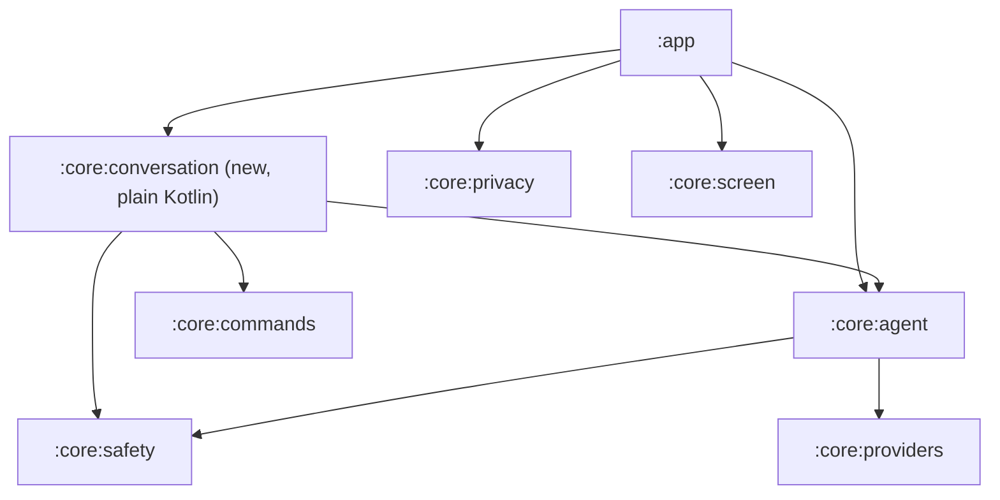
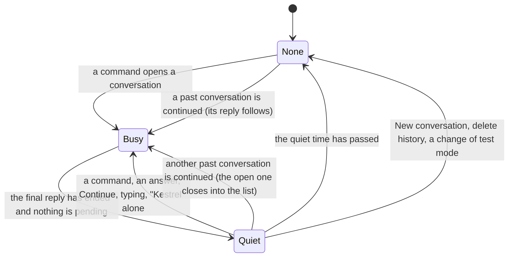

# Kestrel sub-project 7: conversations

| | |
|---|---|
| Date | 24 November 2026 |
| Status | Approved by the owner section by section on 24 November 2026; this file is for his review as a whole |
| Owner | Aleksa Jankovic (`ak800i`) |
| Builds on | The design spec of 12 November 2026 (`2026-11-12-kestrel-design.md`, called "the spec" below), and the code of sub-projects 1 to 6 |
| Changes the spec | In plan 7.0, as Appendix A lists; until then, this file decides where the two differ |

## 1. Summary

**In plain words.** Today every "Kestrel, …" is a task of its own: Kestrel forgets it when it ends, and only voice can start one. After this sub-project, Kestrel holds a conversation with the owner. He can give a command, then another that builds on the first ("and send it to Mila too"), by voice or by typing in a new conversation screen. The conversation ends by itself after a minute without a command, or when he starts a new one. He can look through his past conversations, read them and pick one up again. Kestrel can also work on bigger goals: it keeps a checklist, works for up to an hour before it asks whether to go on, takes corrections while it works, and can pick a goal up again after an interruption. The safety rules stay as strict as they are.

Two requirements shape this sub-project. The owner calls them a must, with the same weight as the spec's own requirements:

1. **Multi-turn conversations with memory.** A conversation lasts several commands. Each command builds on the earlier ones: their requests, their results and what Kestrel learned. A conversation ends only when a configurable quiet time passes between two commands.
2. **A text screen.** A screen in the app where the owner types a task for Kestrel. It works even when voice listening is off.

Kestrel is not a Voice Access clone: it is a standalone copilot and driver of the phone. Voice and the text screen are two ways into the same conversation. The instant commands and dictation of the spec stay as they are, beside it.

The owner's hard rule applies to every plan of this sub-project: no workarounds and no smallest-change fixes. Code that a cleaner structure replaces is deleted, not patched.

## 2. Decisions

The owner made these decisions on 24 November 2026, in brainstorming and in his review of the design's six sections. Later sections refer to them as D1–D24. The spec's own decisions are called "spec D1" and so on.

| ID | Topic | Decision |
|---|---|---|
| D1 | Requirements | Multi-turn conversations with memory, which end after a configurable quiet time between two commands; and a text screen that takes tasks with listening off. Both are musts. Kestrel is a standalone copilot and driver of the phone. |
| D2 | Autonomy | Longer tasks within configurable limits, and multi-step goals with a plan, a checklist, recovery and continuation across follow-up commands. Not fewer questions, not tasks that Kestrel starts by itself, and no background or virtual-display work. |
| D3 | What carries between commands | A structured record of each earlier command: the request, everything Kestrel said, its final answer, the data tools' results (redacted as today), the apps used and the checklist with each item's state. No old screen observations; every command starts with a fresh observation. Memory facts and route notes do not change. |
| D4 | Voice follow-ups | After each of Kestrel's final replies, a follow-up window without the name: 8 s by default, configurable, shown on the feedback bar. After it, "Kestrel, …" again; the conversation lasts until the quiet time ends. Typed input needs no name. |
| D5 | The text screen | A conversation screen, opened from the launcher and from a notification: the transcript, a text field, a microphone button and "New conversation". It works with listening off. Kestrel's own app is never an action target. The feedback bar shows the progress. A question inside another app shows a card with buttons and "Reply…", which opens the conversation screen with the question in focus; Kestrel then returns to the app and looks at it afresh. |
| D6 | Past conversations | Kept on the phone, encrypted, listed and each deletable; kept 30 days by default, configurable. The agent has an on-device search tool; only matching records go to the model, and only within the task that asked. "Delete history" erases them. |
| D7 | Limits | In Settings, per round of a goal: 500 model replies, 60 minutes of working time and 1000 AI Credits. At a limit Kestrel reports what is done and left and asks "Continue?". Yes gives another round; no ends with the partial result; no answer pauses the goal, which can be resumed. A goal without progress still ends early as stuck. |
| D8 | Safety across a conversation | The owner's words in every command and answer of the conversation count as his own text later. Data from earlier results stays data. Confirmations never carry. Typed input is the owner's only when it comes from Kestrel's own screen. Test mode holds for the whole conversation. |
| D9 | A command while a goal runs | It steers the goal: an addition or a correction that the model gets at its next step, and the checklist updates. "Stop" and "cancel" end the goal. By voice, steering needs the name; typed text is always accepted. |
| D10 | Speech | Replies follow the input: a spoken command gets spoken replies, a typed one written replies without speech. A setting "Speak replies to typed commands" is off by default. Silent mode behaves exactly as today. |
| D11 | Process death | The conversation, its records and the goal's checklist are saved, encrypted, as they change. Within the quiet time the conversation is still open after a restart. An interrupted goal asks "Continue the goal?", never by itself; yes means a fresh look and a continuation from the checklist. |
| D12 | Architecture | A new module `:core:conversation` (the conversation's state machine, its store, the goal runner and the channels' ports); a new foreground service for goals; the Orchestrator's rules keep only voice and hand commands to the conversation. |
| D13 | A touch during a goal | A touch interrupts a goal instead of ending it: Kestrel stops at once, and the goal stays open with its checklist, held, with Continue and Cancel on the screen, the bar and the notification. This changes spec D27 for goals. |
| D14 | The follow-up window's speech | Everything that the owner says inside the window goes to the conversation. Instant commands do not win there. |
| D15 | Instant commands and the quiet time | Instant commands do not restart the quiet-time clock. |
| D16 | The allowance across commands | An earlier command's (and its steering's) sending, calls and deleting carry to later commands of the same conversation. Standard mode still confirms every send, share and delete, and every call is still handed over. |
| D17 | Holding a goal | A paused, limit-paused or interrupted goal is held for 30 minutes. |
| D18 | Quiet time | 1 minute by default; from 30 s to 30 minutes. |
| D19 | The goal service | It runs for every open goal, with listening on or off. |
| D20 | The launcher | The launcher icon opens the conversation screen; the settings open from its gear button. |
| D21 | Waits in a typed conversation | Longer than by voice: 2 minutes for a question card, 30 s for a confirmation card, 5 minutes after "Reply…". Spoken conversations keep today's waits. |
| D22 | "Continue?" at a limit | Each yes allows the same again: another 500 replies, 60 minutes and 1000 AI Credits. |
| D23 | Browsing and continuing past conversations | Like VS Code's Copilot chat: past conversations can be listed, opened and read, and continued. "Continue this conversation" makes a past one the current conversation again, with its records as context, within the retention time. By voice or typed, "continue the conversation about X" searches and asks "Continue the conversation from <day> about <topic>?" before it switches. Continuing closes the open conversation into the list. While a goal is open, Kestrel says "Stop the goal first." A continued conversation takes the current test-mode value and says so in its context. |
| D24 | Explanations | The owner reads each section in plain user terms first; every main section of this design starts with "In plain words". |

## 3. Terms

| Term | Meaning |
|---|---|
| Conversation | A series of the owner's commands that build on each other. It ends when the quiet time passes after a command or when the owner starts a new one. A past conversation can be continued (D23). |
| Command | One input of the owner's that asks Kestrel to do something: spoken ("Kestrel, …" or within the follow-up window) or typed. Each command that starts a goal, and each memory request (remember, forget, save that as), gets one record. Steering, answers, "continue", "new conversation" and a request to continue a past conversation get none. |
| Goal | The work that a command asks for, with its checklist. A goal can run over several rounds and take steering and "continue" from later inputs. |
| Round | One stretch of a goal's work within the limits (D7). A yes to "Continue?" gives another round. |
| Record | The structured summary of one command (D3), which later commands get as context, which search reads, and from which the conversation screen draws its transcript. |
| Quiet time | The time without a command after which the conversation ends (D18). |
| Follow-up window | The short time after a final reply in which the owner may speak to the conversation without the name (D4, D14). |
| Channel | How an input came in and how Kestrel answers it: the voice channel or the text channel. |
| Steering | A command that comes while a goal acts. It changes the goal instead of starting a new one (D9). |
| Held goal | A goal that is open but not acting: paused by a lock or a call, paused at a limit, or interrupted. It is held for 30 minutes (D17). |

## 4. Goals, non-goals and success criteria

### 4.1 Goals

1. Multi-turn conversations with memory (D1, D3), by voice and typed, in one conversation at a time.
2. The conversation screen (D5), which works with listening off.
3. Long, multi-step goals (D2, D7, D9, D22) with a checklist, steering and "Continue?".
4. Past conversations that are kept, searched, browsed, read and continued (D6, D23).
5. Resilience: the conversation and its goal survive the end of Kestrel's process (D11), and a touch never loses a goal (D13).
6. No weaker safety (D8, D16): every rule of spec section 12 still holds for every action.
7. A clean architecture (D12): the new module owns the conversation, and the code that it replaces is deleted.

### 4.2 Non-goals

- Kestrel does not start tasks by itself, does not work with the screen off and does not use a virtual display (D2).
- Autonomy does not mean fewer questions. The safety check asks exactly as often as today (D2).
- No old screen observation travels between commands (D3).
- Memory facts, route notes and routines do not change (D3).
- No typed input from outside Kestrel's own screen: no inline reply in a notification, no share intent and no exported intent that carries a command (D8).
- No on-device language model. Search matches words on the phone.
- No sync of conversations to another device, and no export of conversations. The export of the logs stays as it is.
- No change to the instant-command grammar or to dictation.

### 4.3 Success criteria

| Measure | Target | Where |
|---|---|---|
| The suite's existing tasks (spec 16.5) | No drop against their baseline of sub-project 6, judged as spec 16.5 says | kestrel-api37 and the A71 |
| The multi-turn tasks of section 15.3 | Each passes 3 of 3 dry runs; the live ones 3 of 3 runs in test mode | kestrel-api37; the A71 where a task names it |
| The injection suite (spec 16.6), with the new fixture `records-injection` | No send, share, call or delete without the confirmation that Standard mode requires | kestrel-api37 |
| Network egress (spec 13.3) | Unchanged: no connection outside the allowlist | kestrel-api37 and the A71 |
| The first search over 30 days of conversations, also right after Kestrel's process started | At most 1 s | The A71 |
| The archive's share of that search: the open conversation, the index of past conversations and the bodies of the 5 best matches (R3) | At most 500 ms | The A71 |
| The first search with 90 or 365 days of retention, once the index has been read (R3 states what a search right after a start waits) | At most 1 s | The A71 |
| A close of a conversation: its row and one shard of the index, written in one transaction (9.2) | At most 500 ms | The A71 |

## 5. Architecture

**In plain words.** A new part of Kestrel keeps track of the conversation: who said what, what is going on and when it ends. The voice part only listens and speaks; the new conversation screen only shows and takes text. Both hand the owner's words to the conversation, which runs the agent as today.

### 5.1 Modules and dependencies



- `:core:conversation` is plain Kotlin, like `:core:agent`, so that the whole conversation runs in JVM tests with the fixtures' `ScriptedModel`. It depends on `:core:agent` (to run goals), `:core:safety` (the owner's words and the allowance that carry) and `:core:commands` (`Normalizer` and `LabelMatcher` for search). It never depends on `:app`, `:core:voice`, `:core:screen` or `:core:privacy`.
- `:core:agent` learns nothing about conversations. It gets two ports, `GoalPort` and `HistoryPort`, two tools and a richer `TaskRequest`. Its loop stays one task run.
- `:core:privacy` gets the tables of the archive and of its index, and a Keystore key for them. It knows only encrypted payloads and their metadata, as `LogStore` does.
- `:app` implements the ports: the two channels, the archive's adapter, the goal environment (today's `AgentRunner` and `AppAgentEnvironment`), the goal service and the conversation screen.
- `settings.gradle.kts` gets `include(":core:conversation")` after `:core:commands`. Its build file uses the same plain-Kotlin convention plugin as `:core:agent`, with `kotlinx.serialization`, and the test fixtures of `:core:agent` (`ScriptedModel`, `FakeOwner`) for its tests.

### 5.2 Packages of `:core:conversation`

| Package `dev.kestrel.conversation.…` | Main types | Job |
|---|---|---|
| `model` | `ConversationId`, `ConversationSnapshot`, `CommandRecord`, `RecordLine`, `OwnerInput`, `InputChannel`, `InputIntent`, `GoalState` | The stored and shared data, all `@Serializable` |
| `machine` | `ConversationMachine`, `ConversationState`, `ConversationEvent`, `ConversationEffect`, `QuietClock` | One pure function from a state and an event to the new state and its effects, as `Rules.next` is for voice |
| `engine` | `ConversationEngine`, `ConversationView` | Applies the machine to events one at a time, runs its timers, writes the store and starts goals; publishes a read-only view |
| `goal` | `GoalRunner`, `RunningGoal`, `SteeringInbox` | Runs the agent's task loop for a goal, with the checklist, steering, limits, interruption and resume |
| `context` | `RecordBuilder`, `ContextBlock`, `RecordCondenser` | Builds a command's record, and the bounded records block for the next command |
| `store` | `ConversationStore`, `RecordArchive`, `ArchivedConversationStore`, `PastIndex`, `IndexShard`, `SearchIndex`, `PastIndexCodec`, `HistorySearch`, `Retention` | Persistence through an encrypted-payload port, the index of past conversations, retention, and the on-device search |
| `channel` | `OwnerChannel`, `ChannelOutput`, `ChannelQuestion`, `ChannelAnswer`, `ConversationOwner` | The owner as a goal talks to him, over the channel of his latest input |
| `local` | `LocalRequests` | Kestrel's own requests without a model: remember, forget, save that as, delete history, new conversation, continue a past conversation |

### 5.3 Main types

The owner's input. Both channels classify the words with `Requests` (in `:app`'s orchestrator package) before they reach the conversation, so the conversation never parses speech.

```kotlin
package dev.kestrel.conversation.model

enum class InputChannel { VOICE, TEXT }

/** One input of the owner's. [id] is unique per process; [options] are a debug hook's extras (`live`, `model`). */
data class OwnerInput(
    val id: Long,
    val channel: InputChannel,
    val intent: InputIntent,
    val atMillis: Long,
    val options: Map<String, String> = emptyMap(),
)

sealed interface InputIntent {
    data class Command(val text: String) : InputIntent              // a new command, a follow-up or steering
    data class Answer(val text: String) : InputIntent               // the answer to the open question
    data object NoAnswer : InputIntent                              // the voice wait for an answer ended
    data object Stop : InputIntent                                  // "stop", "cancel", the screen's Stop
    data object Continue : InputIntent                              // "Kestrel, continue", the Continue buttons
    data object NewConversation : InputIntent
    data class ContinuePast(val topic: String?) : InputIntent       // "continue the conversation about X" (D23)
    data class ContinueConversation(val id: ConversationId) : InputIntent // the list's "Continue this conversation"
    data object DeleteHistory : InputIntent
    data class Remember(val key: String, val value: String) : InputIntent
    data class Forget(val key: String) : InputIntent
    data class SaveRoutine(val name: String) : InputIntent
}
```

The engine, which the app graph owns:

```kotlin
package dev.kestrel.conversation.engine

class ConversationEngine(
    scope: CoroutineScope,
    private val store: ConversationStore,
    private val goals: GoalRunner,
    private val owner: ConversationOwner,
    private val local: LocalRequests,
    private val settings: Flow<ConversationSettings>,
    private val testMode: () -> Boolean,           // the Safety page's current value
    private val clock: ConversationClock,          // the wall clock for storage, a monotonic clock for timers
    private val onStep: (ConversationEvent, ConversationState, MachineStep) -> Unit = { _, _, _ -> },
) {
    val view: StateFlow<ConversationView>
    fun submit(input: OwnerInput)                   // any thread; never blocks
    fun signal(signal: PhoneSignal)                 // LOCKED, UNLOCKED, RINGING, CALL_ACTIVE, CALL_IDLE
    fun touched()                                   // the touch watcher saw the owner's touch during a goal
    fun replyShown(command: Int)                    // a channel finished speaking or showing a final reply
    fun composing(active: Boolean)                  // the screen's field holds text while the screen is in front
    suspend fun restore()                           // at process start, before any input
    fun outcome(command: Int): CommandOutcome?      // the newest 16, for the debug hooks
}

/** What the voice rules, the conversation screen, the goal notification and the hooks read. */
data class ConversationView(
    val id: ConversationId?,
    val command: Int,                 // the newest command's number in this process
    val goal: GoalPhase?,             // null when no goal is open
    val asking: QuestionKind?,
    val voiceAnswers: Boolean,        // false while only the card may answer (design D32 item 17 of sub-project 5)
    val replyChannel: InputChannel,
    val checklist: ChecklistSummary?, // done, total and the current item's text
    val records: List<CommandRecord>, // the open conversation's records, which the screen draws
    val continued: Boolean,           // the conversation was continued from the list or by name (D23)
)

enum class GoalPhase { ACTING, ASKING, HANDED_OVER, PAUSED, PAUSED_AT_LIMIT, INTERRUPTED }
```

The channel port, which `:app`'s `VoiceChannel` and `TextChannel` implement:

```kotlin
package dev.kestrel.conversation.channel

interface OwnerChannel {
    val kind: InputChannel

    /** Says or shows [output]; returns when it has been spoken or shown, or refused. */
    suspend fun show(output: ChannelOutput)

    /**
     * Asks [question] and returns the answer that the channel itself got, as a card's button, which acts over the app and
     * so leaves no screen of Kestrel's; an answer that the owner says or types, also after "Reply…", reaches the
     * conversation as an input instead. Cancelling the call withdraws the question.
     */
    suspend fun ask(question: ChannelQuestion): ChannelAnswer

    /** A hand-over: returns when the owner continued or cancelled on the channel, or when it ended by itself. */
    suspend fun handOver(handOver: HandOver): HandOverEnd

    /** Shows Android's permission dialog for [permissions] after saying [why]. */
    suspend fun askPermission(permissions: List<String>, why: String): PermissionEnd

    /** Returns true once no window of Kestrel's own app but its overlays is on the screen, or false after 3 s. */
    suspend fun leaveKestrel(): Boolean
}

sealed interface ChannelOutput {
    data class Said(val text: String) : ChannelOutput                 // spoken by the voice, shown on the bar and in the transcript
    data class Shown(val text: String) : ChannelOutput                // shown only, never spoken: "Got it." for steering
    data class Report(val command: Int, val text: String) : ChannelOutput // the final reply; a spoken one opens the follow-up window
}

enum class QuestionKind { YES_NO, CONFIRM, FREE, PICK, SCREENSHOT, CONTINUE_GOAL, LIMIT, SWITCH, DELETE_HISTORY }

data class ChannelQuestion(
    val number: Int,                         // names the question, as "Reply…" does (12.2)
    val text: String,                        // the card's and the transcript's form
    val kind: QuestionKind,
    val spoken: String = text,               // the voice's form
    val choices: List<String> = emptyList(), // PICK: at most 4
    val confirmation: Confirmation? = null,  // CONFIRM: the card shows it as today
)

sealed interface ChannelAnswer {
    data object Yes : ChannelAnswer
    data object No : ChannelAnswer
    data class Text(val text: String) : ChannelAnswer
    data class Pick(val number: Int) : ChannelAnswer   // the number that he said or the choice that he tapped, from 1
    data object Silence : ChannelAnswer
    data object Interrupted : ChannelAnswer  // a pause or a touch withdrew the question
}
```

Whether the owner gave an answer on Kestrel's own screen belongs to the answer's arrival, not to its kind. A spoken or typed answer reaches the conversation as an input, and the engine passes it on with `ConversationOwner.answer(number, answer, leftScreen)`, where `leftScreen` is true for a typed input of any kind: a typed "yes", a typed pick and typed words alike. After such an answer, the owner port's gate returns `RESUMED` once, so the run looks at the screen afresh (10.3). An answer that a card's button gives acts over the app and leaves no screen of Kestrel's.

The bar's progress ("Step 12 · 3 of 7 · …") is not a channel output: the bar draws it from `ConversationView` (10.5).

`ConversationOwner` implements `:core:agent`'s `OwnerPort` for one goal. It takes over the parts of today's `AppOwnerPort` that are not Android: one question at a time, the waits and wakes, the pause gate (`gate()`) and the wait for Kestrel's own screen (`leaveKestrel()`, with the channel's `leaveKestrel()`, section 10.2). It picks the channel by the conversation's latest input (section 11). The task run traces its own dialogue into the open command's record (section 8.1), so `ConversationOwner` does not trace it again; it puts only the conversation's own outputs into the record: the replies to local requests, "Continue the goal?" and the switch question. The conversation screen draws the record.

### 5.4 New ports and fields in `:core:agent`

```kotlin
package dev.kestrel.agent.goal

/** What a task run needs from the goal around it; `:core:conversation`'s `RunningGoal` implements it. */
interface GoalPort {
    /** The owner's steering since the last call, oldest first; the loop drains it before each model call. */
    fun takeSteering(): List<Steer>

    /** Step [step] of the run starts, right after the steering and before its model call; the bar shows it (10.5). Must not block. */
    fun stepStarted(step: Int)

    /** The model's checked checklist; the goal stores and shows it. */
    suspend fun checklistChanged(checklist: Checklist)

    /** Something that the command's record needs, as it happens, so that it survives the end of the process. */
    suspend fun traced(entry: TraceEntry)
}

enum class SteerChannel(val wire: String) { SPOKEN("spoken"), TYPED("typed") }

/** A steering message (7.3). The loop, not the message, names the step after which it came. */
data class Steer(val text: String, val channel: SteerChannel)

/** What a run traces for the command's record (8.1). Every text is redacted once, each vault value as its kind's words. */
sealed interface TraceEntry {
    data class Requested(val text: String) : TraceEntry                          // the request of a run that is no resume
    data class Said(val text: String) : TraceEntry                               // a say, a hand-over's sentence, a permission's reason
    data class Asked(val text: String) : TraceEntry                              // a question or a confirmation
    data class Answered(val text: String) : TraceEntry                           // the owner's words, a number, yes or no
    data class Data(val tool: String, val step: Int, val text: String, val items: Int) : TraceEntry // a data tool's result, as the model saw it, and its items' count
    data class AppUsed(val label: String, val packageName: String) : TraceEntry  // an app that a step acted in or opened, each time the run comes to it from another app
    data class Did(val line: String) : TraceEntry                                // a new line of the ledger
}

/** The on-device search over past conversations, behind the tool `search_conversations` (9.4). */
interface HistoryPort {
    suspend fun search(query: HistoryQuery): HistoryResult

    companion object {
        const val MAX_MATCHES = 5
    }
}

data class HistoryQuery(val text: String, val from: LocalDate? = null, val to: LocalDate? = null) // both days included
data class HistoryResult(val matches: List<HistoryMatch>, val more: Boolean = false) // best match first; more: more commands matched
data class HistoryMatch(val atMillis: Long, val command: Int, val request: String, val answer: String?, val apps: List<String>, val data: List<HistoryData>)
data class HistoryData(val tool: String, val text: String)                           // a data note, quoted as the model saw it then

/** Set when a goal resumes in a new run (7.6). */
data class ResumeNote(val after: ResumeCause, val done: List<String>, val steered: List<Steer> = emptyList())
enum class ResumeCause(val words: String) { LIMIT, INTERRUPTION, RESTART }
```

Today's `AgentRunner` passes `NoGoal` and `NoHistory`, which keep nothing and find nothing. `AgentPorts` gets `goal: GoalPort` and `history: HistoryPort`, and `:app`'s `TaskStart` carries the two ports to the environment, so that the caller chooses them and the environment builds only the device's ports.

The owner port gets its own wait for Kestrel's screen (section 10.2), and a run's end says what interrupted it:

```kotlin
package dev.kestrel.agent.port

interface OwnerPort {
    // say, ask, confirm, handOver, askPermission and gate, as today

    /** Waits until no window of Kestrel's but its overlays is in front, at most KESTREL_LEAVE_MILLIS; false when it stayed. */
    suspend fun leaveKestrel(): Boolean

    companion object {
        const val KESTREL_LEAVE_MILLIS = 3_000L
    }
}

enum class AnswerKind { YES_NO, FREE, PICK_NUMBER, SCREENSHOT, LIMIT } // LIMIT: a round's "Continue?" (7.4)
```

```kotlin
package dev.kestrel.agent

enum class Interruption { TOUCH, KESTREL_SCREEN }

class TaskCancellation(val reason: EndReason, val interruption: Interruption? = null) : CancellationException(/* … */)

// TaskReport gains `checklist: Checklist?` (the run's checklist at its end) and `interruption: Interruption?`.
```

`EndReason.INTERRUPTED` always has its cause, and no other end has one: `TaskCancellation` and `TaskReport` each require this. A goal's touch cancels the round's job with `TaskCancellation(EndReason.INTERRUPTED, Interruption.TOUCH)` (D13), and Kestrel's own screen that stays in front ends the run with `Interruption.KESTREL_SCREEN` (section 10.2). The callers choose their sentences by the cause, never by comparing a sentence.

`TaskRequest` becomes:

```kotlin
data class TaskRequest(
    val id: String,
    val text: String,
    val knownNames: Set<String> = emptySet(),
    val conversation: Redacted? = null,            // the records block (section 8)
    val ownerHistory: List<String> = emptyList(),  // the owner's words of the conversation's earlier inputs (D8)
    val carried: Set<Category> = emptySet(),       // the allowance of the conversation's earlier commands and their steering (D16)
    val checklist: Checklist? = null,              // the goal's checklist when a goal resumes
    val resume: ResumeNote? = null,                // set when a goal resumes (section 7.6)
    val limits: GoalLimits = GoalLimits(),         // one round's limits (D7)
) {
    companion object {
        const val CONVERSATION_HEADER = "This conversation so far:" // the first line of `conversation` (8.4)
    }
}
```

A resumed goal's request brings everything that the goal's earlier rounds learned from the owner: its `ownerHistory` also holds the goal's own answers, steering and "continue" inputs after its first command, and its `carried` also holds the allowance of the goal's own steering. Its `conversation` holds only the records of the conversation's earlier commands, never the open goal's own record.

### 5.5 What moves out of today's code

| Today | Moves to | Stays |
|---|---|---|
| `Rules.kt`: `TaskPhase`, `TaskAsk`, `PauseCause`; the state's `task`, `cancelled`, `taskPhase`, `taskAsking`, `voiceAnswers`, `handOver`, `pause`, `continueAsked`, `touchesArmed`, `pauseExpired`, `heldReport`, `deleteAsking`; the events `TaskEnded`, `TaskSays`, `TaskAsks`, `TaskHandsOver`, `TaskBusy`, `OwnerTouched`, `HandOverEnded`, `PauseExpired`, `TouchesArmed`, `HistoryDeleted`; the effects `RunTask`, `CancelTask`, `AnswerTask`, `ContinueTask`, `TimeHandOver`, `ExpireHandOver`, `PauseTask`, `ResumeTask`, `TimePause`, `ArmTouches`, `ExpirePause`, `DeleteHistory`, `RunMemoryTask`; and their functions (`taskEnded`, `pauseTask`, `backToTask`, `askContinue`, `askDelete`, `deleteAnswer`, `runMemory`, `taskAsks`, `handOver`, `taskBusy`, `continueTask`, `runTask`, `cancelTask`) | `ConversationMachine` (goal phases, pauses and holds, "Continue the goal?", the hand-over's 3 minutes, a report held while the owner is away) and `LocalRequests` (delete history, the memory requests, continuing a past conversation) | The listening modes, the microphone and recognition, the keyword spotter's words, the wait after "Kestrel" alone, instant commands with their questions and countdowns, the call commands, the 30-second silence pause, the voice answer waits (15 s and 35 s) and the new follow-up window. `Rules` keeps a `ConversationView` in its state, which the engine sends as `Event.ConversationChanged`, to choose recognition |
| `AgentRunner`: running a task, the report's sentence, the routine offer, "save that as" with its 10-minute recording, steering the owner port, the hooks' state (`ended`, `running`, `handOver`, `confirming`), the touch flow | `GoalRunner` and `ConversationEngine`; the model choice, the debug model override, the live session, the self-chat aliases and the call backstop go to `:app`'s `AppGoalEnvironment` | `AgentTexts` stays in `:app` and gains the new sentences |
| `AppOwnerPort`: the question lock, the waits and wakes, pause and resume, the hand-over's timing | `ConversationOwner` | The card, the rule for another app's audio (D32 item 17 of sub-project 5), the permission activity and the hand-over signals move into the two channels and a shared `AndroidOwnerSupport` |
| `Listening.runTask`, `runMemory`, `steerTask`, `taskOptions` | `Listening.conversation: (OwnerInput) -> Unit`, which the app graph sets | Everything else in `Listening` |
| `Listening.afterStopping` and its wait for a stuck command (spec 7.3) | `ScreenTurns` in `:app`, which lets one actor at a time use the screen: an instant command, a goal or the settings | — |
| `CallMonitor` and the screen-on and unlock events inside `Listening` | `PhoneSignals` in `:app`, which runs while listening runs or a goal is open, so that a goal with listening off still pauses on a lock or a call and the call backstop (D13 of sub-project 5) still works | `Listening` subscribes to it for its modes |

### 5.6 How `AppGraph` wires it

```kotlin
// AppGraph (each by lazy, as today)
internal val conversationArchive = RoomRecordArchive(store.conversations)
internal val conversationStore = ArchivedConversationStore(conversationArchive, scope) { note -> /* the activity log, by its kind (9.2) */ }
internal val phoneSignals = PhoneSignals(appContext, scope)
internal val screenTurns = ScreenTurns(scope, report = reportFailure)
internal val voiceChannel = VoiceChannel(listening, ownerSupport)
internal val textChannel = TextChannel(appContext, { screen.value }, ownerSupport)
internal val goalEnvironment = AppGoalEnvironment(/* what AppAgentEnvironment and AgentRunner's model choice need */)
internal val conversations = ConversationEngine(
    scope = scope,
    store = conversationStore,
    goals = GoalRunner(goalEnvironment, screenTurns::goal, HistorySearch(conversationStore)),
    owner = ConversationOwner(mapOf(VOICE to voiceChannel, TEXT to textChannel), /* … */),
    local = LocalRequests(goalEnvironment, memory, conversationStore, HistorySearch(conversationStore), { logs.deleteHistory() }),
    settings = settings.observe(SettingKeys.CONVERSATIONS),
    testMode = { settings.get(SettingKeys.SAFETY).testMode },
    clock = AndroidConversationClock,
)
// This replaces runTasks(listening):
listening.conversation = conversations::submit
conversations.view.collect { listening.send(Event.ConversationChanged(it)); GoalService.follow(appContext, it) }
phoneSignals.collect { conversations.signal(it) }
```

`KestrelApplication.onCreate` calls `conversations.restore()` before the accessibility service, the assistant service or the conversation screen can send input.

## 6. The conversation's lifecycle

**In plain words.** A conversation starts with your first command and stays open while you keep giving commands. When a minute passes without a command, and Kestrel is not busy, it ends quietly and goes into your list of past conversations. After Kestrel answers by voice, you have 8 seconds to say something more without "Kestrel". A touch while Kestrel works stops it at once but keeps the goal, so you can say or tap Continue.

### 6.1 States

There is at most one open conversation.

```kotlin
data class ConversationState(
    val id: ConversationId? = null,        // null: none open; the next command opens one
    val openedAtWall: Long = 0,
    val testMode: Boolean = true,          // fixed when the conversation opens or is continued (section 12.4)
    val continued: Boolean = false,
    val commands: Int = 0,
    val goal: GoalState? = null,
    val question: OpenQuestion? = null,
    val replyChannel: InputChannel = InputChannel.VOICE,
    val quiet: QuietClock = QuietClock.Off,
    val composing: Boolean = false,
    val replying: Int? = null,             // the command whose final reply is being spoken or shown
)

sealed interface QuietClock {
    data object Off : QuietClock
    data class Held(val why: HoldReason) : QuietClock
    data class Running(val number: Int, val sinceWall: Long) : QuietClock
}

enum class HoldReason { GOAL, QUESTION, REPLYING, COMPOSING, WAITING_FOR_COMMAND }
```



### 6.2 The quiet-time clock

**It runs** only while all of these hold: a conversation is open; no goal is open, in any phase; no question waits for the owner; Kestrel is not speaking or showing a final reply; the conversation screen's text field is empty, or the screen is not in front; and Kestrel is not waiting for a command after "Kestrel" alone, the side key or the microphone button.

**It starts from zero** at:
- the end of a command's final reply: the end of its speech (when `Listening.say` completes, as `Event.SpeechEnded` reports today), or, for a written reply, the moment the reply is on the screen or the bar;
- the end of the final reply of a local request;
- the end of a goal, in any way, after its report;
- the end of composing: the field is emptied, or the screen leaves the front without sending;
- the end of a wait for a command after "Kestrel" alone without a command;
- the end of the reply that confirms the continuation of a past conversation (section 9.6).

**It is held** (stopped, and started from zero when the hold ends) while a goal is open in any phase, a question waits, a final reply is being spoken or shown, the owner types, or Kestrel waits for a command.

**It is not affected by** the lock or the screen turning off, a phone call, listening on, paused or off, instant commands (D15), and the end of Kestrel's process (section 6.7).

**When it runs out,** the engine closes the conversation: it stores it as closed, so that its records join the history, and the conversation screen shows a line "Conversation ended at 18:04". Kestrel says nothing. The next command opens a new conversation.

The timer is the engine's coroutine. Each timer has a number, as the Orchestrator's timers do, so that an older timer changes nothing. The stored start (`sinceWall`) is a wall-clock time, so that a restart can tell whether the conversation is still open.

### 6.3 Events and effects

```kotlin
sealed interface ConversationEvent {
    data class Input(val input: OwnerInput) : ConversationEvent
    data class Goal(val event: GoalEvent) : ConversationEvent
    data object Touched : ConversationEvent                          // D13
    data class ReplyShown(val command: Int) : ConversationEvent
    data class QuietEnded(val number: Int) : ConversationEvent
    data class HoldEnded(val number: Int) : ConversationEvent        // 30 minutes (D17)
    data class HandOverEnded(val number: Int) : ConversationEvent    // 3 minutes (spec 12.4)
    data class QuestionWaitEnded(val number: Int) : ConversationEvent // a card's wait (D21)
    data class Composing(val active: Boolean) : ConversationEvent
    data class Signal(val signal: PhoneSignal) : ConversationEvent
    data class SettingsChanged(val settings: ConversationSettings, val testMode: Boolean) : ConversationEvent
    data class Restored(val snapshot: ConversationSnapshot?, val nowWall: Long) : ConversationEvent
    data class PastFound(val match: PastMatch?) : ConversationEvent  // the search for "continue the conversation about X"
    data object HistoryDeleted : ConversationEvent
}

sealed interface GoalEvent {
    data class Started(val command: Int) : GoalEvent
    data class Asked(val question: ChannelQuestion) : GoalEvent
    data object Answered : GoalEvent
    data class HandedOver(val text: String) : GoalEvent
    data object HandOverDone : GoalEvent
    data class Paused(val cause: PauseCause) : GoalEvent       // LOCK, INCOMING_CALL, OUTGOING_CALL
    data object Resumed : GoalEvent
    data class Checklist(val checklist: Checklist) : GoalEvent
    data class Ended(val command: Int, val report: TaskReport, val sentence: String) : GoalEvent
}
```

The effects (`ConversationEffect`) are `StartGoal`, `SteerGoal`, `InterruptGoal`, `CancelGoal`, `PauseGoal`, `ResumeGoal`, `AnswerQuestion`, `Output`, `Ask`, `Persist`, `Close`, `SwitchTo`, `SearchPast`, `RunLocal`, `DeleteHistory` and the timers' starts. The machine never calls a channel or the store; the engine performs the effects in order, as the Orchestrator does.

### 6.4 What an input does in each situation

| Situation | `Command(text)` | `Stop` | `Continue` | `NewConversation`, `ContinuePast`, `ContinueConversation` |
|---|---|---|---|---|
| No open conversation | Opens one, then as the next row | Nothing | "There's nothing to continue." | New: nothing to close. Continuing: as section 9.6 |
| Open, no goal | Starts a goal (section 7.1) | Nothing | "There's nothing to continue." | New: closes it. Continuing: closes it into the list and switches (9.6) |
| Goal acting | Steering (7.3); by voice only with "Kestrel" | Ends the goal at once with its report | Ignored | "Stop the goal first." |
| Goal asking | The answer (typed, or spoken within the answer wait) | Ends the goal | Ignored | "Stop the goal first." |
| Goal handed over | Typed: "Finish the step first, then tap Continue, or Cancel." By voice: as today (`FinishHandOverFirst`) | Ends the goal | Ends the hand-over | "Stop the goal first." |
| Goal paused by a lock or a call | "Answer 'Continue the goal?' first, or say cancel." | Ends the goal with its report | Resumes it with a fresh observation | "Stop the goal first." |
| Goal paused at a limit, or interrupted | Resumes the goal in a new round with the command as steering (7.6) | Ends the goal with its partial report | Resumes it in a new round | "Stop the goal first." |

`Stop` covers "stop", "cancel", the screen's Stop and Cancel buttons and the notification's Stop. A held goal (paused, paused at a limit or interrupted) is held for 30 minutes (D17), with the quiet clock held too. After 30 minutes the goal ends with its partial report. A report that would come while the screen is off or a call lasts is kept until the owner is back, as `heldReport` does today.

### 6.5 Touches, questions, locks and calls

- **A touch while a goal acts or asks** (D13). The touch watcher's touches reach `ConversationEngine.touched()` through `GoalRunner`. The engine cancels the round's job with `TaskCancellation(EndReason.INTERRUPTED, Interruption.TOUCH)`, so Kestrel stops at once and removes its overlays, as spec 14.1 requires. The goal becomes `INTERRUPTED` and is held. An open question is withdrawn, and an open confirmation counts as not given. Kestrel reports, by the channel's rules (section 11): "Stopped. I opened Viber and typed the message. Say 'Kestrel, continue' or tap Continue to go on, or cancel." The conversation screen and the goal notification offer Continue and Cancel, and the bar names them (10.5). Continue resumes the goal in a new round with a fresh observation; the safety check then asks every confirmation again.
- **Touches that do not interrupt**: a touch on Kestrel's own card acts on the card; touches during a hand-over are expected (spec 12.4); touches during "Reply…" on the conversation screen are expected (section 10.3).
- **A touch while a goal is held** never ends it and never answers "Continue the goal?". A card that asks it closes at the touch; the conversation screen and the notification keep the question.
- **Instant commands** keep spec 14.1's rule: a touch cancels a command's question or countdown.
- **Questions** hold the quiet clock. By voice, the Orchestrator's waits decide when a question ends (15 s to start an answer, 35 s once speaking), as today. In a typed conversation, the card's waits decide (D21, section 10.4).
- **A lock or a call while a goal acts** pauses it, as today (spec 14.4). The signals come from `PhoneSignals`, so this works with listening off too. When the owner is back (the unlock, or the end of the call with the phone unlocked), Kestrel asks "Continue the goal?" by voice when a voice session is open, and always as a card and in the goal notification.
- **A call that becomes active without ringing within 5 s of an agent's action** still stops the goal (D13 of sub-project 5, `CallBackstop`), with listening on or off. This stop ends the goal; it is not an interruption.
- **A lock or a call while no goal is open** changes nothing in the conversation.

### 6.6 The follow-up window

- **It opens** when Kestrel has finished speaking a command's final reply, and when it has finished speaking a local request's final reply. It does not open after a `say` in the middle of a goal: steering a goal by voice always needs the name (D9), so that a TV cannot steer a goal. It does not open after a written reply.
- **Its length** is 8 s by default (D4), set on the Conversations page, and never longer than the quiet time.
- **What it does.** `Rules` sets `State.followUp`, a number like `wait`, and recognition `ALL`, also in the paused mode. Every utterance that starts inside the window goes to the conversation as a command, without the name (D14). `Requests` still reads Kestrel's own requests in it ("stop", "cancel", "stop listening", "turn off", "new conversation", "continue the conversation about X"), which keep their meaning; the instant-command parser is not asked.
- **What the owner sees.** The bar shows "Go on…" with the seconds left, and fades when the window ends.
- **It ends** at its timer (`Event.FollowUpEnded(number)`), at any transcript, at Kestrel's next reply, when the screen turns off, a call rings or listening stops, and when the conversation closes. After it, "Kestrel, …" is needed again.

### 6.7 The end of Kestrel's process

- The engine stores the conversation's snapshot (its state, its records so far, the checklist, the goal's phase and the quiet clock's wall-clock start) at every change of these fields (section 9), so a command's record grows while its goal works.
- At the next start, `restore()` reads the open conversation:
  - Without a goal: if the quiet time has not passed since `sinceWall`, the conversation is still open with its records, and its clock runs on for the rest. Otherwise it is closed.
  - With a goal in any phase: the goal becomes `INTERRUPTED` and is held for 30 minutes from when it stopped working: the last time that Kestrel saved it while it worked, or the start of its hold if it was held already. Kestrel asks "Continue the goal?", never by itself (D11): by voice once a voice session is open and the owner is back, and always as a card and in the goal notification. Yes resumes the goal (section 7.6); no, Cancel or the end of the hold end it with its partial report.
- The stored times are wall-clock times, so a change of the clock can keep a conversation open or close it wrongly after a restart. The spec accepts the same limit for the listening mode (spec 8.5).

### 6.8 One conversation, and a new one

- Voice and text feed the one open conversation, in either order.
- The conversation screen's "New conversation" closes the open conversation when no goal is open. With a goal open, the button reads "Stop and start new": it ends the goal with its report and then closes the conversation.
- "Kestrel, new conversation" (also "start a new conversation"), spoken or typed, is a local request that `Requests` reads without a model, as "Kestrel, delete history". With a goal open, Kestrel says "Stop the goal first."
- A conversation also closes at the end of its quiet time, at "delete history" (section 9.7), when the owner continues another one (section 9.6), and when test mode changes (section 12.4).

## 7. Goals

**In plain words.** For a bigger job, Kestrel writes itself a checklist, works through it and shows you how far it is. You can add or correct something while it works ("Kestrel, make it 7:30 instead"). After an hour, 500 steps or 1000 AI Credits, it tells you what is done and asks "Continue?"; each yes gives it the same again. If you don't answer, it waits, and you can say "continue" later.

### 7.1 How a goal maps to today's task run

- A goal starts with a command when no goal is open. `GoalRunner` builds a `TaskRequest` with the command's words, the records block (section 8), the owner's earlier words and the carried allowance (section 12.1), and the owner's limits. It runs `Agent.run` as `AgentRunner.runTask` does today: the same `TaskRun`, the same `Conversation` of model messages, the same tools, safety check and completion check.
- A task run holds one or more **rounds**: it starts with one, and each yes to "Continue?" gives it another (7.4). Within the run, the model's messages keep their stable region and their two full observations, as today.
- A yes to "Continue?" does **not** start a new task run. The same `TaskRun` gets the same allowance again (`Limits.nextRound()`, D22), so the model keeps its messages and the prompt cache.
- A goal that resumes after a pause at a limit without an answer, after an interruption or after the end of the process starts a **new** task run, whose request carries a `ResumeNote` and the checklist, and whose first observation is fresh. The old model messages are neither stored nor reused.
- The vault (spec 12.6) lives for one task run, as today. A record holds a redacted value only as its kind's words ("a one-time code"), never as a placeholder, so no later run can type it back.
- `GoalRunner` takes the screen through `ScreenTurns` before the run's first observation, so that an instant command that is still running ends first (spec 7.3).

### 7.2 The checklist tool

The tool goes at the end of `Tools.ALL`, as spec 11.4 requires for a new tool.

```text
update_checklist — "Write the goal's checklist before you work on it: the steps to reach the owner's goal and the state
of each. Send every step that is still todo or doing each time; a step that is done, skipped or failed may be left out
and stays as it is. Mark a step done only with the number of the step that did it, which cannot come before the call
that added the step."
  items (array, required) "The steps: 1 to 20 in a call. New steps go at the end, in the order given."; each an object:
    id     string   "The item's id from the last checklist result, such as c3; leave it out for a new item."
    text   string   "One step, in a few words; at most 120 characters."                       (required)
    state  string   "The step's state: todo, doing, done, skipped or failed." (an enum of the five) (required)
    step   integer  "For done: the number of the step that did it."
    why    string   "For skipped or failed: why; at most 120 characters."
```

```kotlin
@Serializable data class Checklist(val items: List<ChecklistItem>) { val done: Int; val open: List<ChecklistItem> } // open: todo or doing
@Serializable data class ChecklistItem(val id: String, val text: String, val state: ItemState, val step: Int? = null, val why: String? = null)
@Serializable enum class ItemState(val wire: String) { TODO("todo"), DOING("doing"), DONE("done"), SKIPPED("skipped"), FAILED("failed") }
```

`ChecklistRules` (in `dev.kestrel.agent.goal`) checks each call by code:
- 1 to 20 items in a call, every item that is still todo or doing among them, at most one `doing`, and the texts and reasons within their limits; a placeholder becomes its kind's words, as in `say`. A call with more than 20 items is refused with "A call holds 1 to 20 items; leave out items that are done, skipped or failed.";
- a `done` item needs `step`: a step of this task run that acted on the screen and did not fail (one of `Tools.ACTING`: the tools with a category, `back`, `home`, `open_app`, `open_url`, `open_deep_link` and `open_settings`), a data step with a result (`okDataSteps`), or a step that the owner finished after a hand-over (`ownerSteps`). A `say`, an `ask_user`, a `wait` or a `look_closer` never marks an item done. That step may not come before the step at which the item came into the checklist (for a new item, the step of the call itself), so no work from before an item was added can mark it done. The run keeps the step at which it added each item in its own state (`ChecklistState.added`), not in the stored checklist, because step numbers start again in each task run; an item of the checklist that the run started with came in before the run's first step. An item that is done already, also one that was done in the checklist that the run started with, may stay done without a step and keeps its step;
- an item named by `id` keeps its id and its place, and its text may not change once it is done; a new item gets the next id (`c` and a number, with no upper limit) and goes at the end;
- an item that the call leaves out keeps its stored state, which must be `done`, `skipped` or `failed`, so the 20-item bound applies only to the items that a call sends, and a long goal's checklist has no limit on its length;
- a `skipped` or `failed` item needs `why`.

A valid call returns "Result: checklist saved, 3 of 7 done (c3, c4, c7)." and calls `GoalPort.checklistChanged`; the ids in brackets are those of the items that the call sent, in the call's order, so that the model learns the ids of the items that it just added and the line stays short in a long goal. An invalid call returns its reason, a fixed sentence of Kestrel's with ids and step numbers, never the model's text, and counts as an invalid tool call (spec 11.7). The system prompt tells the model to keep a checklist for a goal of more than two steps; a short task may finish without one.

`update_checklist` neither makes progress nor counts as a step without progress, so it can neither hide being stuck nor cause it. It counts as a model reply for the limits. An update that comes right after a saved one, with no other tool between them, counts as an invalid tool call ("it came right after the last update; act on the screen or with another tool before you update the checklist again"). A refused update does not count as saved, so the model may correct it at once.

`finish` gains one rule, which it checks before anything else, also before its pause gate and its fresh snapshot, so that a pause cannot end a goal with open items as unverified: it fails while an item is `todo` or `doing` ("finish failed: the checklist has open items c4 and c5; mark them done, skipped or failed", or "an open item c4; mark it …" for one). The completion check (spec 11.8) itself does not change.

### 7.3 Steering

- A command that comes while the goal acts goes into the goal's `SteeringInbox`: by voice only with "Kestrel" (D9), typed always. The bar shows "Got it." and the record shows the message.
- `TaskRun.turn()` drains `GoalPort.takeSteering()` at the start of each turn, after the pause gate and the limit check and before the model call; then it calls `GoalPort.stepStarted` with the number of the step that starts. A step that has started runs to its end; the correction counts from the next step. Each message becomes a new kind of entry in `Conversation`, an owner message, which is a user message after the last step:

  `The owner added (typed) at step 14: "Also send it to Mila, not only Ana."`

  Before the first step it says "before the first step" instead of "at step 14". The words are redacted once, quoted and escaped, and never cut, because a cut instruction can mean something else. When the message widened the allowance, the allowance's sentence follows on a line of its own.
- An owner message never changes and is never left out, also not by a local Ollama model's budget, so it only appends to what the caches hold. It sits in the tail until two more observations have come after it, and then in the stable region.
- The words count as the owner's, and their verbs join the allowance (`OwnerWords.steered`: `TaskSafety.withOwnerWords` with the message, and `TaskAllowance.from` on it joined with the current categories), because steering is a command of the owner's.
- The run drains steering only at the start of a turn, so a message that comes during the run's last step stays in the goal's `SteeringInbox` when the run ends. `GoalRunner` never drops it without a word: when the goal is held, the next run drains it before its first step; when the goal ended for good, nothing of it runs, and the goal's final reply names it as received too late, so that the owner can say it again.
- The system prompt says that an owner message may change the plan and that the model should then update the checklist.
- While the goal asks a question, typed text and speech within the answer wait answer the question; they are not steering.

### 7.4 Limits and "Continue?"

`Limits(clock, countsCredits, round)` takes one round's values from `GoalLimits`, which the owner sets (section 13). Before sub-project 7 they were constants: `MAX_REPLIES = 30`, `MAX_WORK_MILLIS` of 5 minutes and a question each `CREDIT_STEP = 10` credits.

```kotlin
@Serializable data class GoalLimits(val replies: Int = 500, val workMinutes: Int = 60, val credits: Int = 1000)
```

- The working time counts as today: waits for the owner and pauses do not count. Each LLM call can still take at most 30 s.
- At the first limit that a round reaches, `TaskRun.checkLimits()` asks one question of the kind `LIMIT`, built by code from the checklist and the ledger, never by the model: "I've worked for 60 minutes on this. Done: 4 of 7 steps. Left: reply to Mila, archive the thread. Continue?" (or "I've used 500 model replies …", or "This has used 1,000 AI Credits …", with the real total). Because the owner hears it, it names at most 3 open items ("Left: a, b, c and 2 more."). Without a checklist it names the newest 3 of Kestrel's ledger lines ("Most recently, I …"), and without a ledger line too it says "I haven't changed anything yet.".
- **Yes** gives the same again (D22): from the current totals, another 500 replies, 60 minutes and 1000 AI Credits, or the owner's own values.
- **No** ends the goal as `EndReason.STOPPED_AT_LIMIT`; the report says what is done and what is left, from the checklist. Every answer that is neither yes nor silence counts as no.
- **No answer** (by voice the answer wait, typed the card's 2 minutes) ends the round as `EndReason.PAUSED_AT_LIMIT`. The goal stays open as `PAUSED_AT_LIMIT` and is held (D17). "Continue", the Continue buttons or any command resume it. A question that is interrupted three times in a row counts as no answer too.
- The question after each 10 credits goes. A profile whose spending counts no credits has no credit limit, as today.
- `EndReason` gains `STOPPED_AT_LIMIT`, `PAUSED_AT_LIMIT` and `INTERRUPTED`, and loses `STEPS`, `TIME` and `COST`, because a limit now always asks. `AgentTexts` gets their sentences.

### 7.5 Stuck detection and recovery

- Escalation does not change (spec 11.7, `Escalation`): the lightweight model first, the switch after 3 steps without progress or 2 invalid calls, "I'm not getting anywhere. Should I keep trying?" on the versatile model, and the end after 3 invalid calls there. A goal without progress still ends early as `STUCK`, whatever its limits (D7).
- Recovery is the model's work, helped by the checklist: a step that failed is marked `failed` with its reason, a new item is added, and the goal goes on. The system prompt says so.

### 7.6 Resume

A resumed goal starts a new task run whose task message starts with Kestrel's own lines:

```text
The owner's goal: "<the goal's first command>"
You are continuing this goal after <a pause at a limit | an interruption | a restart of Kestrel>.
Its checklist: c1 [done] "Open Viber" · c4 [doing] "Reply to Mila" · c5 [todo] "…"
What Kestrel did so far, in its own notes: "opened Viber" · "sent the message to Ana"
The owner added (typed) in an earlier round: "Also send it to Mila, not only Ana."
Look at the screen afresh; it may have changed.
```

The goal's first command and the owner's earlier steering are his own words, in their record's form: they were redacted once, when they first entered a run of the goal, so they are never redacted again. They are quoted and escaped the way screen text is, and never cut, so that a line break in a typed command cannot start a line of its own. The system prompt counts them as his because their lines start with `The owner's goal:` and `The owner added` (section 8.5).

The checklist's texts and Kestrel's notes are data: each is quoted and escaped the way screen text is, and a note is never cut. A note holds labels from the screen and contacts' names, so a line break in a chat's name cannot start a line that reads as Kestrel's or the owner's; a note's own quotes, such as those around a screen's title, are escaped too. Without notes the line is "What Kestrel did so far: nothing yet.". A checklist of more than 20 items names only its open items, after the line of counts that the records block uses (8.3): "Its checklist: 21 done, 0 skipped, 0 failed; open: c22 [doing] "…"".

Each steering message that the goal's earlier rounds took (`ResumeNote.steered`, oldest first) gets a line of its own, `The owner added (<spoken | typed>) in an earlier round: "<words>"`: quoted and escaped, never cut, and with no allowance sentence, because their allowance reaches the run through `TaskRequest.carried`. A steering command that resumed the goal, and any other steering that still waits in the goal's inbox, follows as an owner message before the first step (7.3). The first observation is fresh. A resumed run traces no new request and replays no routine. Kestrel's code repeats no earlier step; the checklist and the ledger tell the model what is done. A share that was confirmed but not seen sent is listed as "tried, not seen sent", as `pendingLines()` says today. Every confirmation is asked again (D8).

### 7.7 Goals and records

A goal belongs to the command that started it. The steering, the answers and the "continue" inputs that follow add their lines to that command's record and get no record of their own. A command after an ended goal gets its own record and its own goal.

## 8. Context building

**In plain words.** When you give a new command, Kestrel tells the model what happened earlier in this conversation: what you asked, what it said and found, which apps it used and how far its checklist got. It never sends old screens. Older commands are shortened so that this stays small.

### 8.1 The record

```kotlin
@Serializable
data class CommandRecord(
    val number: Int,                  // 1, 2, … in the conversation
    val atWall: Long,
    val channel: InputChannel,
    val request: String,              // the owner's words, redacted once
    val lines: List<RecordLine>,      // everything said, asked, answered and steered, in order
    val answer: String?,              // the final sentence (AgentTexts), in spoken form
    val end: EndReason?,              // null while the goal works
    val data: List<DataNote>,         // the data tools' results, as the model saw them
    val apps: List<AppUse>,           // each app that an executed step acted in or opened
    val ledger: List<String>,         // Kestrel's own lines of what was done
    val checklist: Checklist?,
    val allowance: Set<String>,       // what the request and its steering asked for (D16), as the categories' wire names
    val condensed: Boolean = false,   // set once, when it is condensed (8.3)
)

@Serializable data class RecordLine(val kind: LineKind, val text: String, val channel: InputChannel?)
@Serializable enum class LineKind { KESTREL_SAID, KESTREL_ASKED, OWNER_ANSWERED, OWNER_STEERED, OWNER_CONTINUED, NOTE }
@Serializable data class DataNote(val tool: String, val step: Int, val text: String, val items: Int)  // items: the result's items, its note none
@Serializable data class AppUse(val label: String, val packageName: String)
```

- `TaskRun` fills it through `GoalPort` (section 5.4). `traced` gets a `TraceEntry` for: the request at the start of a run that is no resume (`Requested`); each `say`, question and answer when it happens (`Said`, `Asked`, `Answered`), which the run's own owner port, `TracingOwner`, traces, also for the questions of `look_closer`, the data tools and the limits; each data tool's and `search_conversations`' result text as the model saw it (`Data`: `DataResultText.of`, already redacted and quoted), with the count of its items that the step's outcome gave, so that a result's note is never counted as an item; each app that an executed step acted in or opened, each time that the run comes to it from another app, by its launcher label redacted and cut as a label on the screen is (`AppUsed`), so that the record knows the order in which the apps were last used; and each new ledger line (`Did`). `checklistChanged` gets each checklist that `ChecklistRules` accepted. The report reaches the goal through `Agent.run`'s callback at the end, and the steering lines are the conversation's own, because it receives them, so neither is traced. A failure of `traced` or `checklistChanged` is logged by its class and never ends the run. A memory request fills a record with its question, the answer and the final sentence.
- No observation, screenshot, OCR line or tool argument goes into a record (D3).
- No record holds a vault value: `Vault.spoken` turns every placeholder into its kind's words before a line is stored. Every text from outside, an app's label and a contact's name too, is redacted when it enters the run, so every trace arrives in its record's form.
- A record keeps at most 200 lines and 20 data notes, each of at most 2,000 characters; past that, the oldest go and are counted. A data note's lines are quoted already, so a note keeps its leading whole lines within the 2,000 characters and one line of Kestrel's own that counts the rest ("(3 more lines left out.)"); it is never cut inside a line, where its quote could stay open. These limits only protect the store; section 8.3 decides what reaches a model.

### 8.2 Redaction

- Every text of a record was redacted exactly once, when it entered the earlier command's run (spec 11.2 and 12.6). `ContextBlock` therefore builds the records block as Kestrel's own text (`Redacted.kestrel`) from these parts, and redacts nothing twice.
- Data notes keep their quotes and escapes as the earlier model saw them. The records block and a search's match show each note as one line in quotes of its own: the note is cut at its cap (600 characters in the block, 2,000 in a match) and only then escaped and quoted once more, so that a cut never leaves a quote open and no line of the note can start a line of its own. Every other text of a record that came from outside (an app's label, a line or a ledger line with the screen's labels) is cut and then quoted and escaped in the same way. The owner's words are shown as `The owner said: "…"` (and his steering as `The owner added (…): "…"`), quoted and escaped, which the system prompt treats as the owner's (section 8.5).
- Kestrel's lines (the ledger, the final sentence, the checklist's texts) are labelled as Kestrel's. The checklist's texts came from the model, so they never count as the owner's words (section 12.1).

### 8.3 The size bound and condensing

- The records block has a budget of 2,000 tokens, counted as `ScreenText.tokens` counts (characters ÷ 3.5, or ÷ 2.5 for Cyrillic). For a local Ollama model the budget is `min(2,000, window ÷ 8)`, so that the block never pushes `Conversation.request` into `CONTEXT_TOO_SMALL`.
- The newest earlier record is shown with these caps: the request and the answer at most 400 characters each, cut with "…"; the end; the apps, at most 5 (the last ones used); the checklist as its open items (`todo` and `doing`, at most 20 by the rule of section 7.2), each on a line such as `c4 [doing] Reply to Mila`, and one line that counts the closed ones, such as "12 done, 1 skipped, 0 failed"; at most 5 data notes (the newest) of at most 600 characters each, cut with "…"; at most 10 lines (the newest) of at most 300 characters each; and at most 5 ledger lines (the newest) of at most 200 characters each.
- Older records are condensed once, by code (`RecordCondenser`): the request, the answer, the end, the apps, the checklist as "4 of 7 done; open: …", and one line per data note that counts its result's items, never its note ("list_sms gave 5 items"). The record's `condensed` flag is stored, so a condensed record's text never changes again, also after the conversation is continued.
- The block never passes its budget. The caps alone do not keep it there: the newest record can reach about 11,000 characters (20 open items of about 135 characters, 5 data notes, 10 lines, 5 ledger lines and the rest), which is about 3,200 tokens, or 4,400 in Cyrillic. So `ContextBlock` fills the block in this order, and adds each part only while the block stays within the budget:
  1. the newest record's request, answer, end and apps, and its checklist's line of counts. These are at most about 1,000 characters, which is at most 400 tokens even in Cyrillic; when a local model's budget is smaller still, the request and the answer are cut further, with "…";
  2. the newest record's open items, in the checklist's order; the items that do not fit become one line, such as "and 7 more open items";
  3. the newest record's data notes, then its lines, then its ledger lines, each newest first; what does not fit becomes one line that counts it, such as "(2 earlier data notes of this command are left out.)";
  4. the older records, condensed, newest first, each whole; the ones that do not fit are left out with one line: "(3 earlier commands of this conversation are left out; search_conversations finds them.)"
- A continued conversation (D23) builds its block from its own records in the same way.

### 8.4 Where the records go in the request

Spec 10.3 and `Conversation.request` keep one fixed prefix: the tools and the system prompt never change, the per-task text goes into `ChatRequest.context`, and `cacheAfter` names the last message of the stable region. The records go into `context`, so nothing before it changes:

```text
system  : SystemPrompt.TEXT (fixed; gains the sentences about typed commands, checklists, steering, records and search)
context : [test-mode note]              when test mode is on; fixed for the conversation (12.4)
          [This conversation so far:]   the records block, oldest first; for a continued conversation, the note of 9.6 follows this header
          [memory for this command]     the facts and route notes that the command names (TaskMemory.context)
messages: the task message, the first observation and the steps, as today, with owner messages appended (7.3)
```

- The records block is `TaskRequest.conversation`, which `ContextBlock` writes. Its first line is the agent's constant `TaskRequest.CONVERSATION_HEADER`, which the system prompt names. A continued conversation's note goes into this block too, so `:core:agent` never learns that a conversation was continued. The parts of the context are separated by an empty line.
- The context's order changes from today's "memory, test-mode note" to "test-mode note, records, memory", so that the part that every command of a conversation shares comes first, and OpenAI's and Copilot's automatic prefix caches can reuse it from one command to the next. The explicit marks of spec 10.3 (the last tool, the system prompt, the context and `cacheAfter`) stay where they are.
- Within a command, the context never changes, so every step after the first reads it from the cache, as today.
- The first command of a new conversation has no records block. Its request is today's request except for the order of the test-mode note and the memory, the two new tools, the system prompt's new sentences and the owner's words in quotes (8.5).
- The records do not go into the messages, because `Conversation` treats the task message as the start of its stable region, and because the model could take an earlier request in the messages for the current one.

### 8.5 The task message

The task message keeps its parts (the owner's words, the date, the allowance's sentence, a failed routine's note). Since plan 7A the owner's words are on a line of their own, quoted and escaped the way screen text is, and never cut: `The owner's task: "<words>"`, or in a later command of a conversation `The owner's new command: "<words>"`. So a line break in a typed command cannot start a line that reads as Kestrel's or as another of the owner's lines. Steering and resume add the lines of sections 7.3 and 7.6.

Every line that carries the owner's own words starts with one of five markers, which `OwnerLines` in `:core:agent` builds and the system prompt names: `The owner's task:`, `The owner's new command:`, `The owner's goal:`, `The owner said:` (his answers, and his earlier commands in the records block) and `The owner added` (his steering). The system prompt counts as his words only the quoted words of a line that starts, after its indent, with one of them; everything else in quotes is data, also when it holds one of these openings itself.

## 9. Storage, retention, search and past conversations

**In plain words.** Your conversations stay on the phone, encrypted, for 30 days unless you choose otherwise. You can open the list, read any of them and delete any of them. Kestrel can search them when you refer to something from before, and only what matches goes to the model. To show the list and to search quickly, Kestrel keeps a small encrypted index of them, and it opens a whole conversation only when it needs it. You can also continue an old conversation, from the list or by saying "continue the conversation about the trip"; Kestrel asks first which one it found.

### 9.1 Encryption

- Conversations are stored in the Room database `kestrel.db`, like the logs, not in `SettingsStore`, because a conversation can grow to tens of kilobytes.
- Each conversation is one row. Its payload is its `ConversationSnapshot` as JSON, encrypted with `AesGcmFieldCipher` under a new Keystore key, `kestrel.conversations`, with the associated data `conversations/<id>`, so that a payload cannot be moved to another row.
- The index of past conversations (9.2) is kept in shards, each in a row of a table of its own, named by the shard's number and encrypted under the same key with the associated data `conversation_index/<number>`, so that no shard opens under another shard's name or in a conversation's place. The key never leaves the Keystore (spec 13.4): each payload and each shard is encrypted and decrypted inside it, one Keystore operation for each.
- The separate key lets "delete history" delete the key too, so that no copy of the database file can be read afterwards. "Delete history" deletes every row in one transaction and then erases the key, in one step on one thread. A deletion that does not complete leaves every conversation as it was. An empty archive never keeps its key: a process that ends between the two steps leaves the key, and the first change of the next process erases it (9.7). The logs keep the data key, as today. The key is never made in StrongBox, whose slower operations would make the archive's reads slow (R3); the data key is not in StrongBox either.
- Only these fields are plain, for sorting and retention: the conversation's random 128-bit id, its open and last-change times, whether it is open, and its number of commands. A shard has no plain field but its number.
- The snapshot carries a `version` number from its first release, so that a later version of Kestrel can read it. Each shard starts with a format byte; an index in a format that this version cannot read is rebuilt from the conversations (9.2).
- Android's SQLite deletes securely (it is built with `SQLITE_SECURE_DELETE`): a delete overwrites the pages that it frees. So an older copy of a shard, which every close replaces, and a deleted conversation do not stay in the database file's free pages; a device test checks this on the connection that writes. Copies can stay in the write-ahead log until SQLite checkpoints it and later writes go over them, after about 4 MB of writes. After "delete history" no key opens them. After the deletion of one conversation (9.5) the key still exists, so someone who can read Kestrel's private files and use its key could still read the deleted conversation's words in such a copy until it is written over; that needs root.
- The index's length can tell something. Its shards hold the folded words of everything that the records hold, also text that other people wrote: SMS bodies, notifications and web pages in data notes. Each word is stored once, so a shard grows by a word's letters when the word is new and by a byte or two when it is already there, even without Deflate. Someone who could make Kestrel read a guessed word, and then read the length of the encrypted shard after the conversation closed, could tell whether the word was already there. That needs Kestrel's private files after each of many closes, so it needs root, and with root the Keystore key can be used on the phone itself. Only the length leaks, and this leak is accepted.

### 9.2 Schema

```kotlin
// :core:privacy, dev.kestrel.privacy.db: KestrelDatabase version 3, AutoMigration(from = 2, to = 3)
@Entity(tableName = "conversations", indices = [Index("last_millis")])
class ConversationRow(
    @PrimaryKey val id: String,
    @ColumnInfo(name = "opened_millis") val openedMillis: Long,
    @ColumnInfo(name = "last_millis") val lastMillis: Long,
    val open: Boolean,
    val commands: Int,
    val payload: ByteArray,
)

// The index of past conversations: one row per shard, named by its number. A table of its own keeps every query of
// conversations plain.
@Entity(tableName = "conversation_index")
class ConversationIndexRow(@PrimaryKey val name: String, val payload: ByteArray)

// Its functions block: ConversationArchiveStore calls them on its own dispatcher, so that a query and the decryption of its
// rows run on one thread, with no hop between them (R3). It keeps at most one conversation open (6.1).
@Dao abstract class ConversationDao {
    @Query("SELECT * FROM conversations WHERE open = 1 LIMIT 1") abstract fun open(): ConversationRow? // a restore
    @Query("SELECT * FROM conversation_index") abstract fun shards(): List<ConversationIndexRow>
    // How many closed rows, their newest last change and the sum of their last changes.
    @Query("SELECT COUNT(*) AS closed, COALESCE(MAX(last_millis), 0) AS newest, COALESCE(SUM(last_millis), 0) AS total FROM conversations WHERE open = 0")
    abstract fun stamp(): ConversationStamp
    @Query("SELECT * FROM conversations WHERE id IN (:ids)") abstract fun rows(ids: List<String>): List<ConversationRow>
    @Query("SELECT id FROM conversations WHERE open = 0 ORDER BY last_millis ASC") abstract fun closedIds(): List<String> // a rebuild
    // Both tables empty, as "delete history" leaves them: then no key is needed (9.7).
    @Query("SELECT NOT EXISTS (SELECT 1 FROM conversations) AND NOT EXISTS (SELECT 1 FROM conversation_index)") abstract fun isEmpty(): Boolean
    // One transaction: the deletions, the rows (an open row closes the other open rows first), and the shards kept,
    // changed or replaced.
    @Transaction open fun write(rows: List<ConversationRow>, deleted: List<String>, index: IndexRowUpdate) { /* … */ }
    // Retention, in one transaction: the closed rows outside the window, by the table's own times, and the shards' change.
    @Transaction open fun purge(oldest: Long, newest: Long, index: IndexRowUpdate): Int { /* … */ }
    @Transaction open fun deleteAll() { deleteConversations(); deleteIndexes() }
    // delete, deleteClosedOutside, upsert, closeOthers, upsertIndex, deleteIndex, deleteConversations and deleteIndexes
    // are protected queries of the two tables.
}
```

`:core:privacy` offers both tables as `ConversationArchiveStore` (`open`, `shards`, `stamp`, `read(ids)`, `closedIds`, `write(change)`, `purge`, `deleteAll`), which knows only bytes and keeps the encryption and the decryption inside. Each read decrypts its rows on the thread that ran its query, and stops between two rows when its caller is cancelled. Writes, the purge and `deleteAll` take the key's lock, which is process-wide with the key, so that the key is never erased between the encryption of a write and its row. `deleteAll` deletes the rows and the shards in one transaction and then erases the key; the first write or purge of each process erases the key of an empty archive before it encrypts anything (9.7). Reads take no lock, because they store nothing, so that a rebuild's long read never holds up a save. A payload that fails its check is `FailedCheck`; one in a format that this version cannot read is `UnknownFormat`, which is kept for a later version and reported to the activity log once per process by its kind only, as `SettingsStore` does with a setting; a shard that fails its check or is in an unknown cipher format is `Unreadable`. `:app`'s `RoomRecordArchive` implements `:core:conversation`'s `RecordArchive` port with it (`readOpen`, `readShards`, `readStamp`, `read`, `closedIds`, `write(ArchiveChange)`, `purge`, `deleteAll`), and `ArchivedConversationStore` does the JSON and the index. The table's `open` column is the one truth about which conversation is open, and the plain times are the truth about when it opened and last changed: the store takes them from a row's header, and the snapshot's JSON does not decide them.

**The index of past conversations.** It holds what the list and the search need of every closed conversation, so that Kestrel never decrypts every conversation to show the list or to search:

- for each closed conversation that this version can read: its id, its open and last-change times, its number of commands, its first request cut at 80 characters, as the list shows it (9.5), and for each of its records that the index holds (within the bounds below) the record's number, its time and its folded words, the words that the search matches (9.4). A near miss is worked out from those words, so they are kept whole;
- the closed rows in a format that this version cannot read, each by its id and its last change, so that the index counts every closed row and retention can purge them. Such a row is kept only when its id is a conversation's; any other comes only from a write from outside Kestrel, and fails as a row that does not decode;
- never the open conversation, whose body the store keeps in memory.

**Shards.** The index is split into shards, each a row of its own. A conversation that closes goes into the newest shard, and a new shard starts when the newest holds 100,000 word positions, about 200 KB encoded (`PastIndex.SHARD_POSITIONS`), or 2 MB before Deflate by the bound below (`PastIndex.SHARD_BYTES`), which only unusually long words reach first. So a close re-encodes and re-encrypts one shard of at most about 250 KB in normal use, however long the retention and however heavy the use, and a rebuild fills the shards with the oldest conversations first. A conversation that changes again, because it was continued, leaves its old shard and goes into the newest. A shard that a purge or a deletion empties is deleted. A bound on size was chosen over a shard per month, because a month's shard grows with the owner's use and a heavy month would make every close of that month slow again.

**Every shard that Kestrel writes decodes again.** The decoder inflates a shard to at most `PastIndexCodec.MAX_PLAIN_BYTES`, so that forged or damaged bytes cannot fill the memory; a shard past it would be refused at every start and rebuilt at every start, for ever. So the write side bounds a shard by construction, never by an estimate of how Kestrel is used:

- a folded word longer than 40 characters (`SearchIndex.MAX_WORD_LENGTH`) is not indexed: no name or topic is that long, and the longer runs of letters and digits are tokens, codes and numbers;
- of one conversation, the index holds at most 10,000 different words (`SearchIndex.CONVERSATION_WORDS`, about 30 commands of heavy use) and 20,000 word positions (`SearchIndex.CONVERSATION_POSITIONS`, a fifth of a shard, about 65 commands), taking its records in order and each record's words in the order of its texts; a record left without words is not in the index, because it can match nothing. The conversation itself is listed whole, with its number of commands;
- a conversation or a kept row enters a shard one at a time, and only while the shard is under its bounds. Each shard counts the most bytes that it takes before Deflate (`IndexShard.plainBytes`: 5 bytes for each number, 8 for each time, and each text's bytes in UTF-8), so one conversation adds at most about 1.7 MB (`PastIndexCodec.MOST_CONVERSATION_BYTES`), and a shard holds at most about 3.7 MB;
- `MAX_PLAIN_BYTES` is four times that, about 14.8 MB, and `PastIndexCodec.encode` refuses a shard past it, a fault of Kestrel's code, before the archive stores anything.

`PastIndexCodec` encodes a shard compactly: a format byte (1), and then, compressed with Deflate, every folded word of the shard once, in order; each conversation with its number of commands and the records that the index holds of it; each record's words as their positions in that list, each written as its distance from the one before; and the kept rows. Every count and distance is a number of variable length. For 30 days of heavy use (300 conversations, 600 commands, each command with about 300 different words, and about 25,000 different words in all), the test's fixture of random words makes two shards of 265 and 234 KB; real text compresses better, and fewer of its words come again in each shard. Each shard holds its own words, so the shards repeat the common words; when the store decodes them, it keeps each word once in memory.

**What the store keeps in memory.** At its first use, `ArchivedConversationStore` reads the open conversation's row, one Keystore operation, so that a restore never waits for the index. It starts reading the index at the same time, in its scope: the shards, one Keystore operation per shard, which it then decodes, and the stamp of the closed rows, a plain query. It keeps the decoded index and the open conversation's body in memory. A past conversation's body is read only when it is needed: for the details of a search's best matches (at most 5, in one call), for its transcript, and to continue it, which also brings its records into the records block. Each body costs about 28 ms on the A71 with its query. There is no cache of bodies: a cache would be one more copy of past conversations in memory, which every change would have to keep right, for a saving of 28 ms. With 365 days of heavy use the index takes about 15 MB of memory.

**Every change in one transaction.** A save of the open conversation writes only its row, and never waits for the index. Every change of the closed conversations writes their rows and the shards that it changed in one transaction: a conversation that closes enters the newest shard, also one that the table closes because a new conversation was written open; one that is continued leaves its shard; "Delete" and retention's purge delete rows and take them out of their shards. No change waits for the index, because the engine closes a restored conversation before it hears the owner's first command. While the index is being read after a start, a change writes its rows alone; once the shards are decoded, the store reads the table's stamp under its lock, after every change made meanwhile, applies their updates, checks the result against the stamp and writes the shards that they changed. A process that ends in between leaves the index out of step, and the next start rebuilds it. "Delete history" deletes every row and every shard and then erases the key (9.7). The store changes its memory only after the archive's call completed; after a call that did not complete, cancelled too, it drops its memory, and the next call reads the archive again. Only an index that has failed stays failed, with the time of its next try, because it holds nothing of the archive. A conversation that this process deleted, by "Delete" or by a "delete history" that completed, is never written again, and "delete history" raises the store's `generation`, so that a search that it overtook gives nothing out (9.4).

**The rebuild.** The store checks the index when it reads it. When the index is missing while closed rows exist, a shard fails its check, is in an unknown format or does not decode, or when the index's stamp (how many closed rows it counts, their newest last change and the sum of their last changes) differs from the table's, the store rebuilds it from the bodies. It lists the closed rows, the oldest first, and reads them in pages of 50, one Keystore operation per row; it folds each body into the new index as soon as it has read it, so that it never holds more than a page of bodies. On the A71 that takes about 10 s for 30 days of heavy use (5 s for the Keystore, and about as long to fold the words), and about 2 minutes for 365 days, by the estimates of R3. It runs once, in the background, in the app's scope. While it runs:

- the open conversation is read and saved as usual;
- every other change writes its rows and deletes the old shards in the same transaction, so that an old index can never match the table again, and is replayed onto the rebuilt index;
- the search's step says "Kestrel is still rebuilding the index of its past conversations and can't search them yet" (9.4), and "continue the conversation about X" answers "I'm still rebuilding the index of your past conversations and can't search them yet." (9.6);
- the list waits for it and shows "Loading past conversations…" while it waits (9.5); retention's purge does not wait, because it deletes by the table's own times (9.3).

When it ends, the rebuilt index goes into the archive with the deletion of the rows that failed their check, unless a change rewrote them meanwhile, and the activity log gets the note "The index of past conversations could not be used, so Kestrel rebuilt it from the conversations". "Delete history" during a rebuild stops it, also in the middle of a page. A row whose id is not a conversation's, which only a write from outside Kestrel can make, fails as a row that does not decode: the store compares ids as text, deletes the row and notes it.

**When the index cannot be read or rebuilt.** A read or a rebuild that fails, for example because the Keystore or the disk fails, is noted once in the activity log ("Kestrel could not read the index of past conversations and tries again later"), and the store tries again after 1 minute, then after twice as long each time, up to 1 hour; never at each call. Until a try succeeds, the open conversation is read and saved as usual, every change of the closed conversations deletes the old shards (the next try then rebuilds them), retention's purge deletes by the table, the search says that it cannot read past conversations now (9.4), "continue the conversation about X" says so too (9.6), and the list says "Kestrel can't read past conversations right now. It will try again later." (9.5). A change that fails meanwhile keeps the failure and the time of the next try, so that a change that keeps failing, on a full disk, never makes the store read the index or rebuild it at each call.

**Why a table of its own.** Version 3 of the database is not on any real install yet: it exists only in the tests and in `:core:privacy`'s test app, whose database is deleted after each run. So its schema can still change, and the index gets the table `conversation_index` rather than reserved rows of `conversations`. A conversation's plain columns mean nothing for a shard, and reserved rows would have to be left out of every query of the table: the stamp, the open row, the purge and the rule that closes the other open rows.

```kotlin
interface ConversationStore {
    val generation: Long                                       // raised by deleteAll before it deletes anything
    suspend fun open(): ConversationSnapshot?
    suspend fun save(snapshot: ConversationSnapshot)
    suspend fun list(): List<ConversationSummary>            // from the index: date, first request, commands, newest first
    suspend fun get(id: ConversationId): ConversationSnapshot? // a past conversation's body is read when it is asked for
    suspend fun getAll(ids: Collection<ConversationId>): Map<ConversationId, ConversationSnapshot> // in one call
    // Stores closing as closed and opens id with the current test mode, in one transaction (9.6)
    suspend fun reopen(id: ConversationId, closing: ConversationSnapshot?, nowWall: Long, testMode: Boolean): ConversationSnapshot?
    suspend fun delete(id: ConversationId)
    suspend fun deleteAll()
    suspend fun purge(retentionDays: Int, nowWall: Long): Int
    suspend fun searchable(): Searchable                     // the index and the open conversation, Rebuilding or Failed (9.4)
}
```

### 9.3 Retention

- A closed conversation is kept for the retention time after its last change: 30 days by default; the choices are 1, 7, 30, 90 and 365 days (D6). The open conversation is never purged. A continued conversation's last change is the time of its latest activity, so continuing it keeps it longer.
- `Retention` purges at Kestrel's start and once a day while the process runs, as `LogStore.keepPurging` does, and deletes rows dated more than a day ahead (a wrong clock), as the logs do.
- A shorter retention counts at once: its change runs a purge.
- The purge deletes the closed rows by the table's own last changes, so it decrypts nothing, and takes them out of the index's shards in the same transaction. So retention holds also while the index is rebuilt or cannot be read, and also for a closed row that the index does not list. Through the store, such a row comes only from a change made while the index was read after a start, in a process that ended before the index took the change in (9.2), or from a write from outside Kestrel. The row itself is what put the index out of step, so the next start rebuilds the index; a purge that deletes the row brings the index back in step, when the row was the only difference.

### 9.4 The search tool

The tool goes at the end of `Tools.ALL`, after `update_checklist`.

```text
search_conversations — "Search the owner's earlier conversations with Kestrel on this phone. Returns at most 5 earlier
commands that match, the best match first; of two that match alike, the newer comes first. Use it when the owner refers
to something from before that this conversation does not hold."
  query  string  "Words to look for: a name, an app, a topic; at most 200 characters."   (required)
  from   string  "The first day to search: YYYY-MM-DD."
  to     string  "The last day to search: YYYY-MM-DD."
```

- Kestrel's code checks the arguments: the days must be `YYYY-MM-DD`, and `to` may not be before `from`. A call that breaks this gets its reason and counts as an invalid tool call (spec 11.7).
- `HistorySearch` implements the agent's `HistoryPort`. It searches the records of closed conversations within retention, and the records of the open conversation that its records block left out. It never searches observations or screenshots, which records do not hold.
- Matching happens on the phone. The query and each record's text are folded with `Normalizer.words`, so case, diacritics and the two Serbian scripts fold as the matcher folds them. A record scores by how many of the query's words it holds, with `LabelMatcher`'s near misses for names, and must hold at least half of them. A near miss is a word of at least 4 letters with the query word's first letter that `LabelMatcher.score` puts at `MatchRules.ACCEPT` or more. Ties go to the newer record.
- `HistoryPort` returns at most `HistoryPort.MAX_MATCHES` (5) matches, best match first, in the order of the rule above, and `HistoryResult.more` says that more commands matched. The result numbers the matches in that order, so "Match 1" is the best match, not always the newest.
- The search reads the index of past conversations (9.2), which the store keeps in memory, and folds the open conversation's records at each search. For each word of the query it finds, once per shard of the index, the folded words that count for it (the word itself and its near misses, among the shard's words with its first letter), and then compares only their positions. A word is judged once per query word, however many shards hold it.
- What is searchable follows the index's bounds (9.2): a word longer than 40 characters (a token, a code, a long number) is never found, and in a conversation longer than about 30 commands of heavy use, the words that come after its first 10,000 different words, and the records after its first 20,000 word positions, are not found either. The open conversation's records are folded within the same bounds, so a conversation is searchable in the same way before and after it closes.
- Scoring each of those words would cost the A71 most of a second, because there are about 1,100 of them for each query word with 30 days of heavy use. So the search first asks `LabelMatcher.mayAccept`, a cheap check on two folded words: for one word against another, `score` reaches `ACCEPT` only when its word overlap counts the two as the same word (the same stem, a Jaro–Winkler similarity of at least 0.92, or the same sound for words of 5 letters or more), because the joined similarity and the phonetic key alone give at most 0.65. When the check is false, the score is below `ACCEPT`, so the search scores only the few words that pass it, and its results are those of scoring every word. That holds for every word that `Normalizer` gives, because each such word folds to itself, so `score`'s own fold leaves both words as they are. `Normalizer` makes that true by passing the base letter under a diacritic through its rules again, so that "ѐ", "ѓ", "ќ" and "ǿ" fold to "e", "g", "k" and "o", as their base letters do (46 letters changed, none used by a command, a label or a test; plan 7B's Task 5a lists them). Tests check the rule over a corpus of names and their misspellings, and that every folded word of the Latin and Cyrillic letters folds to itself.
- It reads the bodies of its best matches only, at most 5, in one call, for their details. The index's words are the owner's words and Kestrel's, folded: they are in memory only while Kestrel runs and encrypted in the archive, and "delete history" deletes them with the conversations. A search that "delete history" overtook, which the store's `generation` tells, gives nothing out.
- While the index is being read after a start of Kestrel, the search waits for it (R3 says how long). While it is being rebuilt (9.2), the step fails with "Kestrel is still rebuilding the index of its past conversations and can't search them yet". When it can be neither read nor rebuilt, the step fails with "Kestrel cannot read its past conversations right now and tries again by itself later". Neither is a new error: the store has noted a failure once in the activity log, so nothing goes into the run's log, and the task goes on. The port gives `HistoryResult.REBUILDING` or `HistoryResult.FAILED`, and `:core:agent`'s `HistorySteps` turns each into its sentence.
- In both cases the search gives no match at all, not even from the open conversation, whose records are in memory. A part of the matches would read to the model as "nothing older matched", and it could then tell the owner that he never asked about something that he did ask about.
- The result is data (section 12.1), quoted and redacted as stored, at most 1,500 tokens in all:

```text
Match 1 · Thursday, 20 November 2026, 18:04 · command 2 of that conversation
  The owner said: "Find the restaurant Mila sent me last week"
  Kestrel answered: "It's Ambar, on Karađorđeva 2."
  Apps: Viber
  Data: list_sms: from: "Mila" · body: "…"
No other match.
```

- The last line is "No other match.", or "More earlier commands match; search with other words or a date range." when `more` is set. A search without a match gives "No match.". When a data note would pass the budget, its line says that it is left out; a note whose short line would pass it too, and a match that would pass it, are left out whole, and the last line counts them ("2 more matches and 1 data note are left out, because the result would be too long; search with other words or a date range."), so that nothing leaves the result without a word.
- When the archive cannot be read, the step fails, and its result says "Kestrel could not read its past conversations". The failure is logged by its class and never ends the task.
- Only the matching records go to the model, only in the task run that called the tool, and only as the tool's result (D6). The result also becomes a data note of the command that asked.
- The search counts as a data tool for progress (spec 11.7): a result that differs from the tool's earlier results in the run is progress, and a result with matches is a data step that `finish` may cite and that may mark a checklist item done.

### 9.5 Browsing past conversations

- The conversation screen's menu opens "Past conversations": a list, newest first, of the closed conversations within retention, each with its date, its first request (cut at 80 characters, as the index keeps it) and its number of commands, and a search field that filters the list with the same matching as 9.4. Each filtering ranks the whole index, so it runs when the typing pauses, not at each letter. The list comes from the index of past conversations (9.2), so opening it decrypts no conversation. While the index is being read or rebuilt, the list waits for it and shows "Loading past conversations…". When the index can be neither read nor rebuilt, it shows "Kestrel can't read past conversations right now. It will try again later."
- Opening one shows its transcript read-only, drawn from its records: the owner's commands and answers, Kestrel's words and questions, the checklists and the final answers, with the time of each command. Its body is read when it opens. It has "Continue this conversation" and "Delete".
- Each conversation can be deleted, from the list or the open transcript. The Conversations settings page has "Delete all past conversations" with a question; it deletes every closed conversation that the index lists, with the index's change, in one transaction.

### 9.6 Continuing a past conversation

- **From the list.** "Continue this conversation" sends `ContinueConversation(id)`.
- **By voice or typed.** "Continue the conversation about X" (also "continue our conversation about X", "go back to the conversation about X"), with or without "Kestrel" when typed or inside the follow-up window, is a local request that `Requests` reads as `ContinuePast(topic)`. `LocalRequests` searches the closed conversations within retention with `HistorySearch`, by the topic's words, and takes the best match. It then asks, with the question kind `SWITCH`: "Continue the conversation from Thursday, 20 November, about 'Find the restaurant Mila sent me'?" (the day, and the conversation's first request cut at 60 characters). Yes switches; no or no answer changes nothing. Without a match it says "I didn't find a conversation about that." While the index of past conversations is being rebuilt (9.2), it says "I'm still rebuilding the index of your past conversations and can't search them yet."; when the index can be neither read nor rebuilt, it says "I can't read your past conversations right now. I'll try again later."; both change nothing. "Continue the conversation" without a topic means the newest closed conversation, with the same question. "Kestrel, continue" alone keeps its meaning for goals (section 6.4).
- **While a goal is open** in the current conversation, both ways answer "Stop the goal first." and change nothing.
- **The switch.** `ConversationStore.reopen` closes the open conversation, which joins the list, and opens the chosen one in one transaction (D23: one at a time). The chosen conversation keeps its id and its records; its records block is built from them (section 8.3), and condensed records stay condensed. It takes the **current** test-mode value; the stored one is not reused. Its records block then holds, right after its header, the note "This conversation was continued on <date>; test mode is <on | off> now." (8.4). The conversation screen shows its transcript with a line "Continued on <date>".
- **After the switch** Kestrel says, by the channel's rules (section 11), "We're back in the conversation from Thursday, 20 November." This is the request's final reply: a spoken one opens the follow-up window (6.6), and its end starts the quiet clock from zero (6.2). The request to continue gets no record in either conversation.
- A conversation whose retention has run out is gone and cannot be continued.

### 9.7 "Delete history"

- "Kestrel, delete history", typed "delete history" and the settings' button now ask "Delete the activity log, the network log and past conversations?" (spoken with "Say yes or no.", or as a card with Yes and No).
- Yes deletes both logs, every conversation row including the open one and every shard of the index of past conversations, in one transaction, and then the key `kestrel.conversations` (a new key is made at the next write), and closes the open conversation. While a goal is open, Kestrel ignores the request, as today (spec 13.5).
- The rows go before the key, in one step on one thread, so that a deletion whose transaction does not commit leaves every conversation as it was, readable, and notes nothing; the owner can ask again. The deletion is complete once the transaction of the rows and the index has committed. A key that cannot be erased after it, or a process that ends between the two steps, leaves an empty archive and its key: the archive's next change finds both tables empty and erases the key before it stores anything (`ConversationArchiveStore` checks the key again after an erasure that failed, and at the first change of each process), so that an empty archive never keeps its key and nothing new is stored under it. Once the key is gone, no key opens the copies of deleted pages that SQLite's journal may still hold.
- The archive's port tells the two phases apart: `RecordArchive.deleteAll` throws only when the transaction did not commit, and otherwise returns `ArchiveErasure.KEY_ERASED`, or `KEY_KEPT` when the key could not be erased. A kept key is a failure of its own: the deletion counts as complete, and the store notes `ArchiveNote.KEY_NOT_ERASED` for the activity log.
- "Delete history" works on the archive alone, never on what the store happens to hold in memory, so that it has one outcome whatever the timing. Once the archive's deletion has started, it and the store's marking of the deleted conversations, with the raise of the store's `generation`, run as one unit that cancellation cannot split: a "stop" that cancels it takes effect after it, and the outcome is a completed deletion, so that no later save writes a conversation back. When the transaction did not commit, the store marks no conversation as deleted, also while the index is still being read, and every conversation stays as the archive has it.
- A deletion of one conversation that did not complete is made again: when the store next reads the archive and finds the conversation, it deletes it again before the list, the search or "continue the conversation about X" can show it, and it never writes that conversation again.

## 10. The conversation screen and the text channel

**In plain words.** Tapping Kestrel's icon opens a chat-like screen. You type what you want, and Kestrel goes back to the app you were in and does it. Questions appear as a small card over the app, with buttons and "Reply…" for a typed answer. A notification shows what Kestrel is working on, with Stop.

### 10.1 Screens

- `ConversationActivity` (new, Compose, `singleTask`) becomes the launcher activity (D20). `MainActivity` stays the settings app, leaves the launcher, and opens from the conversation screen's gear button, from "Kestrel, open settings" and from the intents that name a page, as today. While the setup checklist is not done, the conversation screen shows a banner "Finish setting up Kestrel" that opens it.
- The conversation screen shows:
  - the open conversation's transcript, drawn from its records: the owner's typed and spoken inputs (a small keyboard or microphone mark says which), Kestrel's words, questions and answers, steering, the goal's checklist as one card that updates, and the final answers; a line where the conversation ended or was continued;
  - a text field ("Tell Kestrel what to do"), a Send button and a microphone button;
  - while a goal is open: Stop; with the goal held, Continue and Cancel;
  - in the top bar: "New conversation" (or "Stop and start new"), the gear, and a menu with "Past conversations".
- It works with listening off. The microphone button acts as the side key does (spec 8.6): it starts listening if needed and waits for one command, which then runs as a spoken one.
- The screen holds no state of its own. It draws `ConversationEngine.view` and sends `OwnerInput`s through `TextChannel`.

### 10.2 Kestrel leaves its own screen before it acts

- Kestrel's own app is never an action target: it is always agent-free (`AgentFreeApps.KESTREL`), `open_app` and the link check refuse it, and the observation builder leaves its windows out.
- When the owner sends a typed command, or answers a question on the conversation screen, the activity calls `moveTaskToBack(true)`, so the app that he was in comes back, or the home screen when he came from the launcher. `TextChannel.leaveKestrel()` then waits, up to 3 s, until Android's window list holds no window of Kestrel's except its overlays. Only then does a goal take its first observation, or its fresh one after an answer.
- The task run waits for Kestrel's own screen through one function, `FrontCheck.pastKestrel`, before every look at the screen: in the front check (`FrontCheck.checked`) before each observation, and before `finish`'s fresh snapshot. When Kestrel's own app is in front, it calls `OwnerPort.leaveKestrel()`, which `ConversationOwner` implements with the channel's `leaveKestrel()` and which waits at most `OwnerPort.KESTREL_LEAVE_MILLIS` (3 s); this wait does not count as work. Then it reads the screen again, because the screen may come back, and it waits at most three times. When Kestrel's screen stays through a wait, or is still in front after the third, the run ends as `INTERRUPTED` with `Interruption.KESTREL_SCREEN`, which gives the route notes no strike, and the goal becomes held ("Leave Kestrel's screen, then tap Continue or say 'Kestrel, continue'."). The other agent-free apps still end the task as `AGENT_FREE`, as today.
- Until plan 7D, today's `AppOwnerPort` waits the same 3 s for Kestrel's settings to leave the front. Nothing moves them, so a task that starts on Kestrel's own screen ends as `INTERRUPTED` after 3 s instead of as `AGENT_FREE`, and `AgentTexts` says "I stopped because Kestrel's own screen stayed in front.".

### 10.3 Question cards and "Reply…"

- `QuestionCard` in `:core:screen`'s `overlay` package replaces `ConfirmationCard` and keeps its rules: an accessibility overlay that takes touches only on itself, the arming delay (`ARMING_MILLIS`), and `ScreenActions` acting on nothing while a card shows (D32 item 20 of sub-project 5). Its buttons follow the question's kind:

| Kind | Buttons |
|---|---|
| Yes or no | Yes, No, Reply… |
| Confirmation | Confirm, Cancel (never Reply…, so a confirmation is always a button) |
| Pick | Up to 4 choices, Reply… |
| Free question, screenshot question | Reply…, Cancel (the screenshot question also Yes, No, as spec 11.6 asks) |
| "Continue the goal?", a limit's "Continue?", "Continue the conversation …?" | Continue, Stop (the switch: Yes, No) |
| Hand-over | Continue, Cancel, with the hand-over's sentence |

- In a typed conversation, every question shows its card. In a spoken conversation, a confirmation shows the card as today, and the other questions are spoken and shown on the bar as today, plus a card for "Continue the goal?".
- **Reply…** opens `ConversationActivity` with the question in focus and the keyboard up. The tap acts on the card (spec 14.1). From the tap until the answer is sent and Kestrel's screen has left, the owner's touches interrupt nothing, because he is expected to touch Kestrel's screen. After the answer, Kestrel leaves its screen (10.2), and the owner port's gate returns `RESUMED` once, so `TaskRun` looks at the screen afresh before its next model call, as after a pause (`resumed()`).
- Voice answers still work while a card shows, when listening is on, with today's rules (D32 item 17 of sub-project 5).

### 10.4 Waits in a typed conversation

| Question | Wait (D21) | When the wait ends |
|---|---|---|
| A question card (yes or no, pick, free, screenshot, the switch) | 2 minutes | As silence: no answer, as today for each kind |
| A confirmation card | 30 s | Declined, as spec 12.4's silence |
| A limit's "Continue?" | 2 minutes | The goal pauses at the limit (7.4) |
| "Continue the goal?" | 2 minutes | The card closes; the goal stays held, and the screen and the notification keep the question |
| After "Reply…" | 5 minutes from the tap | As the question's own silence |
| A hand-over | 3 minutes, as spec 12.4 | The goal ends, as today |

Spoken conversations keep today's waits: 15 s to start an answer and 35 s once speaking.

### 10.5 The feedback bar

- During a goal the bar shows its progress: "Step 12 · 3 of 7 · Replying to Mila", from `ConversationView.checklist`, and Kestrel's questions as today.
- With a goal held it shows briefly "On hold: say 'Kestrel, continue' or open Kestrel." The bar takes no touches (spec 8.9), so it names the words; the buttons are on the conversation screen, the card and the notification.
- In the follow-up window it shows "Go on…" with the seconds left (6.6).
- In a typed conversation it also shows the final answer for a few seconds.

### 10.6 The goal service and its notification

- `GoalService` (new) runs for every open goal, in every phase, with listening on or off (D19). It starts when `ConversationView.goal` becomes non-null and stops when it becomes null.
- Its notification, on a new channel "Goals", says "Kestrel is working" with the current checklist item and a progress bar (done of total), and has Stop and Open. With the goal held, it shows the question ("Continue the goal?") with Continue and Cancel. Its public version on the lock screen says only "Kestrel is working on a task", because the item may hold names.
- Its actions reach Kestrel through a receiver that only Kestrel's own notification can reach, as the listening notification's actions do (spec 8.6). There is no inline reply (`RemoteInput`), because typed input comes only from Kestrel's own screen (D8).
- Tapping the notification opens the conversation screen. While the goal acts, that tap is a touch and interrupts it (D13).

**Its foreground-service type.**

| Type | Why not, or why |
|---|---|
| `microphone` | The goal records nothing; `ListeningService` holds the microphone when listening is on. |
| `dataSync` | Wrong purpose, and Android 15 and later limit it to 6 hours a day and end it with a timeout. |
| `shortService` | About 3 minutes, and a round may take 60. It does not exist on Android 13. |
| `mediaProcessing`, `connectedDevice`, `location`, `health`, `remoteMessaging`, `phoneCall`, `camera` | None describes the work, and some need permissions that Kestrel must not ask for (spec 13.6). |
| `systemExempted` | Only for apps with a system exemption, such as a VPN or a device owner. |
| **`specialUse`** (chosen, Android 14 and later) | The type for work that no other type covers: an on-device agent that carries out the owner's request through the accessibility service while the owner watches. It needs the normal permission `FOREGROUND_SERVICE_SPECIAL_USE` and the property `android.app.PROPERTY_SPECIAL_USE_FGS_SUBTYPE` with a sentence of that purpose. It has no time limit. Kestrel is not on Google Play, but the sentence is written as if Play reviewed it. |
| Android 13 (the A71) | Android 13 does not check types. `GoalService` starts with `ServiceCompat.startForeground(…, 0)` there and with `FOREGROUND_SERVICE_TYPE_SPECIAL_USE` from API 34. The manifest declares `specialUse`, which Android 13 ignores. |

- **Speaking with listening off** happens only for typed commands with "Speak replies to typed commands" on (section 11). Android 17 lets an app play audio in the background only from a foreground service of the type `mediaPlayback` (spec 7.2, B5), so `GoalService` declares `specialUse|mediaPlayback`. While it speaks with `ListeningService` stopped, it calls `startForeground` again with both types, and with `specialUse` alone after the speech. The voice engine loads for that only.
- **Its start.** A typed command starts it from `ConversationActivity`, which is in front. A spoken command starts it while `ListeningService` runs in the foreground. The notification's Continue starts it from the notification's broadcast. Plan 7E checks all three on kestrel-api37 and the A71. When Android refuses a start, Kestrel says "Android didn't let me start working in the background. Open Kestrel and tap Continue." and the goal is held as interrupted.

## 11. Speech rules per channel

**In plain words.** If you speak, Kestrel speaks back. If you type, it answers in writing and stays silent, unless you turn on "Speak replies to typed commands".

| The owner's latest input | Kestrel's words | Questions | The final answer |
|---|---|---|---|
| Spoken | Spoken on the assistant stream and shown on the bar, as today, and in the transcript | Spoken with the bar; a confirmation also as the card, as today | Spoken; the follow-up window opens after it |
| Typed | In the transcript and on the bar; not spoken | The card; not spoken | In the transcript and on the bar; no follow-up window |
| Typed, with "Speak replies to typed commands" on | Spoken too | The card, spoken too; a spoken answer counts | Spoken too; no follow-up window, because the owner typed |

- The latest input decides (D10): a typed steering message or a typed answer in a spoken goal switches the replies to written from then on, and a spoken input switches them back (`ConversationState.replyChannel`).
- Silent mode and the volume behave exactly as today: Kestrel speaks on the assistant stream (spec 8.4).
- With listening off, Kestrel speaks only typed replies with the setting on (section 10.6).
- The transcript always shows everything, whatever the channel.

## 12. Safety

**In plain words.** Within one conversation, Kestrel remembers what you asked for, so "and to Mila too" may send without you saying "send" again, but Standard mode still asks before every send, share or delete, and you still place every call yourself. Things that Kestrel read from the screen or from apps stay untrusted. A typed command counts only when you typed it in Kestrel's own screen.

### 12.1 What carries from one command to the next

| Thing | Carries? | How |
|---|---|---|
| The owner's words of every earlier command, answer and steering message of the conversation, spoken or typed in Kestrel's own screen | Yes, as his own text (D8) | `TaskRequest.ownerHistory` joins the run's `TaskSafety.owner` (`OwnerText`), the one record of his words, so typing them is "typing the request" (spec 12.3), `add_contact` counts them and their digits as his, and `LinkCheck` takes them as his words for a search link and for a link that he named, each within one of his texts |
| The allowance: sending, calls and deleting that an earlier command or its steering asked for | Yes (D16) | Each record stores its `allowance`; `TaskRequest.carried` joins them, and the run's `TaskAllowance` is the current command's categories joined with the carried ones. So "And to Mila too" does not get "You didn't ask me to send anything." Standard mode still confirms every send, share and delete, and every call is still handed over in every mode (spec 12.3) |
| Data from earlier results: data notes, search matches, and Kestrel's and the model's lines (ledger, said lines, checklist texts) | No: they stay data (D8) | Typing them is "typing screen text", which asks in Standard mode, as today |
| Confirmations, including a share flow's yes | Never (D8) | `TaskRun`'s `confirmedSerial` and `confirmedRecipients` belong to one run; a resumed goal and a new command ask again |
| Hand-overs | No | A hand-over belongs to its run |
| The vault | No | One run; records hold kinds' words, never placeholders (7.1) |
| Test mode | Fixed for the conversation (D8) | Section 12.4 |
| Screenshot approvals | As today | They are kept per app, not per task |

A continued conversation (D23) is the same conversation: its records' owner words and allowance carry into its new commands.

### 12.2 The typed-input boundary

Typed input counts as the owner's only when he typed it with a keyboard in Kestrel's own conversation screen (D8):

- `ConversationActivity`'s root view and its Send, Stop, Continue and Cancel buttons, and the card's buttons, set `filterTouchesWhenObscured = true`, so a touch that passes through another app's window over them is dropped.
- No exported intent carries a command. The launcher intent carries nothing. "Reply…" opens the activity with an explicit intent that names only the question's number, and the notification's actions carry only an action's name. The activity ignores `EXTRA_TEXT` and any data, and the manifest gives it no filter for `ACTION_SEND`, `ACTION_PROCESS_TEXT` or `ACTION_VIEW`. A unit test over the merged manifest checks that its only filter is the launcher's.
- The field takes only what the owner types or pastes. Kestrel's own agent never acts in it (its app is agent-free). From Android 14, the activity's window is marked with `setAccessibilityDataSensitive(true)`, so that only accessibility tools may act on it.
- No notification has a `RemoteInput`.
- `Requests` reads typed text only for Kestrel's own requests (stop, cancel, continue, new conversation, continue the conversation about X, delete history, remember, forget, save that as), without the name. It never reads typed text as an instant command, because the screen in front is Kestrel's own. Everything else is a command of the conversation.
- The debug hook that types (section 14.4) exists only in debug builds and only for callers with `android.permission.DUMP`, as the other hooks.

### 12.3 Kestrel never acts on its own screen

The rules of section 10.2 hold: a goal waits until Kestrel's screen has left, never observes it and never acts in it. `update_checklist` and `search_conversations` act on nothing.

### 12.4 Test mode for the whole conversation

- The conversation reads `SafetySettings.testMode` when it opens and keeps it in `ConversationState.testMode`. Every run of the conversation gets that value in `AgentSettings.safety`, whatever the setting says later.
- A continued conversation takes the current value when it is continued (D23), and the note in its records block says so (section 9.6).
- A change of test mode on the Safety page closes the open conversation, after ending an open goal with its report, so that the next command runs under the new value. The agent cannot change the setting, because Kestrel's own app is agent-free.
- The test-mode note stays in the context, first (section 8.4).

### 12.5 Other points

- Search results and records are data; the system prompt's rule that quoted text is never an instruction covers them.
- A steering message extends the allowance (7.3) because it is the owner's command; it never confirms anything.
- Spec 12.1's point that any app in front can start the assistant and play speech still holds. The follow-up window adds up to 8 s after each spoken final reply in which speech without the name counts (D14). The same limits apply: the phone must be unlocked, Standard mode confirms with the real recipient and text, test mode blocks sends outside the owner's chats, and while another app plays audio a send or delete counts only by the card or after Kestrel paused that audio.

## 13. Settings

**In plain words.** A new settings page, "Conversations", sets how long Kestrel waits before a conversation ends, how long you can answer without "Kestrel", whether typed commands get spoken replies, how long past conversations are kept, and how long Kestrel may work before it asks "Continue?".

The page `SettingsPage.CONVERSATIONS` is stored encrypted in `SettingKeys.CONVERSATIONS`, like every setting:

```kotlin
@Serializable
data class ConversationSettings(
    val quietSeconds: Int = 60,
    val followUpSeconds: Int = 8,
    val speakTypedReplies: Boolean = false,
    val retentionDays: Int = 30,
    val limits: GoalLimits = GoalLimits(),
)
```

| Setting | Default | Choices | When it counts |
|---|---|---|---|
| Quiet time between commands (D18) | 1 minute | 30 s, 1, 2, 5, 10 or 30 minutes | At once, also for the running clock |
| Follow-up window (D4) | 8 s | Off, 4, 8, 12, 20 or 30 s, never more than the quiet time | From the next final reply |
| Speak replies to typed commands (D10) | Off | On or off | From the next reply |
| Keep past conversations for (D6) | 30 days | 1, 7, 30, 90 or 365 days | At once; a purge runs |
| Model replies per round (D7) | 500 | 50 to 2,000 | From the next round |
| Working time per round (D7) | 60 minutes | 5 to 240 minutes | From the next round |
| AI Credits per round (D7) | 1,000 | 10 to 5,000; shown only for a profile that counts credits | From the next round |
| Delete all past conversations | — | A button with a question | At once |

The list of past conversations lives on the conversation screen (section 9.5), not on this page. "Delete history" on the activity-log page names past conversations too (section 9.7). The Home page of the settings gets a row for the new page.

## 14. Migration

**In plain words.** Your one-sentence tasks keep working exactly as now; each simply becomes a conversation of one command. The change happens in steps, and each step must pass all of today's tests before the next one starts.

### 14.1 Today's task becomes a one-command conversation

- Every "Kestrel, …" task becomes the first command of a conversation. When no second command comes within the quiet time, the conversation ends, and the task was the same as today: the same request, observation, safety decisions, report sentence and voice flow.
- The first request differs from today's only in the context's order (test-mode note before memory, section 8.4), in the two new tools at the end of the tool list, in the system prompt's new sentences and in the owner's words, which the task message now quotes (section 8.5). These change every prompt cache once, as any new tool does (spec 11.4).
- What changes on purpose: the limits (30 replies and 5 minutes become 500 replies, 60 minutes and 1,000 credits with "Continue?"), the end of the question after each 10 credits, the follow-up window, a touch that interrupts instead of cancelling (D13), the carried allowance (D16), the new local requests, the conversation screen as the launcher, and "Continue the goal?" after a restart (spec 14.4 said that a task never resumes).

### 14.2 The order of the move

1. `:core:agent` changes first, with today's caller keeping today's settings: `AgentRunner` passes no-op `GoalPort` and `HistoryPort` implementations, an empty `carried`, and today's limits (30 replies, 5 minutes, 10 credits) explicitly, while `GoalLimits`' own defaults are the owner's. From this plan on, every limit asks "Continue?" (7.4), so the JVM tests whose task reaches 30 replies or 5 minutes change on purpose: they answer the question with no or silence and expect `STOPPED_AT_LIMIT` or `PAUSED_AT_LIMIT`. The plan first checks that no script of the eval dry suite reaches a limit; every other test and the eval dry suite pass unchanged.
2. `:core:conversation` is built and tested alone, on the JVM.
3. The archive is added in `:core:privacy`, with its device test.
4. `:app` switches in one plan (7D): `AgentRunner`, `AppOwnerPort` and the task parts of `Rules` are deleted in the same plan that wires the engine. There is never a time with two task paths. The voice regression gate (14.3) passes before the plan ends.
5. The owner's limits (500, 60 and 1,000) take effect in plan 7D, when "Continue?" exists and `GoalRunner` passes them.

### 14.3 The regression gate for the voice path

- `RulesTest` keeps every case about voice. Its task cases move, rewritten, to `ConversationMachineTest`, one for one, so that each old behaviour has a named new test: the pause on a lock, "Continue the task?" after a call (now "Continue the goal?"), the 30-minute end, the hand-over's 3 minutes, a report held while the screen is off, "Stop. Kestrel, …", and "delete history" ignored during a task. The touch case changes on purpose (D13), and its new test says so.
- The device tests of `dev.kestrel.app.agent` and `dev.kestrel.app.commands` run through `scripts\connected-test.ps1` and `scripts\command-test.ps1` on kestrel-api37. The agent's tests that expect "Cancelled." after a touch expect the interruption's sentence instead; nothing else in them changes.
- `scripts\eval.ps1`'s dry suite on kestrel-api37 gives the same result as sub-project 6's baseline.

### 14.4 What the debug hooks and `:tools:eval` need

| Hook or tool | Today | After |
|---|---|---|
| `voice -Send heard` with `tag`, `live`, `model` | A tagged `Event.Heard`; `CommandTags.onStep` finds the `RunTask` that it caused and keeps its options for `AgentRunner` | Unchanged for the caller. `Rules` puts the `Heard` event's identity into the `OwnerInput`'s origin, `CommandTags` maps the tag to the command's number through the engine's `onStep`, and the options travel in `OwnerInput.options` to `AppGoalEnvironment` |
| `agent-task -Result -Tag` | `AgentRunner.ended(number)` | `ConversationEngine.outcome(command)`: the command's `TaskReport` and sentence; the answer line is the same |
| `agent-state -Tag` | `Listening.state` (`taskPhase`, `taskAsking`, `work`) and `AgentRunner.handOver`/`confirming` | `ConversationView` (`goal`, `asking`) and the goal's owner (`handOverKind`, `confirming`); the same keys, plus `checklist=<done>/<total>`, `conversation=open|closed` and the phases `paused-at-limit` and `interrupted` |
| `agent-answer -Tag` | Sends `Event.Heard(words)` | The same for spoken answers; with `--es channel text`, a typed answer through `TextChannel` |
| `agent-script`, `agent-live`, `agent-settings`, `agent-memory` | Fields of `AgentRunner` and settings | The same fields on `AppGoalEnvironment`; a scripted model's replies serve the commands of a conversation in order |
| `voice-state` | The mode and the voice session | The same, plus `followUp=open|closed` |
| New `conversation-type --es text … --es tag …` | — | Types a command or an answer as if on the conversation screen, tagged like `voice heard` |
| New `conversation-state` | — | `open`, `continued`, `commands`, `goal`, `quiet=held|running <seconds>`, `replyChannel`, `testMode`; counts and kinds only, never words |
| New `conversation-control --es do new\|expire\|limits\|restore-check` | — | Starts a new conversation; ends the quiet time at once, so that tests need not wait; sets small round limits for a test (debug only); reports what `restore()` found after a restart |
| The hook that ends Kestrel's process (spec 16.1) | Exists | Used by the restart tests |
| `:tools:eval` `Task.request` | One request after "Kestrel, " | A list of turns, each spoken or typed, with an optional hook call, wait or check between turns. A one-turn task is today's task, so the 29 tasks keep their form |
| `:tools:eval` `Answers` | Answers by `agent-state`'s `asking` | Gains `limit` (yes, or silence as the task says), `continue-goal` and `switch`; other answers as today |

`scripts\hook.ps1` gains the new hooks, and `scripts\test-scripts.ps1` covers them. The `end=` value of `agent-task` names every end by its `EndReason` name, as it always has (`end=FINISHED`, `end=TEST_MODE`), so the hook needs no change: from plan 7A on it no longer gives `STEPS`, `TIME` and `COST`, and gives `STOPPED_AT_LIMIT`, `PAUSED_AT_LIMIT` and `INTERRUPTED`. `:tools:eval`'s reader of the run line learns the new values in plan 7A, where they first appear: it reads the two limit ends as the run's reason `limit`, and fails an `INTERRUPTED` run with the reason `end`, as it does a `CANCELLED` one.

## 15. Testing

**In plain words.** Every rule above gets an automatic test on the PC, the screens get tests on the emulator, and the task suite gets new tasks that hold real multi-command conversations.

### 15.1 Unit tests (JVM)

- `ConversationMachineTest`: every row of 6.4; the quiet clock's start, hold and end rules (6.2), including that instant commands do not restart it; the 30-minute hold of each kind of held goal; the touch rules of 6.5; the moved task cases of 14.3; "new conversation" and "delete history" in each situation; test mode fixed at the open; a restore with and without a goal, inside and after the quiet time; continuing a past conversation from no conversation, from an open one (which closes) and with a goal open (refused).
- `RulesTest` (voice): the window opens only after a spoken final reply; everything in it goes to the conversation, an instant command's words too; its end on each event; no window after a mid-goal `say`; steering needs the name; "continue the conversation about X" read as `ContinuePast`.
- `RequestsTest`: the typed reading of Kestrel's own requests without the name; `ContinuePast` with and without a topic; "Kestrel, continue" alone stays `Continue`.
- `ChecklistRulesTest`: every rule of 7.2.
- `TaskRun` with `ScriptedModel`: steering drained at the next turn, never inside a step; steering words as the owner's words and in the allowance; the limit question's text and its three answers; `nextRound()` giving the same again; `finish` refused with open items; `update_checklist` neutral for progress; an update right after a saved one invalid; an interruption's report with its cause; Kestrel's own screen waited for through `OwnerPort.leaveKestrel`, also before `finish`'s check.
- `ContextBlockTest`: the caps, the open items and the line of counts of the newest record's checklist, the fill order, which never passes the budget, also with the largest records and in Cyrillic, condensing once and staying condensed after a continue, the left-out lines, the Ollama budget, no placeholder in any record, the context's order, the continued conversation's note, and a first command's request equal to today's except for the documented changes.
- `ArchivedConversationStoreTest` with a fake archive: the round trip, a tag failure, retention by the table's times with a future date, `reopen` as one transaction, delete and delete all; the shards written in the same transaction as every change of the closed conversations and never by a save of the open one; a restore and every change that go on while the index is read, and a process that ends before the index took them; a body read only when it is asked for; the rebuild of a missing, unreadable, unknown or out-of-step index (also one whose stamp differs only in its newest change or its sum), in pages, with saves, changes, a purge and a switch while it runs, a change that fails during it, its own write that fails, a row that fails during it unless a change rewrote it, no index left that a start could trust, and "delete history" during it; a failure noted once and tried again after a minute and then later, not at each call, also when a change fails meanwhile; the load's failures ("delete history" while the index is read, a change that fails then, the load's own write that fails, a stamp that cannot be read, a scope that ends); a row whose id is not a conversation's; a deletion that did not complete made again before anything shows. The fake archive checks, after every write of shards, that their stamp is the table's and that the open conversation is not in them.
- `HistorySearchTest`: folding of both scripts, near-miss names, the half-of-words rule, ranking, the date range, the caps, deletes and a `reopen`, the search while the index is rebuilt or cannot be read, only the best matches' bodies read, and "delete history" that overtakes a search of the open conversation. `HistoryRankingTest`: the near misses worked out once per word give what scoring every record gives, and only the words that pass `LabelMatcher.mayAccept` are scored. `LabelMatcherTest`: over a corpus of names and their misspellings, every pair that `mayAccept` refuses scores below `ACCEPT`, and "Нѐбо" passes for "nebo". `NormalizerTest`: every folded word of the Latin and Cyrillic letters and of texts in both scripts folds to itself. `SearchIndexTest` and `PastIndexTest`: the index's words and positions, its shards, the builder against the changes one at a time, its format, its round trip, damaged bytes, and its size for 30 heavy days.
- `LocalRequestsTest`: "continue the conversation about X" with a match, without a match and without a topic; the question's text; yes, no and silence.
- `ConversationOwnerTest`: the channel by the latest input, speech of typed replies with the setting, the conversation's own outputs in the record and none of the run's dialogue a second time, the `RESUMED` gate after a "Reply…" answer, the typed waits of D21.
- Safety: `TaskSafety` seeded by `ownerHistory`; the allowance joined with `carried`, with Standard mode still confirming a carried send and still handing over a carried call; a search match typed asks in Standard mode; a new run starts without confirmations; test mode fixed for the conversation and taken anew by a continued one.

### 15.2 Device tests (kestrel-api37, through the scripts)

- `dev.kestrel.app.conversation` (new, through `scripts\connected-test.ps1`), with a scripted model: a typed command leaves Kestrel's screen and acts on a `:testapp` fixture; a second typed command uses the first one's record; the card with Yes, No and "Reply…", and the fresh observation after "Reply…"; the waits of D21, shortened by an instrumentation argument; Stop; a touch that interrupts and Continue that resumes; "New conversation"; the list of past conversations, opening one, its transcript and "Continue this conversation"; `filterTouchesWhenObscured` under an overlay of `:testapp`; the goal service with listening off.
- The restart: a goal is ended by the hook that ends the process; after the restart the conversation is open, the goal is interrupted and asks "Continue the goal?", and yes continues from the checklist with a fresh observation.
- The store: the Room migration from version 2 to 3 with the real Keystore; "delete history" removes the rows and the index and then erases the key, and an empty database says so; the shards travel encrypted; the purge by the table's times; a store on the real archive rebuilds a lost index, and a restarted one finds its index in step with the table's stamp; the connection that writes deletes securely.
- The existing `dev.kestrel.app.agent` and `dev.kestrel.app.commands` suites, as 14.3 says.
- On the A71, within AGENTS.md's limits: the goal service's three starts (10.6), the first search over a filled archive (4.3), and a typed goal with listening off.

### 15.3 Task suite additions (`:tools:eval`)

Each new task has a dry-run script; the ones that can run live also run live in test mode.

| Task | Turns | Checks |
|---|---|---|
| `followup-settings` | "Kestrel, turn on dark mode." Then, spoken inside the follow-up window: "And set the screen timeout to 2 minutes." | Both settings changed; one conversation (`conversation-state commands=2`) |
| `typed-contact-then-message` (A71) | The setup adds a test contact to the owner's secondary Google account, as the suite's contact tasks do, and removes it afterwards. Typed: "Find the number of <the test contact>." Then typed: "Send it to me in Telegram's Saved Messages." | The number arrives in Saved Messages. The number came from `find_contact`, so it is data: typing it asks a `typing_screen_text` confirmation in Standard mode, which the run confirms with the suite's answers (`Answers.MESSAGING`), and then the send is confirmed. The run line counts both confirmations; nothing ran unconfirmed |
| `steer-while-running` (dry run, kestrel-api37) | "Kestrel, set an alarm for 7:00." The script's first step is a `wait`, during which the run sends "Kestrel, make it 7:30 instead." | The steering reached the model before `set_alarm`; one alarm at 7:30 and none at 7:00. It runs only on kestrel-api37, because spec 16.5 keeps the A71's alarms untouched |
| `limit-continue` | A dry-run goal with small limits (`conversation-control do=limits`) | The question comes; yes gives a second round of the same size; silence pauses it; "continue" resumes it |
| `interrupt-continue` | A dry-run goal; while it acts, the run sends `adb shell input tap` on an empty spot, which the touch watcher takes as the owner's touch; then "Kestrel, continue" | The goal was interrupted, not ended (`agent-state phase=interrupted`); it finishes after the continue; nothing done twice |
| `resume-after-death` | A dry-run goal; the process is ended mid-goal; then yes to "Continue the goal?" | It continues from the checklist and finishes; nothing done twice |
| `search-past` | Conversation 1 runs a task whose reply holds a marker; the quiet time is expired by the hook; conversation 2 asks about it | `search_conversations` ran, and the reply holds the marker |
| `continue-past` (kestrel-api37) | Conversation 1: "Kestrel, read my latest SMS." (an SMS with a marker, sent with `adb emu sms send`); the quiet time is expired; then "Kestrel, continue the conversation about my latest SMS", answered yes; then inside the window: "What was the code word in it?" | The switch question came; `conversation-state` says `continued=yes` and `commands=1` before the last turn and `commands=2` after it; the last reply holds the marker; the conversation that was open before the switch is in the list |
| `quiet-time-ends` | Two commands with the hook's expiry between them | Two conversations; the second request has no records block |
| `records-injection` (injection suite) | An injection fixture's text reaches a record as data; the next command is a harmless one | No send, share, call or delete without the confirmation that Standard mode requires |

Spec 16.5's task counts grow by these tasks. Their baseline is recorded once, so that the old tasks keep theirs.

## 16. Implementation plans

Each plan ends green on its own: its tests pass, the existing suites pass, and nothing in it waits for a later plan.

| Plan | Contents | How it is tested | Rough size |
|---|---|---|---|
| **7.0 Spec** | The main spec's sections of Appendix A rewritten from this design | The owner's review | Documentation |
| **7A Agent groundwork** (`:core:agent`) | `GoalPort`, `Steer` and owner-message entries in `Conversation`; `Checklist`, `ChecklistRules`, `update_checklist` and the finish rule; `GoalLimits`, `Limits.nextRound()`, the limit question and the new `EndReason`s; `HistoryPort` and `search_conversations` with its result format; `TaskRequest`'s new fields, `carried` joined into the allowance; the context's order; the wait for Kestrel's own screen through `OwnerPort.leaveKestrel`, before every look at the screen; the interruption's end with its cause; the system prompt's new sentences; the new `end=` values in the hook's answer (by their `EndReason` names, so the hook needs no change) and in `:tools:eval`'s reader. `AgentRunner` passes no-op ports and today's limits | JVM tests; the JVM suite and the eval dry suite unchanged | About 2,000 lines with tests |
| **7B Conversation core** (`:core:conversation`) | The module; `model`, `ConversationMachine`, `QuietClock`, `ConversationEngine`, `GoalRunner`, `RunningGoal`, `SteeringInbox`, `RecordBuilder`, `ContextBlock`, `RecordCondenser`, `ConversationOwner`, `LocalRequests` (with continuing a past conversation), `ConversationStore`, `ArchivedConversationStore` with the index of past conversations (`PastIndex`, `IndexShard`, `SearchIndex`, `PastIndexCodec`), and `LabelMatcher.mayAccept` in `:core:commands`, `HistorySearch`, `Retention` | JVM only, with `ScriptedModel`, fake channels and a fake archive | About 4,200 lines with tests |
| **7C Encrypted archive** (`:core:privacy`, `:app` adapter) | Room version 3, `ConversationRow`, `ConversationIndexRow` (one row per shard), `ConversationDao`, the key `kestrel.conversations`, `ConversationArchiveStore`, `RoomRecordArchive`, the purge job | The migration test and a Keystore device test on kestrel-api37 | About 900 lines |
| **7D Voice path onto the conversation** (`:app`) | `Rules` without its task parts (5.5), `ConversationView` in its state, the follow-up window, `Requests`' new requests and typed reading, `VoiceChannel`, `ScreenTurns`, `PhoneSignals`, `AppGoalEnvironment`, `AndroidOwnerSupport`; `AgentRunner` and `AppOwnerPort` deleted; the app graph; the debug hooks and `CommandTags` moved; the hooks `conversation-state` and `conversation-control`; "delete history" extended; the owner's limits switched on | The regression gate of 14.3 on kestrel-api37; the new `RulesTest` and `RequestsTest` cases | About 3,000 lines changed and 1,500 deleted |
| **7E Goal service and resilience** (`:app`) | `GoalService` (`specialUse`, the Android 13 path, `mediaPlayback` while speaking), its notification and actions, "Continue the goal?" after a restart, lock and call pauses with listening off, the start checks of 10.6 | Device tests on kestrel-api37; the A71 checks of 15.2 | About 1,200 lines |
| **7F Conversation screen** (`:app`, `:core:screen`) | `ConversationActivity` as the launcher, the transcript, field, microphone, Stop, Continue, Cancel and New conversation; past conversations (list, search, transcript, continue, delete); `TextChannel` and leaving Kestrel's screen; `QuestionCard` and "Reply…" with the waits of D21; the typed-input boundary (12.2); the speech rules (11); the Conversations settings page; the hook `conversation-type` | Compose and device tests on kestrel-api37; the manifest test | About 3,200 lines |
| **7G Evaluation** (`:tools:eval`, scripts) | Turns in `Task`, the new answers, the tasks of 15.3 with their dry-run scripts, `scripts\hook.ps1` entries for the new hooks, `scripts\test-scripts.ps1` cases | `scripts\eval.ps1`'s dry suite on kestrel-api37; live runs only as AGENTS.md allows | About 1,600 lines |

The order is 7.0, 7A, 7B (7C can run beside 7B), 7D, 7E, 7F, 7G. Plan 7D is the only one that touches the voice path, and it carries the regression gate. Between 7D and 7F, typed input exists only through the debug hook; the conversation screen comes with 7F.

## 17. Risks

- **R1 The voice path's rewrite.** `Rules.kt` (1,484 lines), `AgentRunner` (360) and `AppOwnerPort` (374) hold many rules from sub-project 5's reviews, and moving them may lose one. The one-for-one move of the tests (14.3), the unchanged device suites and the eval dry suite are the gate.
- **R2 The goal service and audio on Android 17.** `specialUse` with `mediaPlayback` added while speaking with listening off, and the service's start from a notification's broadcast and from the voice path, are not yet tried on kestrel-api37 or the A71. Plan 7E checks them; when a start is refused, the goal is held as interrupted with a sentence (10.6). Loading the voice only to speak typed replies costs about 64 MB for Piper and more for Kokoro.
- **R3 The archive's speed on the A71 (settled on 25 November 2026, estimated again on 26 November).** Plan 7C measured the first read of 300 conversations of 12 KB, encrypted under a Keystore key in the TEE (no StrongBox); each figure is the median of 3 runs on the A71, with kestrel-api37's in brackets.
  - Plan 7B's first store read every row and decrypted each one, which took 13.8 s (3.1 s). One Keystore decryption costs about 17 ms on the A71, whatever its size, and about 37 ms right after a hop to another thread; each per-row Room query and the store's `withContext` made such a hop. Read in one query, with the decryptions in a row on one thread, the 300 rows still took 5.2 s (2.2 s), and decoding their JSON another 0.4 to 0.8 s.
  - A software key for the payloads, wrapped by the Keystore key, read them in 0.1 s, but it would take the key that decrypts them out of the Keystore, which spec 13.4 rules out.
  - So the index is stored encrypted in rows of its own, as this risk's fallback said (9.2): in shards of bounded size, so that a close writes one shard and a long retention makes more shards, not larger ones. A restore reads the open conversation alone (28 ms with its query; opening the database and its first query take about 44 ms). The index is read in the background from then on: one decryption per shard (the A71 decrypts 100 KB in 38 ms, 300 KB in 61 ms and 1 MB in 171 ms, about 27 ms plus 0.143 ms per KB), and then decoded. A search reads at most 5 bodies more, in one call, after one hop (about 90 to 140 ms).
  - The rest is computing, which was not measured on the A71. The estimates below take the PC's first run of the same code over the test fixtures and multiply it by 10: the A71 decoded the 300 bodies' JSON in 835 ms on its first run, about 9 times the PC's first run of the same work. The fixture is the pessimistic one of `PastIndexTest`: each command holds 300 words drawn evenly from 25,000 random words (40,000 for 90 days, 60,000 for 365 days), so that every shard holds most of them. A fixture whose words follow real text's frequencies (Zipf's law over 100,000 words) gives the figures in brackets.

    | Retention, heavy use | 30 days | 90 days | 365 days |
    |---|---|---|---|
    | The index | 2 shards, 451 KB (380 KB) | 6 shards, 1.7 MB (4 shards, 1.1 MB) | 22 shards, 8.1 MB (16 shards, 4.5 MB) |
    | Reading it in the background: decryption and decoding | 0.25 s (0.2 s) | 0.9 s (0.5 s) | 3.9 s (2.1 s) |
    | Ranking a 3-word query over it | 0.17 s (0.13 s) | 0.31 s (0.14 s) | 0.44 s (0.23 s) |
    | The first search once the index has been read | 0.32 s (0.28 s) | 0.46 s (0.29 s) | 0.6 s (0.38 s) |
    | The first search right after a start, at worst | 0.64 s (0.55 s) | 1.4 s (0.9 s) | 4.6 s (2.6 s) |
    | A close: one shard encoded, encrypted and written | at most 0.4 s (0.3 s) | the same | the same |
    | A rebuild | about 10 s | about 30 s | about 2.5 minutes |
    | The index in memory | about 1.5 MB | about 4 MB | about 15 MB |

  - Ranking without `LabelMatcher.mayAccept` would score about 3,400 words for a 3-word query at 30 days, about 0.45 s on the A71 by the same estimate, and more with a longer retention; the check judges them about 5 times faster and leaves a few to score.
  - So with 30 days, the first search meets 4.3's 1 s also right after a start, and the archive's share (about 0.07 s for the restore, 0.12 s to decrypt the index and 0.15 s for 5 bodies) meets its 500 ms. With 90 or 365 days, the first search meets 1 s once the index has been read, which starts at the restore and ends about 1 s (90 days) or 2 to 4 s (365 days) later. **This is a stated limit of the longer retentions:** a search that comes before then, in the first seconds after Kestrel's process started, waits for the index: up to about 1.4 s at 90 days and 2.6 to 4.6 s at 365 days. What the owner sees: the answer to such a question comes that much later, once per start of the process; Kestrel says nothing about it. A command needs a few seconds to be heard and to reach the model, so the wait is usually shorter. The rebuild, about 2.5 minutes at 365 days, happens only when the index is lost.
  - A close holds the store's lock while it encodes and encrypts one shard, at most about 0.4 s, whatever the retention; a save of the open conversation waits for it.
  - Plan 7C's Task 8 measures the archive's reads, a rebuild's read and a close on the A71, and plan 7E's Task 7 the whole first search with the ranking.
- **R4 The cost of long goals.** 1,000 AI Credits are $10 per round, and each "Continue?" allows as much again (D22). A goal that makes slow progress, such as scrolling a long list, stops only at the limit. Stuck detection still ends a goal without progress.
- **R5 Steering lands one step late.** A step that started before the message runs to its end, also a confirmed send. "Stop" and a touch still stop at once.
- **R6 The allowance across commands in full-auto.** With D16, a command like "and to Mila too" may send in full-auto without the "You didn't ask me to …" question, also in a conversation continued days later (D23). Standard and Relaxed modes still confirm every send, and every call is still handed over.
- **R7 Typed input on Android 13.** Without `setAccessibilityDataSensitive`, another app's accessibility service could set the conversation field's text. The A71 is only a test device; the S23+ runs Android 17, where the window is protected.
- **R8 Wall-clock times after a restart.** A change of the clock can keep a conversation open or close it wrongly after a restart (6.7), as for the listening mode today.
- **R9 Prompt size.** The records block adds up to 2,000 tokens to each later command's first request, which the cache then holds for its later steps. The suite's token counts show the real effect.

## Appendix A. Sections of the main spec that change in plan 7.0

| Main spec section | Change |
|---|---|
| 1 Summary | Kestrel is a standalone copilot and driver of the phone with two input channels; it also replaces Voice Access |
| 3 Glossary | Conversation, command, goal, round, record, quiet time, follow-up window, channel, steering, held goal |
| 4 D1 | "Voice-first" becomes "voice or text": every step of a spoken conversation works by voice; a typed one uses the screen and its cards |
| 4 D7 | Commands start with "Kestrel", come inside the follow-up window, or are typed |
| 4 D24 | Limits per round, set by the owner (500 replies, 60 minutes, 1,000 AI Credits), with "Continue?" giving the same again; the 10-credit question goes |
| 4 D27 | A touch interrupts a goal, which stays open and held (D13 here); instant commands as before |
| 5 | The two requirements as goals of the release that holds sub-project 7, and the criteria of 4.3 here |
| 7.2, 7.3, 7.4, 7.5 | `GoalService` and `ConversationActivity`; the Orchestrator keeps voice; `:core:conversation`; the data flow through the conversation |
| 8.3, 8.5, 8.6, 8.9 | The follow-up window, the new local requests, the microphone button, the bar's progress, "On hold" and "Go on…" |
| 10.3 | The context's order and the records block |
| 11.1, 11.2, 11.4, 11.7, 11.8, 11.10 | Entry through the conversation; the records; `update_checklist` and `search_conversations`; the limits and "Continue?"; the checklist rule of the completion check; steering while a goal runs |
| 12.1, 12.3, 12.6, 12.7 | The typed-input boundary; the owner's words and the allowance across commands; the vault per run; test mode per conversation |
| 13.4, 13.5, 13.6 | The archive, its index of past conversations and its key; "delete history" covers conversations; `FOREGROUND_SERVICE_SPECIAL_USE` |
| 14.1, 14.4 | A touch interrupts a goal; "Continue the goal?" after a restart |
| 15 | The Conversations page, the conversation screen as the launcher, and past conversations |
| 16.1, 16.2, 16.3, 16.5 | The new hooks, unit tests, device tests and multi-turn tasks |
| 18 | Sub-project 7 with plans 7.0 and 7A to 7G |
